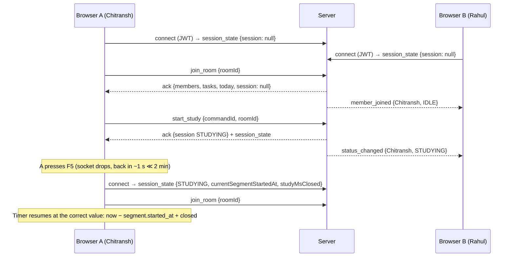
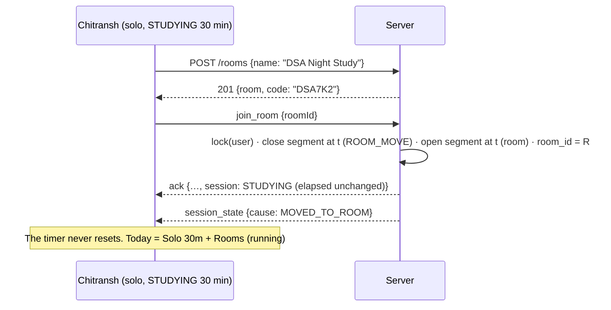
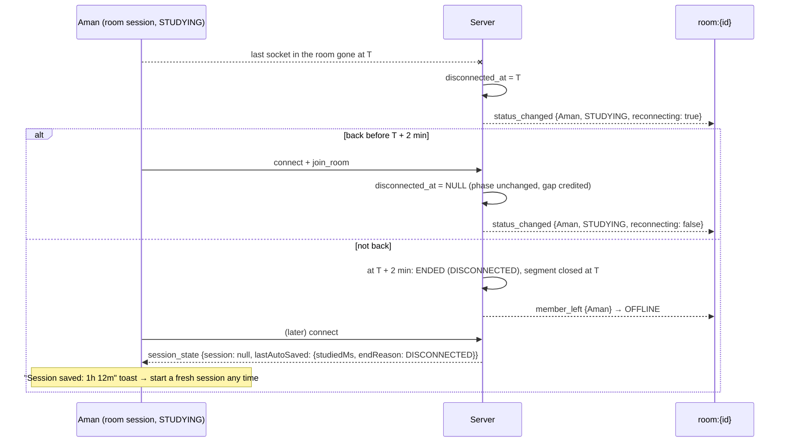
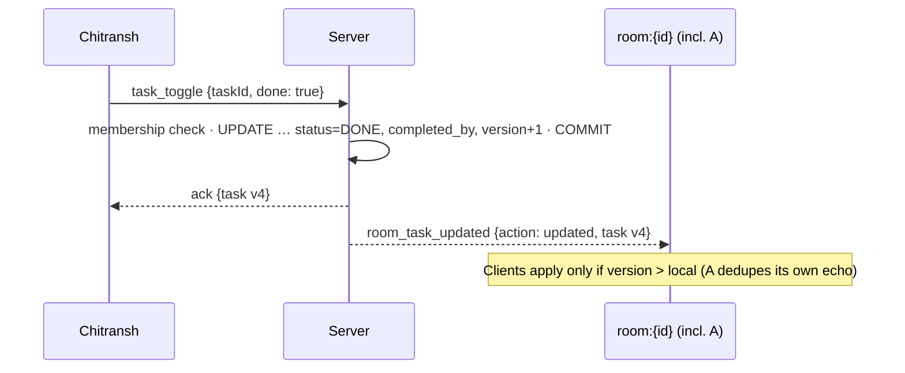

# StudySync — API Design (REST + Socket.IO)

> **Status: v1.0 FINAL — reconciled with the final spec. Awaiting approval.**
> Request and response shapes become Zod schemas in `packages/shared/src/schemas`, with event
> maps in `packages/shared/src/realtime/events.ts`. Server and client share one contract.
> The spec's §8 socket events are used **with their exact names**. Additions are marked **(+)**.
> IDs like I-xx, D-x and R-x refer to [ARCHITECTURE.md](./ARCHITECTURE.md).

---

## Contents

1. [Conventions](#1-conventions)
2. [Shared types](#2-shared-types)
3. [Errors](#3-errors)
4. [REST endpoint list](#4-rest-endpoint-list)
5. [REST details](#5-rest-details)
6. [Socket.IO connection](#6-socketio-connection)
7. [Client → server events](#7-client--server-events)
8. [Server → client events](#8-server--client-events)
9. [Realtime flows](#9-realtime-flows)
10. [Rate limits](#10-rate-limits)
11. [Authorization matrix](#11-authorization-matrix)

---

## 1. Conventions

| Topic | Rule |
|---|---|
| Base URL | `/api/v1` (same origin as the web app; Vite proxies it in development) |
| Auth | REST: `Authorization: Bearer <accessToken>`. Socket: `auth.token` in the handshake. |
| CSRF | `/auth/refresh` and `/auth/logout` (cookie-based) require `X-StudySync-CSRF: 1` |
| Instants | ISO-8601 **UTC with `Z`**, millisecond precision. Instants from clients are never accepted for timer logic. |
| Local dates | `YYYY-MM-DD` in the user's timezone |
| Durations | Integer milliseconds, `…Ms` suffix |
| Validation | Zod `.strict()`. Unknown keys → `VALIDATION_ERROR` |
| Pagination | `?limit=20&cursor=<opaque>` → `{ items, nextCursor }`, limit ≤ 100 |
| Timer commands | Socket only. Each carries `commandId` (UUID, idempotent) and, except `start_study`, `sessionId` (I-20). |
| Server time | Every session payload carries `serverNow` (client clock-offset correction) |
| Versions | Session and task payloads carry `version`. Clients drop anything older than what they hold. |

---

## 2. Shared types

```ts
type UUID = string;
type Instant = string;                 // "2026-10-31T18:00:00.000Z"
type LocalDate = string;               // "2026-10-31"
type BreakMinutes = 5 | 10 | 15 | 30;  // R4
type Phase = 'STUDYING' | 'ON_BREAK' | 'BREAK_OVER';
type RoomStatus = 'STUDYING' | 'ON_BREAK' | 'IDLE' | 'OFFLINE';
type EndReason = 'USER' | 'DISCONNECTED' | 'IDLE_TIMEOUT';

interface UserDto { id: UUID; name: string; email: string; timezone: string; createdAt: Instant }
interface UserRef { id: UUID; name: string }

/** The caller's own active session. Never describes anyone else's timer (R1/R2). */
interface SessionDto {
  id: UUID;
  phase: Phase;                          // derived at serverNow
  version: number;
  roomId: UUID | null; roomName: string | null;       // null = solo
  task: { id: UUID; title: string } | null;
  startedAt: Instant;
  studyMsClosed: number;                 // Σ closed segments
  currentSegmentStartedAt: Instant | null;            // non-null iff STUDYING
  break: { durationMinutes: BreakMinutes; startedAt: Instant; endsAt: Instant } | null; // ON_BREAK or BREAK_OVER
  disconnectedAt: Instant | null;        // non-null while in disconnect grace
  autoSaveAt: Instant | null;            // grace: disconnectedAt+2m · BREAK_OVER: endsAt+30m · else null
}
// Client display (never authoritative):
//   elapsed   = studyMsClosed + (phase === 'STUDYING' ? correctedNow − currentSegmentStartedAt : 0)
//   countdown = break.endsAt − correctedNow            (ON_BREAK)
//   Resume enabled only when correctedNow ≥ break.endsAt

interface AutoSavedNotice {             // drives the saved-session toast (F-40)
  sessionId: UUID; endReason: 'DISCONNECTED' | 'IDLE_TIMEOUT'; endedAt: Instant; studiedMs: number;
}

interface SessionStatePayload {
  session: SessionDto | null;
  cause: SessionCause;
  lastAutoSaved: AutoSavedNotice | null; // unseen system-ended session, if any
  serverNow: Instant;
}
type SessionCause =
  | 'CONNECT' | 'SYNC'
  | 'START' | 'BREAK' | 'BREAK_OVER' | 'RESUME' | 'END' | 'MOVED_TO_ROOM' | 'TASK_SET'
  | 'DISCONNECTED' | 'RECONNECTED' | 'AUTO_SAVED_DISCONNECT' | 'AUTO_SAVED_IDLE';

interface RoomDto {
  id: UUID; name: string; code: string;  // e.g. "DSA7K2"
  createdBy: UserRef; isCreator: boolean;
  memberCount: number; createdAt: Instant;
}

/** What other members see (§11.4 of ARCHITECTURE). */
interface MemberStatusDto {
  user: UserRef;
  status: RoomStatus;
  breakEndsAt: Instant | null;           // ON_BREAK → viewer renders "On Break 08:42"
  reconnecting: boolean;                 // in the 2-min display grace (I-19)
  version: number;
}

interface TaskDto {
  id: UUID; roomId: UUID | null;         // null = personal
  title: string; description: string | null;
  status: 'TODO' | 'DONE'; dueDate: LocalDate | null;
  version: number;
  createdBy: UserRef; completedBy: UserRef | null; completedAt: Instant | null;
  createdAt: Instant; updatedAt: Instant;
}

interface TodayInRoomDto {
  roomId: UUID; serverNow: Instant;
  members: { user: UserRef; todayMs: number; studyingSince: Instant | null }[];  // I-09
}

interface SessionSummaryDto {
  id: UUID; startedAt: Instant; endedAt: Instant | null; endReason: EndReason | null;  // null while active
  studiedMs: number;
  breaks: { count: number; totalMs: number };                                  // I-12
  where: { roomId: UUID | null; roomName: string | null; movedFromSolo: boolean };
  task: { id: UUID; title: string } | null;
  completedTasks: { id: UUID; title: string }[];                               // I-13
}

interface TodayDto { localDate: LocalDate; timezone: string; soloMs: number; roomsMs: number; totalMs: number;
                     thresholdMs: 1500000; qualified: boolean; serverNow: Instant }
interface StreakDto { current: number; longest: number; currentStart: LocalDate | null;
                      lastQualifiedDate: LocalDate | null; todayQualified: boolean; todayMs: number;
                      thresholdMs: 1500000; atRisk: boolean }
```

---

## 3. Errors

REST: `{ "error": { "code", "message", "details"?, "requestId" } }`.
Socket ack: `{ "ok": false, "error": { "code", "message", "details"? } }`.

| Code | HTTP | When |
|---|---|---|
| `VALIDATION_ERROR` | 400 | Zod failure, including a break duration ∉ {5,10,15,30} |
| `INVALID_TIMEZONE` | 400 | Not an IANA zone |
| `UNAUTHENTICATED` / `TOKEN_EXPIRED` | 401 | Missing or invalid / expired access token |
| `INVALID_CREDENTIALS` | 401 | Login failed (uniform) |
| `REFRESH_INVALID` / `REFRESH_REUSED` | 401 | Bad refresh token / reused rotated token (family revoked) |
| `CSRF_REQUIRED` | 403 | Missing CSRF header |
| `FORBIDDEN` | 403 | Member lacks the right (deleting someone else's room task) |
| `NOT_FOUND` | 404 | Missing **or not visible to the caller** (no existence leaks) |
| `INVALID_CODE` | 404 | Unknown room code (uniform for brute-force resistance) |
| `EMAIL_TAKEN` | 409 | Registration conflict |
| `ROOM_FULL` | 409 | 50 members reached (D-3) |
| `SESSION_ALREADY_ACTIVE` | 409 | `start_study` while a session is active (R6). `details.session` holds it. |
| `NO_ACTIVE_SESSION` | 409 | Command but no active session (e.g. it was just auto-saved) |
| `STALE_SESSION` | 409 | `sessionId` is not the active session (I-20) |
| `NOT_STUDYING` | 409 | `take_break` outside `STUDYING` |
| `BREAK_NOT_OVER` | 409 | `resume_study` during `ON_BREAK`. `details.breakEndsAt` (R5, I-05). |
| `NOT_ON_BREAK` | 409 | `resume_study` while `STUDYING` |
| `MUST_START_IN_CURRENT_ROOM` | 409 | `start_study` with a `roomId` different from the user's current room presence (I-07) |
| `NOT_IN_SESSION_ROOM` | 409 | `resume_study` for a room session from a socket not in that room |
| `SESSION_IN_OTHER_ROOM` | 409 | Join or enter another room while the session lives in room A (I-06). `details.roomName`. |
| `TASK_NOT_ATTACHABLE` | 409 | Task is not yours or not in the session's room (I-17) |
| `VERSION_CONFLICT` | 409 | `task_update` with a stale `expectedVersion`. `details.current` holds the task. |
| `TASK_LIMIT_REACHED` | 409 | 500 room tasks / 1,000 personal tasks |
| `RATE_LIMITED` | 429 | See §10. `Retry-After` header / `details.retryAfterMs`. |
| `INTERNAL` | 500 | Unexpected (no internals leaked) |

Every session-related rejection includes `details.session` (the current `SessionDto` or
`null`), so the client can resync immediately.

---

## 4. REST endpoint list

| # | Method | Path | Auth | Purpose | Phase |
|---|---|---|---|---|---|
| 1 | POST | `/auth/register` | — | Create account (timezone auto-detected) | 1 |
| 2 | POST | `/auth/login` | — | Log in | 1 |
| 3 | POST | `/auth/refresh` | cookie + CSRF | New access token, rotated refresh cookie | 1 |
| 4 | POST | `/auth/logout` | cookie + CSRF | Revoke refresh family | 1 |
| 5 | GET | `/users/me` | bearer | Profile | 1 |
| 6 | PATCH | `/users/me` | bearer | Edit name, timezone | 1 |
| 7 | GET | `/tasks` | bearer | My personal tasks | 1 |
| 8 | GET | `/sessions/current` | bearer | Active session + unseen auto-save (refresh-proof fallback) | 0 |
| 9 | GET | `/sessions` | bearer | Session history (paginated) | 1 |
| 10 | GET | `/sessions/:sessionId/summary` | owner | End-of-session summary | 1 |
| 11 | POST | `/sessions/:sessionId/summary-seen` | owner | Acknowledge the auto-save toast | 2 |
| 12 | GET | `/stats/today` | bearer | TODAY: Solo / Rooms / Total | 1 |
| 13 | GET | `/stats/daily` | bearer | Per-day totals for a range | 1 |
| 14 | GET | `/stats/streak` | bearer | Current / longest streak | 3 |
| 15 | GET | `/stats/periods` | bearer | Weekly / monthly totals | 3 |
| 16 | GET | `/stats/heatmap` | bearer | Weekday × hour heatmap | 4 |
| 17 | GET | `/rooms` | bearer | My Rooms | 2 |
| 18 | POST | `/rooms` | bearer | Create room (code generated) | 2 |
| 19 | POST | `/rooms/join` | bearer | Join by code (membership) | 2 |
| 20 | GET | `/rooms/:roomId` | member | Room details | 2 |
| 21 | GET | `/rooms/:roomId/members` | member | All members with live status | 2 |
| 22 | GET | `/rooms/:roomId/tasks` | member | Room tasks | 2 |
| 23 | GET | `/rooms/:roomId/today` | member | Today in this room | 2 |
| 24 | GET | `/rooms/:roomId/history` | member | Room history page (per day, per member) | 4 |
| 25 | GET | `/health` | — | Liveness | 0 |
| 26 | GET | `/health/ready` | — | Readiness (DB) | 0 |
| — | POST | `/__test__/clock` | test only | Fast-forward server clock (E2E). Absent unless `NODE_ENV=test` and `ENABLE_TEST_CLOCK=true`. | 0 |

All **mutations of sessions, presence and tasks are socket events** (§7). REST mutations are
limited to auth, profile, room creation, join by code and acknowledging a summary.

---

## 5. REST details

### Auth

| Endpoint | Body | Success | Errors |
|---|---|---|---|
| `POST /auth/register` | `{ name (1–50), email (≤254, lower-cased), password (10–72 bytes), timezone (IANA) }` | `201 { user, accessToken, accessTokenExpiresAt }` + `Set-Cookie: ss_refresh=…; HttpOnly; Secure; SameSite=Strict; Path=/api/v1/auth` | `VALIDATION_ERROR`, `INVALID_TIMEZONE`, `EMAIL_TAKEN`, `RATE_LIMITED` |
| `POST /auth/login` | `{ email, password }` | `200` (same as register) | `INVALID_CREDENTIALS`, `RATE_LIMITED` |
| `POST /auth/refresh` | — (cookie) | `200 { user, accessToken, accessTokenExpiresAt }` + rotated cookie | `REFRESH_INVALID`, `REFRESH_REUSED` (family revoked), `CSRF_REQUIRED` |
| `POST /auth/logout` | — (cookie) | `204`, cookie cleared, family revoked | `CSRF_REQUIRED` |

### Users

| Endpoint | Body | Success | Notes |
|---|---|---|---|
| `GET /users/me` | — | `200 UserDto` | |
| `PATCH /users/me` | `{ name?, timezone? }` | `200 UserDto` | A timezone change applies to segments started afterwards (I-10). The running segment keeps its snapshot. |

### Rooms

| Endpoint | Body / query | Success | Errors / rules |
|---|---|---|---|
| `GET /rooms` | — | `200 { items: (RoomDto & { lastVisitedAt })[] }` | My Rooms, most recent first |
| `POST /rooms` | `{ name (1–60) }` | `201 RoomDto` | Code generated (32-char alphabet, 6 chars, unique, retried). Creator becomes a member. **The client then emits `join_room`**, which moves an active solo session into the room ("Study with friends", F-12). Rejected with `SESSION_IN_OTHER_ROOM` if the caller's session lives in another room. 20/day per user. |
| `POST /rooms/join` | `{ code }` (case-insensitive input, normalized to upper case) | `200 RoomDto` | Idempotent for existing members. `INVALID_CODE`, `ROOM_FULL`, `SESSION_IN_OTHER_ROOM` (no membership change), `RATE_LIMITED`. The client then emits `join_room`. |
| `GET /rooms/:roomId` | — | `200 RoomDto` | Members only, else `404` |
| `GET /rooms/:roomId/members` | — | `200 { members: MemberStatusDto[], serverNow }` | **All** members, absent ones `OFFLINE` (I-18) |
| `GET /rooms/:roomId/tasks` | `?status=TODO\|DONE` | `200 { items: TaskDto[] }` | Not deleted. Ordered by status, due date, created. |
| `GET /rooms/:roomId/today` | — | `200 TodayInRoomDto` | Live, includes running segments. The client refetches every 60 s and on `status_changed`. |
| `GET /rooms/:roomId/history` | `from, to: LocalDate` (≤ 366 days) | `200 { days: { date, members: { user, studyMs }[] }[] }` | Phase 4. Per member, by that member's local date. |

### Tasks (reads; mutations are socket events)

| Endpoint | Success |
|---|---|
| `GET /tasks?status=TODO\|DONE` | `200 { items: TaskDto[] }` (personal only, owner only) |

### Sessions

| Endpoint | Success | Notes |
|---|---|---|
| `GET /sessions/current` | `200 { session: SessionDto \| null, lastAutoSaved, serverNow }` | Reconciles first (a due auto-save is applied, stamped at its deadline) |
| `GET /sessions?cursor&limit&from&to` | `200 { items: { id, startedAt, endedAt, endReason, roomId, roomName, studiedMs }[], nextCursor }` | Newest first |
| `GET /sessions/:sessionId/summary` | `200 SessionSummaryDto` | Owner only. For a still-active session it returns a live partial summary with `endedAt: null` and `endReason: null`. |
| `POST /sessions/:sessionId/summary-seen` | `204` | Sets `summary_seen_at`. Idempotent. |

### Stats (caller only; local dates in the caller's current timezone)

| Endpoint | Query | Success |
|---|---|---|
| `GET /stats/today` | — | `200 TodayDto` (includes the running segment) |
| `GET /stats/daily` | `from, to: LocalDate` (≤ 366 days) | `200 { timezone, days: { date, soloMs, roomsMs, totalMs, qualified }[] }` (zero-filled) |
| `GET /stats/streak` | — | `200 StreakDto` (computed from history, I-11) |
| `GET /stats/periods` | `granularity: week \| month`, `from, to` | `200 { periods: { start: LocalDate, totalMs, soloMs, roomsMs, qualifiedDays }[] }` |
| `GET /stats/heatmap` | `from, to` | `200 { cells: { weekday: 1-7, hour: 0-23, studyMs }[] }` |

---

## 6. Socket.IO connection

```ts
const socket = io(origin, { path: '/socket.io', auth: { token: accessToken }, transports: ['websocket', 'polling'] });
```

1. Handshake: JWT verified (HS256, `iss`/`aud`). Failure → `connect_error` with message
   `UNAUTHENTICATED` / `TOKEN_EXPIRED` / `TOO_MANY_CONNECTIONS` (> 5 per user).
2. The socket joins `user:{userId}`. Liveness is re-evaluated: for a solo session this
   connection makes the user live again (`RECONNECTED` if in grace).
3. **The server immediately emits `session_state`** (`cause: 'CONNECT'`) to that socket. This
   is the spec's refresh-proof reconstruction.
4. If the client is on a room screen, it emits `join_room`. The ack carries every snapshot it
   needs.

Every client→server event takes an ack callback:
`(res: { ok: true, data } | { ok: false, error: { code, message, details? } }) => void`.

---

## 7. Client → server events

| Event | Spec | Payload | Ack `data` | Rules |
|---|---|---|---|---|
| `join_room` | ✓ | `{ roomId }` | `{ room: RoomDto, members: MemberStatusDto[], tasks: TaskDto[], today: TodayInRoomDto, session: SessionDto \| null, serverNow }` | Membership required (`NOT_FOUND`). Leaves presence in any other room (I-08). **If the user has an active solo session, it moves into this room** (segment split, F-15, `session_state` cause `MOVED_TO_ROOM`). If the session lives in another room → `SESSION_IN_OTHER_ROOM` (no change). Updates `last_visited_at`. Broadcasts `member_joined`. |
| `leave_room` | ✓ | `{ roomId }` | `{}` | Presence ends. If the user's session lives in this room → grace starts (I-02). Others see the last status with `reconnecting`, then `OFFLINE` after 2 min. |
| `start_study` | ✓ | `{ commandId, roomId: UUID \| null, taskId?: UUID \| null }` | `{ session: SessionDto }` | `roomId` must equal the user's current room presence (or `null` if none): `MUST_START_IN_CURRENT_ROOM`. `SESSION_ALREADY_ACTIVE`. `TASK_NOT_ATTACHABLE`. |
| `take_break` | ✓ | `{ commandId, sessionId, durationMinutes: 5 \| 10 \| 15 \| 30 }` | `{ session }` | `NOT_STUDYING`, `VALIDATION_ERROR` |
| `resume_study` | ✓ | `{ commandId, sessionId }` | `{ session }` | `BREAK_NOT_OVER` (until the countdown hits 0), `NOT_ON_BREAK`, `NOT_IN_SESSION_ROOM` |
| `end_study` | ✓ | `{ commandId, sessionId }` | `{ summary: SessionSummaryDto }` | Allowed from every phase. Membership is untouched. |
| `set_session_task` | (+) | `{ commandId, sessionId, taskId: UUID \| null }` | `{ session }` | Attach or clear the "what am I working on" task (F-29, I-17) |
| `task_add` | ✓ | `{ id: UUID, roomId: UUID \| null, title, description?, dueDate?: LocalDate }` | `{ task: TaskDto }` | `roomId` null = personal. A replayed `id` returns the existing task. Room tasks require membership. |
| `task_toggle` | ✓ | `{ taskId, done: boolean }` | `{ task }` | **Set semantics** (I-14): a no-op if already in that state. Sets or clears `completed_by` / `completed_at`. |
| `task_update` | (+) | `{ taskId, expectedVersion, title?, description?, dueDate?: LocalDate \| null }` | `{ task }` | `VERSION_CONFLICT` with `details.current` |
| `task_delete` | (+) | `{ taskId }` | `{}` | Personal: owner. Room: task creator or room creator (`FORBIDDEN`). Soft delete. |
| `sync_state` | (+) | `{}` | `SessionStatePayload` | Explicit resync and clock-offset sample |
| `auth_renew` | (+) | `{ token }` | `{ expiresAt }` | Swap the socket's token before expiry |

---

## 8. Server → client events

| Event | Spec | Channel | Payload | When |
|---|---|---|---|---|
| `session_state` | ✓ | `user:{me}` (all my devices) | `SessionStatePayload` | On connect, and on **every** change to my session: commands, break countdown reaching 0 (`BREAK_OVER`), grace started or ended, auto-save, room move, task attach |
| `member_joined` | ✓ | `room:{id}` | `{ roomId, member: MemberStatusDto }` | A member's presence begins |
| `member_left` | ✓ | `room:{id}` | `{ roomId, userId }` | 2-min display grace over → shown `OFFLINE` |
| `status_changed` | ✓ | `room:{id}` | `{ roomId, member: MemberStatusDto }` | A member started, took a break (with `breakEndsAt`), reached break over (`IDLE`), resumed, ended (`IDLE`), or lost/regained presence (`reconnecting`) |
| `room_task_updated` | ✓ | `room:{id}` | `{ roomId, action: 'added' \| 'updated' \| 'deleted', task?: TaskDto, taskId, actorId }` | Any room task change, after commit |
| `personal_task_updated` | (+) | `user:{me}` | `{ action, task?: TaskDto, taskId }` | Personal task change (keeps my other devices in sync) |
| `auth_expired` | (+) | socket | `{}` | Token expired without renewal. The server disconnects next. |

**No event starts, stops or changes a timer for a room or for another user (R2).**

---

## 9. Realtime flows

### 9.1 Phase 0 spike: two browsers, live status, refresh-safe timer



### 9.2 Study with friends (mid-study room creation, F-12)



### 9.3 Break → Break Over → Resume (R3, R4, R5)

```mermaid
sequenceDiagram
  participant A as Rahul
  participant S as Server
  participant R as room:{id}
  A->>S: take_break {sessionId, durationMinutes: 10}
  S-->>A: session_state {ON_BREAK, break.endsAt = t+10m}
  S-->>R: status_changed {Rahul, ON_BREAK, breakEndsAt}  → others show "On Break 09:59…"
  A->>S: resume_study (at t+5m)
  S-->>A: ack {ok:false, BREAK_NOT_OVER, breakEndsAt}
  Note over S: at t+10m (scheduler; derived phase, no DB write)
  S-->>A: session_state {BREAK_OVER, autoSaveAt = t+40m}
  S-->>R: status_changed {Rahul, IDLE}
  Note over A: "Break over — Resume" (no auto resume)
  A->>S: resume_study
  S-->>A: session_state {STUDYING}
  S-->>R: status_changed {Rahul, STUDYING}
```

### 9.4 Disconnect grace (R9)



### 9.5 Room task check-off (R8)



---

## 10. Rate limits

| Scope | Limit |
|---|---|
| `POST /auth/login` | 5/min per IP+email · 20/min per IP |
| `POST /auth/register` | 5/hour per IP |
| `POST /auth/refresh` | 30/min per IP |
| `POST /rooms/join` (code guessing) | 10/min and 30/hour per user · 60/hour per IP |
| `POST /rooms` | 20/day per user |
| REST reads | 300/min per user |
| Socket timer commands (`start_study`, `take_break`, `resume_study`, `end_study`, `set_session_task`) | 30/min per socket |
| Socket task events | 120/min per socket |
| `join_room` / `leave_room` | 20/min per socket |
| `sync_state` | 30/min per socket |
| Sockets per user | 5 |

---

## 11. Authorization matrix

| Action | Anonymous | Authenticated non-member | Room member | Room creator | Task creator |
|---|---|---|---|---|---|
| Register / login | ✓ | — | — | — | — |
| Own profile, own session, own history, own stats | ✗ | ✓ | ✓ | ✓ | ✓ |
| Join room by valid code | ✗ | ✓ | ✓ (idempotent) | ✓ | — |
| Read room / members / statuses / tasks / today / history | ✗ | ✗ (404) | ✓ | ✓ | — |
| `join_room` presence, receive room broadcasts | ✗ | ✗ | ✓ | ✓ | — |
| Start a session in the room | ✗ | ✗ | ✓ (while present) | ✓ | — |
| Add / toggle / edit room task | ✗ | ✗ | ✓ | ✓ | ✓ |
| Delete room task | ✗ | ✗ | ✗ | ✓ | ✓ |
| Personal tasks | ✗ | owner only | owner only | owner only | owner only |
| Attach task to own session | ✗ | own personal | own personal + session room's tasks | same | same |
| See another member's display status | ✗ | ✗ | ✓ | ✓ | — |
| See another member's personal totals, tasks or history | ✗ | ✗ | ✗ (only "Today in this room" / room history) | ✗ | — |
| Control another user's timer | ✗ | ✗ | ✗ | ✗ | ✗ |

Room management actions (rename, regenerate code, remove member) are pending **D-2**.
