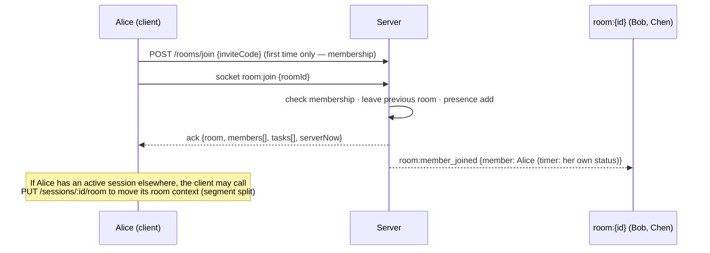
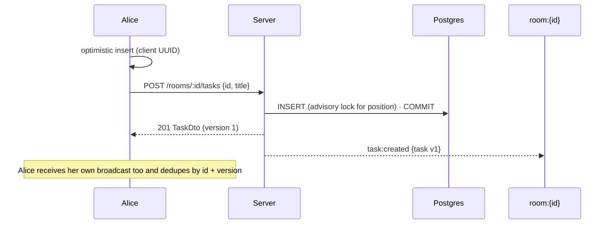
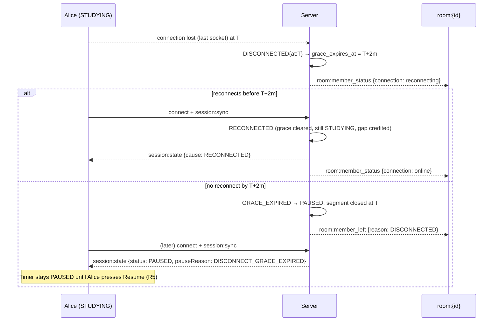
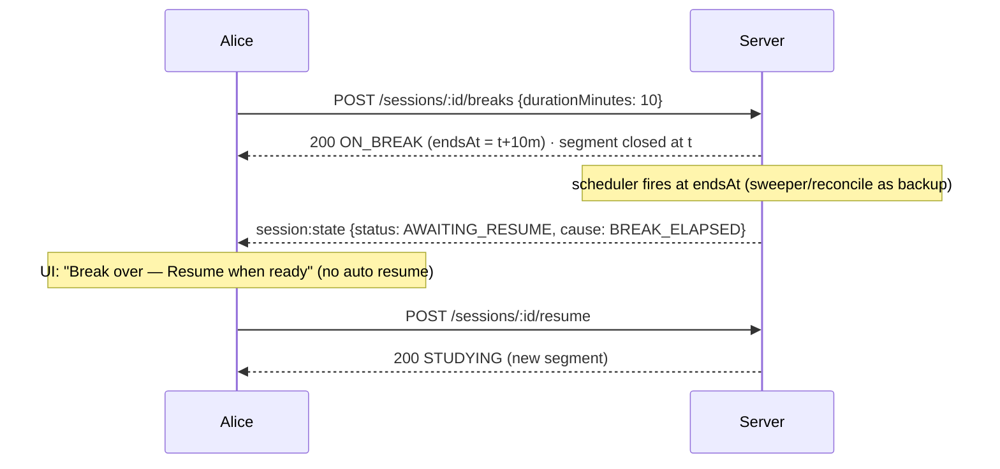

# StudySync — API Design (REST + Socket.IO)

> **Status: Draft v0.1 (planning phase).** All request and response shapes will be implemented
> as **Zod schemas in `packages/shared/src/schemas`**, and TypeScript types will be inferred from
> them. Server and client therefore share one contract. Items tagged **[Qn]** refer to
> [ARCHITECTURE.md §3](./ARCHITECTURE.md#3-assumptions--open-questions).

---

## Contents

1. [Conventions](#1-conventions)
2. [Shared types](#2-shared-types)
3. [Errors](#3-errors)
4. [Endpoint summary](#4-endpoint-summary)
5. [Auth](#5-auth)
6. [Users](#6-users)
7. [Rooms & membership](#7-rooms--membership)
8. [Room tasks](#8-room-tasks)
9. [Study sessions (timer)](#9-study-sessions-timer)
10. [Stats](#10-stats)
11. [Health & test-only](#11-health--test-only)
12. [Socket.IO contract](#12-socketio-contract)
13. [Realtime flows](#13-realtime-flows)
14. [Rate limits](#14-rate-limits)
15. [Authorization matrix](#15-authorization-matrix)

---

## 1. Conventions

| Topic | Rule |
|---|---|
| Base URL | `/api/v1` (same origin as the web app; Vite proxies it in development). |
| Format | JSON (`Content-Type: application/json`). Bodies are limited to 100 KB. |
| Authentication | `Authorization: Bearer <accessToken>` on every endpoint except `register`, `login`, `refresh`, `logout` and `health`. |
| CSRF | Endpoints that read the refresh cookie (`/auth/refresh`, `/auth/logout`) require the header `X-StudySync-CSRF: 1`. |
| IDs | UUID strings. |
| Instants | ISO-8601 **UTC** with `Z` and milliseconds, e.g. `2026-10-31T18:00:00.000Z` (R12). The API rejects offsets other than `Z`. |
| Local dates | `YYYY-MM-DD` strings, interpreted in the user's timezone (R13). |
| Durations | Integer milliseconds, with a `Ms` suffix. |
| Validation | Zod `.strict()` objects. Unknown keys → `400 VALIDATION_ERROR`. |
| Pagination | Cursor-based: `?limit=20&cursor=<opaque>` → `{ items: T[], nextCursor: string \| null }`. `limit` ≤ 100. |
| Timer command idempotency | Every timer command body carries `commandId: UUID` (client-generated, one per user intent). A replay returns the current state with header `Idempotent-Replayed: true`. |
| Task create idempotency | The client supplies the task `id` (UUID v4). Replaying the same create returns the existing task. |
| Optimistic concurrency | `expectedVersion` (optional for timer commands, required for task text edits and moves). A mismatch returns `409 VERSION_CONFLICT` with the current entity. |
| Server time | Timer-related responses include `serverNow` so the client can correct clock skew. |
| Request id | Every response carries `X-Request-Id`, which is also included in error bodies. |
| Rate limits | `RateLimit-*` headers (draft-7). `429 RATE_LIMITED` includes `Retry-After`. |

---

## 2. Shared types

```ts
type UUID = string;
type Instant = string;            // "2026-10-31T18:00:00.000Z"
type LocalDate = string;          // "2026-10-31"
type BreakMinutes = 5 | 10 | 15 | 30;                  // R4 — the only legal values
type SessionStatus = 'STUDYING' | 'PAUSED' | 'ON_BREAK' | 'AWAITING_RESUME' | 'ENDED';
type RoomRole = 'OWNER' | 'MODERATOR' | 'MEMBER';
type TaskStatus = 'TODO' | 'IN_PROGRESS' | 'DONE';

interface UserDto {
  id: UUID; email: string; displayName: string;
  timezone: string;               // IANA, e.g. "Asia/Kolkata"
  createdAt: Instant;
}

interface PublicUserDto { id: UUID; displayName: string }

interface RoomDto {
  id: UUID; name: string; description: string | null;
  visibility: 'PUBLIC' | 'PRIVATE';
  inviteCode: string | null;      // only for OWNER / MODERATOR, null otherwise
  owner: PublicUserDto;
  maxMembers: number; memberCount: number;
  myRole: RoomRole | null;        // null = not a member (public preview)
  createdAt: Instant; archivedAt: Instant | null;
}

interface RoomMemberDto { user: PublicUserDto; role: RoomRole; joinedAt: Instant }

interface TaskDto {
  id: UUID; roomId: UUID;
  title: string;                  // 1–200 chars
  notes: string | null;           // ≤ 2000 chars
  status: TaskStatus;
  position: string;               // opaque ordering key; sort ascending by byte order
  version: number;
  createdBy: PublicUserDto; updatedBy: PublicUserDto;
  completedBy: PublicUserDto | null; completedAt: Instant | null;
  createdAt: Instant; updatedAt: Instant;
}

/** The authoritative state of the caller's own timer. Never describes anyone else's timer. */
interface SessionStateDto {
  id: UUID;
  status: SessionStatus;
  version: number;                // strictly increasing; clients drop older versions
  roomId: UUID | null;
  startedAt: Instant;
  endedAt: Instant | null;
  endReason: 'USER' | 'IDLE_TIMEOUT' | 'ACCOUNT_DELETED' | null;
  statusSince: Instant;
  pauseReason: 'USER' | 'DISCONNECT_GRACE_EXPIRED' | null;
  studyMsClosed: number;                       // closed segments only
  currentSegmentStartedAt: Instant | null;     // non-null iff STUDYING
  breakMsClosed: number;
  currentBreak: {                              // non-null iff ON_BREAK
    durationMinutes: BreakMinutes; startedAt: Instant; endsAt: Instant;
  } | null;
  connection: { disconnectedAt: Instant | null; graceExpiresAt: Instant | null };
  idle: { deadlineAt: Instant | null; warningAt: Instant | null };   // null while ON_BREAK / ENDED
  today: {
    localDate: LocalDate;
    studyMsClosed: number;        // persisted daily total (excludes the open segment)
    thresholdMs: 1500000;         // R11
  };
  serverNow: Instant;
}
// Client display (never authoritative):
//   elapsedStudyMs = studyMsClosed + (STUDYING ? correctedNow − currentSegmentStartedAt : 0)
//   todayStudyMs   = today.studyMsClosed + portion of open segment since local midnight
//   breakRemaining = currentBreak.endsAt − correctedNow

type SessionCause =
  | 'START' | 'PAUSE' | 'RESUME' | 'START_BREAK' | 'END' | 'CHANGE_ROOM'          // user
  | 'BREAK_ELAPSED' | 'GRACE_EXPIRED' | 'IDLE_TIMEOUT'                              // system
  | 'DISCONNECTED' | 'RECONNECTED' | 'LEASE_LOST' | 'SYNC';

/** What room members see about each other [Q11]. A read-only view of independent timers (R1/R2). */
interface MemberStatusDto {
  user: PublicUserDto;
  role: RoomRole;
  connection: 'online' | 'reconnecting';
  timer: {
    status: SessionStatus | 'NO_SESSION';
    since: Instant | null;
    currentSegmentStartedAt: Instant | null;   // lets the viewer render this member's own elapsed time
    breakEndsAt: Instant | null;
  };
  todayStudyMsClosed: number;
  version: number;                             // presence-entry version for ordering
}

interface SessionSummaryDto {
  id: UUID; roomId: UUID | null; roomName: string | null;
  status: SessionStatus; startedAt: Instant; endedAt: Instant | null;
  endReason: SessionStateDto['endReason'];
  studyMs: number; breakMs: number;
}

interface SessionDetailDto extends SessionSummaryDto {
  segments: { id: UUID; roomId: UUID | null; startedAt: Instant; endedAt: Instant | null; durationMs: number | null; endReason: string | null }[];
  breaks:   { id: UUID; durationMinutes: BreakMinutes; startedAt: Instant; scheduledEndAt: Instant; endedAt: Instant | null; actualMs: number | null; endReason: string | null }[];
  events:   { type: string; actor: 'USER' | 'SYSTEM'; occurredAt: Instant; fromStatus: SessionStatus | null; toStatus: SessionStatus }[];
}
```

---

## 3. Errors

Envelope (HTTP and socket acks):

```json
{ "error": { "code": "INVALID_TRANSITION", "message": "Cannot start a break while PAUSED.", "details": { "current": { "...": "SessionStateDto" } }, "requestId": "b6f1…" } }
```

| HTTP | Code | When |
|---|---|---|
| 400 | `VALIDATION_ERROR` | Zod failure. `details.issues[]` lists `{ path, message }`. |
| 400 | `INVALID_TIMEZONE` | Not a valid IANA zone. |
| 401 | `UNAUTHENTICATED` | Missing or invalid bearer token. |
| 401 | `TOKEN_EXPIRED` | The access token expired. The client refreshes and retries once. |
| 401 | `INVALID_CREDENTIALS` | Login failed (uniform message). |
| 401 | `REFRESH_INVALID` | Missing, expired or revoked refresh token. The cookie is cleared. |
| 401 | `REFRESH_REUSED` | A rotated token was reused. The family is revoked. |
| 403 | `CSRF_REQUIRED` | Missing CSRF header on cookie endpoints. |
| 403 | `FORBIDDEN` | Member lacks the role for this action (only when membership is already known to the caller). |
| 404 | `NOT_FOUND` | Missing **or not visible to the caller** (no existence leaks). |
| 404 | `INVITE_INVALID` | Unknown invite code. |
| 409 | `EMAIL_TAKEN` | Registration with an existing email. |
| 409 | `SESSION_ALREADY_ACTIVE` | `POST /sessions` while a non-ended session exists. `details.session` holds it (R6). |
| 409 | `INVALID_TRANSITION` | The command is not legal from the current state. `details.current` holds the state. |
| 409 | `SESSION_ENDED` | Command on an ended session. |
| 409 | `VERSION_CONFLICT` | `expectedVersion` mismatch. `details.current` holds the entity. |
| 409 | `ROOM_FULL` | Capacity reached. |
| 409 | `ROOM_ARCHIVED` | Mutation on an archived room. |
| 409 | `OWNER_MUST_TRANSFER` | The owner tried to leave. |
| 409 | `ID_CONFLICT` | A client-supplied task id already exists with different content. |
| 409 | `TASK_LIMIT_REACHED` | The room already has the maximum number of live tasks. |
| 410 | `TASK_DELETED` | Edit or move of a deleted task. |
| 413 | `PAYLOAD_TOO_LARGE` | Body exceeds the limit. |
| 429 | `RATE_LIMITED` | See §14. |
| 500 | `INTERNAL` | Unexpected error (no internals exposed). |

---

## 4. Endpoint summary

| Method | Path | Auth | Purpose |
|---|---|---|---|
| POST | `/auth/register` | — | Create account |
| POST | `/auth/login` | — | Log in |
| POST | `/auth/refresh` | cookie + CSRF | Rotate refresh token, new access token |
| POST | `/auth/logout` | cookie + CSRF | Revoke current token family |
| POST | `/auth/logout-all` | bearer | Revoke all sessions on all devices |
| GET | `/users/me` | bearer | Profile |
| PATCH | `/users/me` | bearer | Update display name / timezone |
| PUT | `/users/me/password` | bearer | Change password |
| DELETE | `/users/me` | bearer | Delete account |
| GET | `/rooms` | bearer | My rooms |
| GET | `/rooms/discover` | bearer | Public rooms |
| POST | `/rooms` | bearer | Create room |
| GET | `/rooms/:roomId` | bearer | Room details |
| PATCH | `/rooms/:roomId` | owner/mod | Edit room |
| POST | `/rooms/:roomId/archive` | owner | Archive room |
| POST | `/rooms/:roomId/restore` | owner | Restore archived room |
| POST | `/rooms/join` | bearer | Join by invite code |
| POST | `/rooms/:roomId/join` | bearer | Join public room |
| POST | `/rooms/:roomId/leave` | member | Leave room (membership) |
| POST | `/rooms/:roomId/invite-code/rotate` | owner/mod | New invite code |
| POST | `/rooms/:roomId/transfer-ownership` | owner | Transfer ownership |
| GET | `/rooms/:roomId/members` | member | Members list |
| PATCH | `/rooms/:roomId/members/:userId` | owner | Change role |
| DELETE | `/rooms/:roomId/members/:userId` | owner/mod | Remove member |
| GET | `/rooms/:roomId/presence` | member | Presence snapshot |
| GET | `/rooms/:roomId/tasks` | member | Task list |
| POST | `/rooms/:roomId/tasks` | member | Create task |
| PATCH | `/rooms/:roomId/tasks/:taskId` | member | Edit task |
| POST | `/rooms/:roomId/tasks/:taskId/move` | member | Reorder task |
| DELETE | `/rooms/:roomId/tasks/:taskId` | creator/mod/owner | Delete task |
| GET | `/sessions/active` | bearer | My current timer state |
| POST | `/sessions` | bearer | **START** |
| POST | `/sessions/:sessionId/pause` | owner of session | **PAUSE** |
| POST | `/sessions/:sessionId/resume` | owner of session | **RESUME** |
| POST | `/sessions/:sessionId/breaks` | owner of session | **START_BREAK** (5/10/15/30) |
| POST | `/sessions/:sessionId/end` | owner of session | **END** |
| PUT | `/sessions/:sessionId/room` | owner of session | **CHANGE_ROOM** |
| POST | `/sessions/:sessionId/activity` | owner of session | Activity (REST fallback) |
| GET | `/sessions` | bearer | Session history |
| GET | `/sessions/:sessionId` | owner of session | Session detail |
| GET | `/stats/today` | bearer | Today's totals |
| GET | `/stats/daily` | bearer | Daily series |
| GET | `/stats/summary` | bearer | Period summary |
| GET | `/stats/streak` | bearer | Streak |
| GET | `/stats/hourly` | bearer | Time-of-day heatmap |
| GET | `/stats/rooms` | bearer | Per-room breakdown |
| GET | `/health` | — | Liveness |
| GET | `/health/ready` | — | Readiness |

---

## 5. Auth

### `POST /auth/register`

```ts
// body
{ email: string /* ≤254, normalized to lower case */,
  password: string /* 10–72 UTF-8 bytes */,
  displayName: string /* 1–50, trimmed */,
  timezone: string /* IANA, auto-detected by the client */ }
// 201
{ user: UserDto, accessToken: string, accessTokenExpiresAt: Instant }
// + Set-Cookie: ss_refresh=<opaque>; HttpOnly; Secure; SameSite=Strict; Path=/api/v1/auth; Max-Age=2592000
```

Errors: `400 VALIDATION_ERROR`, `400 INVALID_TIMEZONE`, `409 EMAIL_TAKEN`, `429`.

### `POST /auth/login`

Body `{ email, password }` → `200` (same shape as register, plus a new token family cookie).
Errors: `401 INVALID_CREDENTIALS` (identical for unknown email and wrong password, with
equalized timing), `429`.

### `POST /auth/refresh`

Requires the cookie and `X-StudySync-CSRF: 1`. → `200 { user, accessToken, accessTokenExpiresAt }`
and a rotated cookie. The old token is marked `revoked_at` / `replaced_by_id`. Presenting an
already-rotated token → `401 REFRESH_REUSED` and **the entire family is revoked**. A
`token_version` mismatch → `401 REFRESH_INVALID`.

### `POST /auth/logout`

Cookie + CSRF → `204`. Revokes the family and clears the cookie. Idempotent.

### `POST /auth/logout-all`

Bearer → `204`. Increments `users.token_version`, revokes every refresh token, and emits
`auth:revoked` to `user:{id}` before disconnecting all of the user's sockets.

---

## 6. Users

| Endpoint | Body | Response | Notes |
|---|---|---|---|
| `GET /users/me` | — | `200 UserDto` | |
| `PATCH /users/me` | `{ displayName?, timezone? }` | `200 UserDto` | A timezone change is written to `user_timezone_changes`. It affects **new segments only**; an open segment keeps its snapshot [Q13]. |
| `PUT /users/me/password` | `{ currentPassword, newPassword }` | `200 { accessToken, accessTokenExpiresAt }` + new cookie | Increments `token_version` (all other devices are logged out) and revokes other families. Wrong current password → `401 INVALID_CREDENTIALS`. |
| `DELETE /users/me` | `{ password }` | `204` | Ends the active session (`ACCOUNT_DELETED`), transfers or archives owned rooms, deletes data [Q18]. |

---

## 7. Rooms & membership

Rooms are **reusable** (R7). They persist when empty, keep membership and tasks across visits,
and are only archived explicitly by the owner. **Rooms have no timer** (R2).

**Membership vs presence:** *membership* (REST) is durable access to a room. *Presence*
(socket `room:join` / `room:leave`) means "I am in this room right now". Presence requires
membership.

| Endpoint | Body / Query | Success | Errors / rules |
|---|---|---|---|
| `GET /rooms` | `?cursor&limit` | `200 Page<RoomDto>` | Rooms where I am a member (archived included, flagged). |
| `GET /rooms/discover` | `?q&cursor&limit` | `200 Page<RoomDto>` | `PUBLIC`, not archived. `q` is a case-insensitive name search (≤ 80 chars). |
| `POST /rooms` | `{ name, description?, visibility, maxMembers? }` | `201 RoomDto` | The creator becomes `OWNER` (memberCount = 1). An invite code is generated (10 chars, unambiguous alphabet, retried on collision). |
| `GET /rooms/:roomId` | — | `200 RoomDto` | Members get the full DTO. Non-members of a `PUBLIC` room get a preview (`myRole: null`, `inviteCode: null`). Otherwise `404`. |
| `PATCH /rooms/:roomId` | `{ name?, description?, visibility?, maxMembers? }` | `200 RoomDto` | Moderators may edit name and description. Visibility and `maxMembers` are owner-only. `maxMembers ≥ memberCount`. Emits `room:updated`. |
| `POST /rooms/:roomId/archive` | — | `200 RoomDto` | Owner only. Emits `room:archived`, clears presence, and clears the room context of members' active sessions (segment split, Q8). Archived rooms are read-only. |
| `POST /rooms/:roomId/restore` | — | `200 RoomDto` | Owner only. |
| `POST /rooms/join` | `{ inviteCode }` | `200 RoomDto` | Idempotent if already a member. `404 INVITE_INVALID`, `409 ROOM_FULL`, `409 ROOM_ARCHIVED`. Capacity uses a conditional update (C13). |
| `POST /rooms/:roomId/join` | — | `200 RoomDto` | `PUBLIC` rooms only (private → `404`). Same errors as above. |
| `POST /rooms/:roomId/leave` | — | `204` | The owner gets `409 OWNER_MUST_TRANSFER`. Removes presence on all of the user's sockets. Clears the room context of the user's active session (Q8). |
| `POST /rooms/:roomId/invite-code/rotate` | — | `200 { inviteCode }` | Owner/moderator. The old code stops working immediately. |
| `POST /rooms/:roomId/transfer-ownership` | `{ userId }` | `200 RoomDto` | Owner only. The target must be a member. The old owner becomes `MODERATOR`. Atomic. |
| `GET /rooms/:roomId/members` | `?cursor&limit` | `200 Page<RoomMemberDto>` | Members only. |
| `PATCH /rooms/:roomId/members/:userId` | `{ role: 'MODERATOR' \| 'MEMBER' }` | `200 RoomMemberDto` | Owner only. Emits `room:member_role_changed`. |
| `DELETE /rooms/:roomId/members/:userId` | — | `204` | Owner removes anyone except themself. A moderator removes `MEMBER`s only. Emits `room:member_removed` to the room **and** to `user:{removed}`. The removed user's sockets leave the channel immediately. Their **timer is unaffected** apart from losing room context (R1). |
| `GET /rooms/:roomId/presence` | — | `200 { members: MemberStatusDto[], serverNow }` | Members only. Same data as the `room:join` ack. |

---

## 8. Room tasks

Shared, ordered, versioned. Every successful mutation is broadcast to `room:{roomId}` **after
commit** (R8). Limits: 500 live tasks per room [Q10].

### `GET /rooms/:roomId/tasks`

`200 { items: TaskDto[] /* ordered by position */, serverNow }`. Members only.

### `POST /rooms/:roomId/tasks`

```ts
{ id: UUID,                       // client-generated → idempotent create
  title: string, notes?: string | null,
  status?: TaskStatus,            // default TODO
  afterTaskId?: UUID | null }     // insert after this task; omitted/null = append at end
```

- `201 TaskDto` and emits `task:created`.
- A replay with the same `id` and the same content → `200 TaskDto` (no duplicate broadcast).
- The same `id` with different content or a different room → `409 ID_CONFLICT`.
- Archived room → `409 ROOM_ARCHIVED`. Limit reached → `409 TASK_LIMIT_REACHED` with
  `details.limit`.

### `PATCH /rooms/:roomId/tasks/:taskId`

```ts
{ expectedVersion?: number,       // REQUIRED when title or notes change
  title?: string, notes?: string | null, status?: TaskStatus }
```

- `200 TaskDto` (version + 1) and emits `task:updated`.
- **Status-only** changes are set-semantics, so `expectedVersion` is optional and setting the
  current value is a no-op `200` (C11).
- Moving to `DONE` sets `completedBy` / `completedAt`. Leaving `DONE` clears them.
- `409 VERSION_CONFLICT { details.current: TaskDto }`, `410 TASK_DELETED`.

### `POST /rooms/:roomId/tasks/:taskId/move`

`{ expectedVersion: number, afterTaskId: UUID | null }` (`null` = move to top) → `200 TaskDto`
with a new `position`, and emits `task:moved`. The server computes the key between neighbors
under a per-room advisory lock (C12).

### `DELETE /rooms/:roomId/tasks/:taskId`

`204`. Creator, moderator or owner. Soft delete. Emits `task:deleted { taskId, version }`.
Idempotent (already deleted → `204`). Edits after deletion → `410`.

---

## 9. Study sessions (timer)

All endpoints act **only on the caller's own session** (R1). A session id belonging to someone
else → `404`. Every command:

1. locks the session row,
2. checks `commandId` idempotency,
3. **reconciles due deadlines** (break elapsed, grace expired, idle timeout — each stamped at
   its own deadline),
4. applies the command through the pure state machine,
5. persists segments, breaks, daily totals and events, then increments `version`,
6. commits, emits `session:state` to `user:{id}` and `room:member_status` to the current room,
   then reschedules deadlines.

Every timer command counts as **activity** (resets the idle clock).

Common command body: `{ commandId: UUID, expectedVersion?: number }`.
Common success: `200 SessionStateDto` (`201` for start).
Common errors: `404 NOT_FOUND`, `409 INVALID_TRANSITION` (+ current state), `409 SESSION_ENDED`,
`409 VERSION_CONFLICT`, `400 VALIDATION_ERROR`.

| Endpoint | Extra body | Legal from | Result | Rules |
|---|---|---|---|---|
| `GET /sessions/active` | — | — | `200 { session: SessionStateDto \| null }` | Reconciles before returning. |
| `POST /sessions` | `{ commandId, roomId?: UUID \| null }` | no active session | `201` → `STUDYING` | **R6**: an existing active session → `409 SESSION_ALREADY_ACTIVE` with `details.session`. `roomId` requires membership and a non-archived room. |
| `POST /sessions/:id/pause` | — | `STUDYING` | `PAUSED` (`pauseReason: USER`) | Segment closed at *now*. |
| `POST /sessions/:id/resume` | — | `PAUSED`, `AWAITING_RESUME`, `ON_BREAK` | `STUDYING` | **The only way back to STUDYING (R5).** From `ON_BREAK` it ends the break early (`RESUMED_EARLY`) [Q4]. |
| `POST /sessions/:id/breaks` | `{ durationMinutes: 5 \| 10 \| 15 \| 30 }` | `STUDYING` | `ON_BREAK` | **R4**: any other value → `400 VALIDATION_ERROR`. **R3**: the segment closes at the instant the break opens. No extension or chaining [Q5]. When it elapses the server moves the session to `AWAITING_RESUME`, **not** `STUDYING`. |
| `POST /sessions/:id/end` | — | any non-ended | `ENDED` (`endReason: USER`) | Closes the open segment or break. |
| `PUT /sessions/:id/room` | `{ commandId, roomId: UUID \| null }` | any non-ended | same status | Membership required. While `STUDYING`, the segment is split at *now* [Q8]. |
| `POST /sessions/:id/activity` | `{}` | any non-ended | `204` | REST fallback for `activity:ping`. Postpones idle timeout only; never adds study time. |
| `GET /sessions` | `?from&to&cursor&limit` | — | `200 Page<SessionSummaryDto>` | Newest first. |
| `GET /sessions/:id` | — | — | `200 SessionDetailDto` | Segments, breaks and the event timeline. |

**System transitions** (no endpoint; applied by reconcile and pushed as `session:state`):

| Cause | From → To | Accounting |
|---|---|---|
| `BREAK_ELAPSED` | `ON_BREAK` → `AWAITING_RESUME` | Break closed at `endsAt`. **No automatic resume (R5).** |
| `GRACE_EXPIRED` | `STUDYING` → `PAUSED` (`DISCONNECT_GRACE_EXPIRED`) | Segment closed at the disconnect instant (R9). |
| `IDLE_TIMEOUT` | `STUDYING` / `PAUSED` / `AWAITING_RESUME` → `ENDED` | If studying, the segment is closed at the last activity [Q1/Q2] (R10). |

---

## 10. Stats

Read-only, scoped to the caller. Local dates are in the user's **current** timezone (R13).
Ranges are capped at 366 days. Live values include the open segment where noted.

| Endpoint | Query | Response |
|---|---|---|
| `GET /stats/today` | — | `{ localDate, timezone, studyMs /* incl. open segment */, breakMs, thresholdMs: 1500000, qualified, serverNow }` |
| `GET /stats/daily` | `from, to: LocalDate` | `{ timezone, days: { date: LocalDate, studyMs, breakMs, qualified }[] }`: a continuous series with zero-filled gaps, ready for Recharts `BarChart`. |
| `GET /stats/summary` | `range: '7d' \| '30d' \| '90d' \| '365d'` | `{ range, from, to, totalStudyMs, totalBreakMs, avgDailyStudyMs, activeDays, qualifiedDays, sessionsCount, longestSessionStudyMs, previous: { totalStudyMs, qualifiedDays } }` |
| `GET /stats/streak` | — | `{ current, longest, currentStart: LocalDate \| null, lastQualifiedDate: LocalDate \| null, todayQualified, todayStudyMs, thresholdMs: 1500000, atRisk }`. The current streak counts today if qualified (including the open segment), otherwise it runs through yesterday; `atRisk = !todayQualified && current > 0`. |
| `GET /stats/hourly` | `from, to: LocalDate` | `{ timezone, cells: { weekday: 1-7, hour: 0-23, studyMs }[] }` (heatmap) |
| `GET /stats/rooms` | `from, to: LocalDate` | `{ rooms: { roomId: UUID \| null, roomName: string \| null, studyMs }[] }` (`null` = solo) |

Additional analytics (room statistics, leaderboards) are pending the specification [Q16, Q20].

---

## 11. Health & test-only

| Endpoint | Response |
|---|---|
| `GET /health` | `200 { status: 'ok' }` |
| `GET /health/ready` | `200 { status: 'ok', db: 'ok' }` or `503` |
| `POST /__test__/clock` | `{ advanceMs?: number, setTo?: Instant }` → `200 { now }`. **Mounted only when `NODE_ENV=test` and `ENABLE_TEST_CLOCK=true`. Boot fails if enabled in production.** Used by E2E tests to fast-forward breaks, grace and idle. |

---

## 12. Socket.IO contract

Typed maps `ClientToServerEvents` / `ServerToClientEvents` live in
`packages/shared/src/realtime/events.ts`. Every inbound payload is Zod-validated.

### 12.1 Connection

```ts
const socket = io(origin, {
  path: '/socket.io',
  auth: { token: accessToken },
  transports: ['websocket', 'polling'],
});
```

- Handshake failure → `connect_error` with `err.message` ∈ `UNAUTHENTICATED`, `TOKEN_EXPIRED`,
  `TOO_MANY_CONNECTIONS` (> 5 sockets per user).
- After connect: the socket joins `user:{userId}`. If it is the user's first live socket, the
  server applies `RECONNECTED` to the active session (clears grace).
- After every (re)connect the client **must** emit `session:sync`, then `room:join` for the room
  it is viewing (resync contract, ARCHITECTURE §8.5).

### 12.2 Acks

Every client→server event takes an ack callback:

```ts
type Ack<T> = (res: { ok: true; data: T } | { ok: false; error: { code: string; message: string } }) => void;
```

### 12.3 Client → server

| Event | Payload | Ack data | Rules |
|---|---|---|---|
| `auth:renew` | `{ token: string }` | `{ expiresAt: Instant }` | Swaps the socket's token before expiry without reconnecting. Re-checks `token_version`. |
| `clock:sync` | `{ clientSentAt: number }` (client epoch ms) | `{ clientSentAt, serverNow: Instant }` | Used for NTP-style offset estimation. |
| `session:sync` | `{}` | `{ session: SessionStateDto \| null }` | Reconciles, then returns the authoritative state. |
| `activity:ping` | `{}` | `{ idleDeadlineAt: Instant \| null }` | Throttled by the client to ≤ 1/60 s. Resets the idle clock (R10). Never adds study time. |
| `room:join` | `{ roomId: UUID }` | `{ room: RoomDto, members: MemberStatusDto[], tasks: TaskDto[], serverNow }` | Requires membership and a non-archived room. Leaves the previously joined room on all of the user's sockets [Q7]. Updates `room_members.last_visited_at`. Emits `room:member_joined`. Presence join **does not** change the timer's room context; the client calls `PUT /sessions/:id/room` if needed [Q8]. |
| `room:leave` | `{ roomId: UUID }` | `{}` | Removes presence (all of the user's sockets) and emits `room:member_left { reason: 'LEFT' }`. Membership is unchanged. |

### 12.4 Server → client

| Event | Channel | Payload | Trigger |
|---|---|---|---|
| `session:state` | `user:{id}` | `{ session: SessionStateDto, cause: SessionCause }` | Every committed session change (user or system). Clients apply it only if `version` is newer. |
| `session:idle_warning` | `user:{id}` | `{ sessionId, idleDeadlineAt: Instant, serverNow }` | 5 min before idle timeout (at 25 min idle). The client shows "Still studying?" |
| `room:member_joined` | `room:{id}` | `{ roomId, member: MemberStatusDto }` | Presence join |
| `room:member_left` | `room:{id}` | `{ roomId, userId, reason: 'LEFT' \| 'DISCONNECTED' \| 'REMOVED' \| 'SWITCHED_ROOM' }` | Presence leave / grace expired / kick |
| `room:member_status` | `room:{id}` | `{ roomId, member: MemberStatusDto }` | A member's connection (`online` ↔ `reconnecting`) or **their own** timer status changed |
| `room:updated` | `room:{id}` | `{ room: RoomDto }` | Room edited |
| `room:archived` | `room:{id}` | `{ roomId }` | Archived. Clients navigate away. Sockets are removed from the channel. |
| `room:member_removed` | `room:{id}` + `user:{removed}` | `{ roomId, userId }` | Kick |
| `room:member_role_changed` | `room:{id}` | `{ roomId, userId, role }` | Role change / ownership transfer |
| `task:created` | `room:{id}` | `{ roomId, task: TaskDto, actorId }` | |
| `task:updated` | `room:{id}` | `{ roomId, task: TaskDto, actorId }` | |
| `task:moved` | `room:{id}` | `{ roomId, task: TaskDto, actorId }` | |
| `task:deleted` | `room:{id}` | `{ roomId, taskId, version, actorId }` | |
| `auth:expired` | socket | `{}` | Token expired without renewal. The server disconnects next. |
| `auth:revoked` | `user:{id}` | `{}` | Logout-all / password change. The server disconnects next. |

**There is deliberately no event that starts, stops or changes a timer for a room or for
another user (R2).**

---

## 13. Realtime flows

### 13.1 Entering a room



### 13.2 Task sync



### 13.3 Disconnect grace (R9)



### 13.4 Break lifecycle (R3, R4, R5)



---

## 14. Rate limits

Initial values, tuned in Phase 9. Keyed per IP for anonymous endpoints and per user otherwise.

| Scope | Limit |
|---|---|
| `POST /auth/login` | 5 / min per IP+email, 20 / min per IP |
| `POST /auth/register` | 5 / hour per IP |
| `POST /auth/refresh` | 30 / min per IP |
| Timer commands | 30 / min per user |
| `POST …/activity` | 2 / min per user |
| Task mutations | 120 / min per user |
| Room create / join | 20 / hour per user |
| Other authenticated reads | 300 / min per user |
| Socket `activity:ping` | 2 / min per socket |
| Socket `room:join` / `room:leave` | 10 / min per socket |
| Socket other events | 60 / min per socket |
| Concurrent sockets | 5 per user |

---

## 15. Authorization matrix

| Action | Non-member | Member | Moderator | Owner |
|---|---|---|---|---|
| View public room preview | ✓ (public only) | ✓ | ✓ | ✓ |
| View private room / members / tasks / presence | ✗ (404) | ✓ | ✓ | ✓ |
| Join public room | ✓ | — | — | — |
| Join private room | with invite code | — | — | — |
| `room:join` presence | ✗ | ✓ | ✓ | ✓ |
| Create / edit / move / complete task | ✗ | ✓ | ✓ | ✓ |
| Delete task | ✗ | own tasks | ✓ | ✓ |
| Edit room name / description | ✗ | ✗ | ✓ | ✓ |
| Change visibility / capacity | ✗ | ✗ | ✗ | ✓ |
| Rotate invite code | ✗ | ✗ | ✓ | ✓ |
| Remove member | ✗ | ✗ | MEMBERs only | anyone but self |
| Change roles / transfer ownership | ✗ | ✗ | ✗ | ✓ |
| Archive / restore room | ✗ | ✗ | ✗ | ✓ |
| Leave room | — | ✓ | ✓ | after transfer |
| Read or control **another user's** timer | ✗ | ✗ | ✗ | ✗ |
| See another member's timer **status** (Q11) | ✗ | ✓ | ✓ | ✓ |

The permission model is pending the specification [Q9, Q10].
