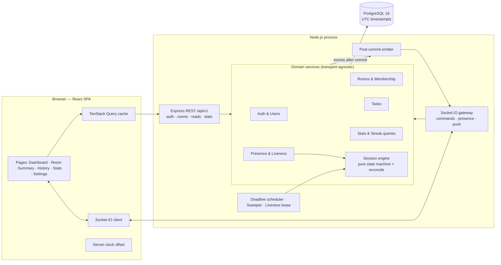
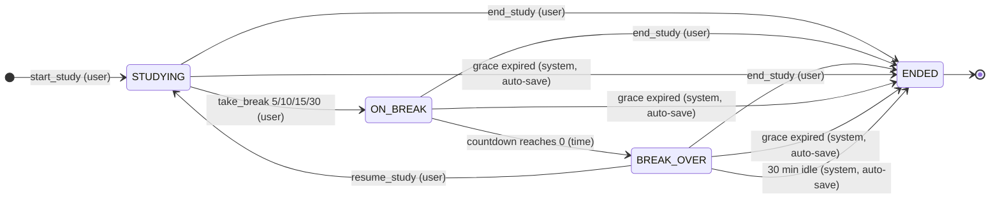
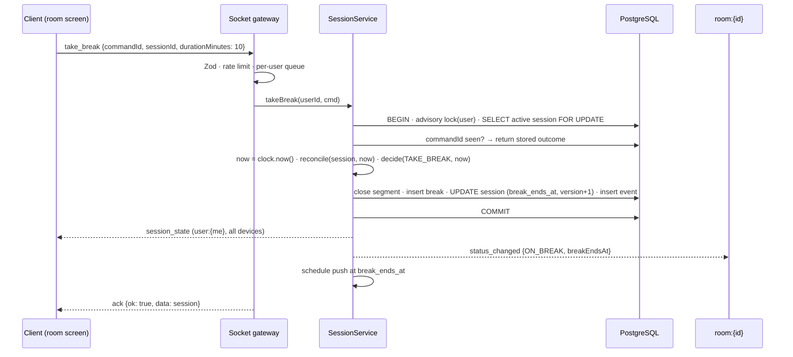

# StudySync — Architecture

> **Status: v1.0 FINAL — reconciled with the final product specification. Awaiting approval.**
> No application code exists yet. The spec is the source of truth. Where it was silent or
> ambiguous, the interpretations used are listed in [§4](#4-interpretations-of-the-spec). Gaps
> that need a product decision are listed in [§5](#5-gaps-needing-a-product-decision); they are
> **not** in the baseline until approved.

Companion documents:
[DATABASE_DESIGN.md](./DATABASE_DESIGN.md) ·
[API_DESIGN.md](./API_DESIGN.md) ·
[DEVELOPMENT_ROADMAP.md](./DEVELOPMENT_ROADMAP.md) ·
[TESTING_STRATEGY.md](./TESTING_STRATEGY.md) ·
[CLAUDE.md](./CLAUDE.md)

---

## Contents

1. [Product definition](#1-product-definition)
2. [Spec coverage matrix](#2-spec-coverage-matrix)
3. [Product rules → enforcement](#3-product-rules--enforcement)
4. [Interpretations of the spec](#4-interpretations-of-the-spec)
5. [Gaps needing a product decision](#5-gaps-needing-a-product-decision)
6. [Edge cases and how they are handled](#6-edge-cases-and-how-they-are-handled)
7. [System architecture](#7-system-architecture)
8. [Technology stack](#8-technology-stack)
9. [Architectural principles](#9-architectural-principles)
10. [Backend architecture](#10-backend-architecture)
11. [Membership, presence and sessions](#11-membership-presence-and-sessions)
12. [Realtime architecture](#12-realtime-architecture)
13. [Study timer subsystem](#13-study-timer-subsystem)
14. [Time accounting, timezones and streaks](#14-time-accounting-timezones-and-streaks)
15. [Tasks](#15-tasks)
16. [Frontend architecture](#16-frontend-architecture)
17. [Security and authorization](#17-security-and-authorization)
18. [Risk registers](#18-risk-registers)
19. [Project folder structure](#19-project-folder-structure)
20. [Environments, configuration and constants](#20-environments-configuration-and-constants)
21. [Observability](#21-observability)
22. [Scalability path](#22-scalability-path)
23. [Architecture decision records](#23-architecture-decision-records)

---

## 1. Product definition

> **StudySync is a study productivity platform where students study solo or together in shared
> rooms.** Each user manages tasks, runs their own server-verified study timer, and takes
> controlled breaks (max 30 min) that never count as study time. When a break ends, they must
> click Resume. Rooms are always-on spaces joined by code. Members see each other's live status
> (studying / on break / idle / offline) and share a task list, but every member's study time is
> tracked individually: anyone can break, leave or rejoin without affecting anyone else. The
> server records time in segments. Sessions auto-save after 2 minutes of disconnection or 30
> minutes of idleness. Days are counted in the user's local timezone. A streak day requires at
> least 25 minutes of actual recorded study.

**Core rule:** *Your study time is always yours. Rooms give presence and shared tasks — never a
shared timer.*

### Glossary

| Term | Meaning |
|---|---|
| **Session** | One user's study run, from Start Study to End Study or auto-save. `ACTIVE` or `ENDED`. At most one `ACTIVE` session per user. |
| **Phase** | Where an active session is right now: `STUDYING`, `ON_BREAK` or `BREAK_OVER`. It is **derived**, not stored (§13.2). |
| **Segment** | One continuous block of `STUDYING`. **The only source of study time.** |
| **Break** | A 5/10/15/30-minute countdown taken from `STUDYING`. Never counted as study. |
| **Room** | A permanent space with a name and a 6-character code. It has members and room tasks. **It has no timer.** |
| **Membership** | The durable link between a user and a room. It powers *My Rooms* and access to the room. |
| **Presence** | Ephemeral "this user is on this room's screen right now", tracked from live sockets. |
| **Liveness** | Whether the server can see the user for their session: any live connection for a solo session, presence in that room for a room session (§11.3). |
| **Disconnect grace** | 2 minutes after liveness is lost. Return in time and nothing changes; otherwise the session auto-saves. |
| **Idle timeout** | 30 minutes in `BREAK_OVER` without clicking Resume → the session auto-saves. |
| **Auto-save** | The server ends the session itself (`DISCONNECTED` or `IDLE_TIMEOUT`). All recorded time is kept. |
| **Local day** | A calendar date in the user's timezone. Study time is split at local midnights. |
| **Room display status** | What other members see: 🟢 `STUDYING`, 🟡 `ON_BREAK` (with countdown), ⚪ `IDLE`, ⚫ `OFFLINE`. |

---

## 2. Spec coverage matrix

Every feature in the final spec, where it is designed, and the build phase that delivers it
(phase numbers follow your build order; see DEVELOPMENT_ROADMAP.md).

| ID | Spec feature | Designed in | Phase |
|---|---|---|---|
| F-01 | Four states: Studying, On Break, Break Over/Idle, Offline | §13.2, §11.4 | 0 |
| F-02 | Breaks of 5 / 10 / 15 / 30 min only (30 max) | §13.4, DB `brk_duration_allowed` | 0 |
| F-03 | Break countdown visible to the room ("On Break 08:42") | §12.4 `status_changed.breakEndsAt` | 0 |
| F-04 | Break Over → no auto resume; explicit Resume | §13.4, DB `brk_resume_only_after_end` | 0 |
| F-05 | End Study from any state | §13.4 | 0 |
| F-06 | Break time never counts as study | §13.1, §14.1 | 0 |
| F-07 | Disconnect grace 2 min → continue or auto-save; status Offline | §13.6, §11.3 | 2 |
| F-08 | Idle timeout: 30 min in Break Over → auto-save | §13.7, DB `brk_close_window` | 2 |
| F-09 | No zombie sessions | §13.6–13.9 | 2 |
| F-10 | Come back later → fresh session; daily totals merge | §14.2 | 1 |
| F-11 | Create Room from dashboard | API `POST /rooms` | 2 |
| F-12 | "Study with friends" mid-study → room created, session moves in, timer keeps running | §11.5 | 2 |
| F-13 | 6-char room code, no O/0/I/1, unique; share code or link | §17.4, DB `rooms_code_format` | 2 |
| F-14 | Join Room by code | API `POST /rooms/join` | 2 |
| F-15 | Joining while solo-studying moves the session into the room | §11.5 | 2 |
| F-16 | Joining while not studying → Idle; start whenever | §11.4 | 2 |
| F-17 | One active session per user, DB-enforced; no solo-while-in-room, no two rooms | §11.5, DB partial unique index | 0 / 2 |
| F-18 | A session lives in one room; End Study to study elsewhere | §11.5 | 2 |
| F-19 | Rooms reusable; My Rooms list; one-click rejoin | §11.1, API `GET /rooms` | 2 |
| F-20 | Leave = close tab or click Leave → after 2 min Offline; time saved | §11.3, §11.4 | 2 |
| F-21 | End Study in a room → personal summary → dashboard; membership and room stay | §13.4, §11.1 | 2 |
| F-22 | Room screen: name, code, members + statuses, room tasks, your timer, Today in this room | §16.3 | 2 |
| F-23 | "Today in this room", computed live | §14.5 | 2 |
| F-24 | One member's break or leave never affects anyone else | §3 R1/R2 | 0 |
| F-25 | Personal tasks (private) | §15 | 1 |
| F-26 | Room tasks, real-time check-off | §15, §12.4 | 2 |
| F-27 | Task fields: title, description, due date, status, created_at, completed_at | DB `tasks` | 1 |
| F-28 | Tasks never determine study time | §15 | 1 |
| F-29 | Attach one task to a session (optional) | §15.3 | 1 |
| F-30 | Server is the source of truth; client never sends durations | §9, §13 | 0 |
| F-31 | Segments; breaks are the gaps between segments | §13.1 | 0 |
| F-32 | Refresh-proof timer reconstruction | §16.2 | 0 |
| F-33 | Every session (solo or room) contributes to the daily total | §14.2 | 1 |
| F-34 | Timezone captured at signup (auto-detected, editable) | §14.6 | 1 |
| F-35 | UTC storage; local-day grouping; 11pm–1am splits across two days | §14.3 | 1 |
| F-36 | Streak: ≥ 25 min recorded study per local day; presence doesn't count | §14.4 | 3 |
| F-37 | Streak computed from history, never a stored counter | §14.4 | 3 |
| F-38 | Today view: Solo / Rooms / Total | §14.2 | 1 |
| F-39 | Session summary: studied, breaks, where, task, completed during session | §13.11 | 1 |
| F-40 | Summary also after auto-save ("saved-session toast") | §13.11 | 2 (toast UI: 4) |
| F-41 | History: per-day totals, weekly/monthly graphs, heatmap | §14.7 | 1 / 3 / 4 |
| F-42 | Socket.IO, JWT handshake, server validates every transition, broadcasts to room | §12 | 0 |
| F-43 | Client→server events: `join_room` … `task_toggle` | API §8 | 0–2 |
| F-44 | Server→room events + `session_state` on connect | API §8 | 0–2 |
| F-45 | DB tables, one-ACTIVE partial unique index, unique code | DATABASE_DESIGN §4–5 | 0 |
| F-46 | Server validation rules (6) | §13.4 | 0 |
| F-47 | Build order: Spike → Solo → Rooms → Stats → Polish | DEVELOPMENT_ROADMAP | — |
| F-48 | Polish: heatmap, room history page, break-end notification + sound, saved-session toast | §16.5 | 4 |
| F-49 | Not building: video, voice, chat, file/screen sharing, AI, notes, music, calendar, friends, public communities, leaderboards | §8.3 | — |

---

## 3. Product rules → enforcement

Enforcement is layered: **UI → shared Zod schema → service / state machine → database
constraint**. Test IDs are defined in [TESTING_STRATEGY.md](./TESTING_STRATEGY.md).

| # | Rule | Enforcement | Tests |
|---|---|---|---|
| R1 | Every user has an independent timer | Sessions are owned by one user. Every command acts only on the caller's own session. Room views render each member from their own data. | T-R1 |
| R2 | Never a shared timer | `rooms` has no timer columns. No event changes more than one user's session. There is no room-level start, end or countdown. | T-R2 |
| R3 | Break time never counts as study | Study = Σ segments only. Take Break closes the segment at the same instant the break opens. Segments and breaks have no-overlap constraints. Audit A (DB §8). | T-R3 |
| R4 | Breaks are 5/10/15/30 min only; 30 is the max | Shared constant. Zod literal union. DB `CHECK (duration_minutes IN (5,10,15,30))` and `ends_at = started_at + duration`. | T-R4 |
| R5 | No automatic resume; Resume only from Break Over | Only `resume_study` (a user command) opens a segment after a break. It is rejected during `ON_BREAK`. DB `brk_resume_only_after_end`. DB `evt_no_system_resume`: a system event can never enter `STUDYING`. | T-R5 |
| R6 | One active session per user, ever | Partial unique index `study_sessions(user_id) WHERE status='ACTIVE'`. A per-user advisory lock serializes all session commands. No solo study while present in a room; no study in two rooms (§11.5). | T-R6 |
| R7 | Rooms are reusable | Rooms are never deleted. Membership persists. Sessions reference rooms but never own them. | T-R7 |
| R8 | Room tasks synchronize in real time | Mutation → commit → `room_task_updated` to `room:{id}`. Version and set-semantics toggles. Resync on (re)join. | T-R8 |
| R9 | Disconnect grace 2 min → auto-save | `disconnected_at` is persisted. Deadline `disconnected_at + 2 min` → `ENDED (DISCONNECTED)`, with open intervals closed at the disconnect instant. A liveness lease covers crashes. Recovery survives restarts. | T-R9 |
| R10 | Idle timeout 30 min in Break Over → auto-save | Deadline `break_ends_at + 30 min` → `ENDED (IDLE_TIMEOUT)`. DB `brk_close_window` (a break can never stay open past `ends_at + 30 min`). Recovery survives restarts. | T-R10 |
| R11 | Streak: ≥ 25 min actual study per local day, computed from history | Gaps-and-islands **query** over per-day totals computed from segments. There is no stored streak counter. | T-R11 |
| R12 | All timestamps stored in UTC | `timestamptz`, DB/session/process timezone UTC, API ISO-8601 with `Z`. | T-R12 |
| R13 | Daily totals use the user's timezone | Segments carry a timezone snapshot and are split at local midnights in SQL (DST-safe, validated). "Today" is resolved in the user's current timezone. | T-R13 |
| R14 | Server is the source of truth for time | Clients never send timestamps or durations. Every instant comes from the injected server `Clock`. | T-R14 |
| R15 | A session lives in one room; solo sessions move into a room on create or join | `SESSION_IN_OTHER_ROOM` guard. Move = segment split, so solo time stays solo. | T-R15 |
| R16 | Membership ≠ presence ≠ session | Three separate models (§11). Being in a room never starts a timer. | T-R16 |
| R17 | Room code: 6 chars, no O/0/I/1, unique | Generator over a 32-character alphabet. DB `CHECK` regex + unique index + retry on collision. | T-R17 |
| R18 | Only room members can touch room tasks | Authorization guard on every task operation and every room read. | T-R18 |

---

## 4. Interpretations of the spec

Where the spec is silent or ambiguous, this design uses the reading most consistent with the
spec's text and intent. Each item is testable and listed so you can veto any of them.

| ID | Topic | Interpretation (baseline) | Why |
|---|---|---|---|
| I-01 | "⚪ Break Over / Idle" | **Server:** two cases, `BREAK_OVER` (an active session whose countdown has finished) and `NO_SESSION` (present, not studying). **Room display:** both show as ⚪ Idle. **Your own timer:** "Break over — Resume". | The spec groups them visually, but only `BREAK_OVER` has the 30-min auto-save. |
| I-02 | What "connection drops" means | **Solo session:** any live socket on any device keeps it alive. **Room session:** the user must be *present in that room* (room screen open on any device). Closing the tab and clicking Leave are therefore treated identically. | Spec: "Leaving = closing the tab or clicking Leave. After 2 min you show ⚫ Offline. Your accrued time stays saved." |
| I-03 | Time credited when grace expires | Open segment or break closed **at the disconnect instant**, and `ended_at` = that instant. If the user returns within 2 min, the gap is credited (nothing lost). | Spec: "Back within 2 min → nothing lost". Time after the last verified presence is not "accrued". |
| I-04 | When idle timeout fires | Exactly `break_ends_at + 30 min`. There is **no** idle rule while `STUDYING` or `ON_BREAK`. `ended_at` = that instant. | The spec defines idle only for Break Over. See D-1 for the gap. |
| I-05 | Early resume | **Not allowed.** During `ON_BREAK` the only actions are waiting or End Study. | Spec validation rule: "can't Resume unless Break Over". |
| I-06 | Changing rooms mid-session | A solo session (`room_id` NULL) moves into a room on create or join (the open segment is split so the solo part stays solo). A session already in room A **cannot** enter room B: `SESSION_IN_OTHER_ROOM`, "End Study first". | Spec: "Your session lives in one room. To study somewhere else: End Study first." |
| I-07 | Where Start Study puts the session | Started on a room screen → in that room. Started elsewhere → solo. Starting solo while present in a room is rejected. | Spec: "You cannot study solo while in a room." |
| I-08 | Presence in several rooms | One room at a time per user. Entering room B moves presence out of A, but only when there is no active session in A. | Keeps the status display and session liveness unambiguous. |
| I-09 | "Today in this room" | Per member: study time in segments recorded **in this room** during **that member's own local today**, including their running segment. Members with 0 are hidden. Sorted by time, matching the mock. | Matches each member's own daily totals; everyone sees the same panel. |
| I-10 | Timezone changes | Each segment snapshots the user's timezone when it starts, and days are grouped by that snapshot. Changing timezone affects future study only, so past days and streaks never shift. "Today" uses the current timezone. | Spec: "days are grouped in the user's local time", without retroactive changes. |
| I-11 | When a streak day counts | As soon as recorded time for the local day (including the running segment) reaches 25:00. The current streak is the run of qualifying days ending **today**, or ending **yesterday** if today has not qualified yet (still alive, shown "at risk"). | Recorded time is server-verified even while the segment is open. |
| I-12 | "Breaks: 2 (18 min)" in the summary | Count = breaks taken. Minutes = countdown time actually used (each ≤ its chosen 5/10/15/30). Waiting in Break Over is neither study nor break. The spec's "gap between segments" (break + waiting) stays derivable. | Bounded, understandable numbers. |
| I-13 | "✓ Completed during session" | Tasks (personal or room) that **this user** marked done between session start and end. | Needs `tasks.completed_by_id` (DB §2). |
| I-14 | `task_toggle` semantics | The payload carries the target state (`done: true/false`). Set semantics mean two members toggling at once can't cancel each other out. | A blind toggle is not concurrency-safe. |
| I-15 | Task status values | `TODO` / `DONE` (checkbox). `due_date` is a calendar date with no time or timezone. | The spec mock uses ☐/☑. |
| I-16 | Room task permissions | Any member can add, toggle and edit. Only the task's creator or the room's creator can delete. Personal tasks are owner-only. | Spec: "can't touch room tasks unless a room member". Delete is restricted to limit damage. |
| I-17 | Attaching a task | Allowed at Start Study or any time during an active session. The task must be your own personal task or a task of the session's room. One task at a time; it can be cleared. | Spec: "optionally attach one task to a study session". |
| I-18 | Room member list | Shows **all members**: absent ones as ⚫ Offline. | The spec mock shows "Rohan — Offline". |
| I-19 | Showing someone who left | For up to 2 min after presence is lost, their last status is shown with a "reconnecting" hint; then ⚫ Offline. This applies with or without a session. | Spec: "After 2 min you show ⚫ Offline." |
| I-20 | Stale tabs | Every command except `start_study` carries `sessionId`, so a stale tab can never end or change a newer session (`STALE_SESSION`). | Multi-tab safety. |
| I-21 | Join link | `/join/DSA7K2` → login if needed → membership → room screen. | Spec: "Share the code or a link". |
| I-22 | Login persistence | Short-lived JWT access token + rotating httpOnly refresh cookie (no tokens in `localStorage`). | The spec mandates JWT; this is the secure way to survive page refreshes. |

---

## 5. Gaps needing a product decision

These are **not** in the baseline. Each needs your yes or no. Recommendations are given.

| ID | Gap | Risk if left as-is | Recommendation |
|---|---|---|---|
| D-1 | **Empty chair while STUDYING.** The spec's idle rule covers only Break Over. A user who walks away with the tab open keeps accruing study time indefinitely. | Inflated study time and streaks; contradicts "no free time for empty chairs". | Add a "Still studying?" prompt after 2 h of continuous studying. With no answer in 10 min, the session auto-saves at the prompt time. Or accept as-is. |
| D-2 | **Room management.** There is no rename, no code regeneration, no member removal, no way to remove a room from My Rooms, and no delete. | A leaked code can never be revoked; unwanted members can't be removed. | Room creator can rename and regenerate the code. Any member can "Remove from My Rooms" (ends membership). No room deletion (rooms are reusable). |
| D-3 | **Room size.** The spec sets no limit. | Unbounded broadcast fan-out; abuse. | Baseline already includes a **technical safety limit of 50 members per room** (constant). Confirm the number. |
| D-4 | **Account management.** There is no password reset, password change or account deletion. | Users locked out permanently; no data deletion. | Password change + account deletion in Phase 4. Password reset needs an email provider (later). |
| D-5 | **Breaks with the laptop closed.** By the disconnect rule, closing the laptop during a 30-min break auto-saves the session after 2 min. | Users may be surprised. Their time is saved and they start a fresh session afterwards. | Keep (spec-consistent, no zombies). Explain it in the break UI: "Keep StudySync open during your break." |

---

## 6. Edge cases and how they are handled

| # | Edge case | Handling |
|---|---|---|
| E-01 | Two tabs click Start Study at once | Per-user advisory lock + partial unique index → exactly one session. The other tab gets `SESSION_ALREADY_ACTIVE` + `session_state`. |
| E-02 | Resume clicked at exactly `break_ends_at` | Allowed (`now ≥ break_ends_at`). The DB check `closed_at ≥ ends_at` agrees. |
| E-03 | Resume clicked at exactly `break_ends_at + 30 min` | The deadline instant belongs to the system. Reconcile ends the session first (`IDLE_TIMEOUT`) → `NO_ACTIVE_SESSION` + summary. |
| E-04 | Resume clicked 1 s before the countdown ends (client clock ahead) | `BREAK_NOT_OVER` with `breakEndsAt`. The client re-syncs its clock offset. |
| E-05 | End Study during a break | Break closed at *now* (`ENDED_BY_USER`). Break minutes = time actually taken. |
| E-06 | Page refresh while studying | Socket reconnects within seconds (≪ 2 min). The timer is reconstructed from `session_state`. Nothing lost. |
| E-07 | Wi-Fi drops for 90 s while studying | Grace absorbs it. The gap is credited and the session continues. |
| E-08 | Laptop sleeps 10 min while studying | Liveness lost at T → auto-save at T+2 min, segment closed at T. On wake: summary + "session saved" toast. A fresh session is needed. |
| E-09 | Room session; user opens the dashboard in the same tab | Presence in the room is lost → grace starts. The app shows a persistent banner: "Back to room — your session saves in 1:42". |
| E-10 | Room session in tab A; tab B open on the dashboard; tab A closed | Room presence lost (tab B is not in the room) → grace → auto-save unless the user returns to the room. |
| E-11 | Solo session; user joins a room by code | Session moves into the room at *now* (segment split). The timer display keeps running, because it shows the session total. |
| E-12 | Session in room A; user enters room B's code | `SESSION_IN_OTHER_ROOM` → "End Study in DSA Night Study first." No side effects. |
| E-13 | Two tabs join two different rooms while solo-studying | Serialized per user: the first moves the session; the second gets `SESSION_IN_OTHER_ROOM`. |
| E-14 | Server restarts during a break | The break countdown is derived from `break_ends_at` (no write needed). Clients reconnect and resync. If the user doesn't reconnect, the lease marks liveness lost at `last_seen_at`. |
| E-15 | Server down for 1 hour | On boot the sweeper reconciles: sessions past their deadlines are ended **stamped at the deadline**, not at boot time. Lease-stale sessions are ended at `last_seen_at` + grace rules. |
| E-16 | Segment from 23:00 to 01:00 local | Split by local day: 1 h yesterday, 1 h today (validated in SQL, including DST days). |
| E-17 | Studying across a DST change | True elapsed time (UTC) is credited. A local day can be 23 h, 23.5 h, 24.5 h or 25 h. Validated against PostgreSQL. |
| E-18 | Local midnight does not exist (e.g. `America/Santiago`) | Postgres resolves the day boundary to the transition instant (validated). |
| E-19 | User changes timezone mid-day | Past segments keep their snapshot. "Today" switches to the new zone. The streak is computed over local dates (I-10). |
| E-20 | Two members toggle the same room task at once | Set semantics: both send the target state; the result is deterministic and both receive the final version. |
| E-21 | Two members edit the same task's text | `expectedVersion` → one wins, the other gets `VERSION_CONFLICT` with the current task. |
| E-22 | Attached task gets deleted | Soft delete. The session keeps its `task_id`, and the summary still shows the title. |
| E-23 | Room code collision during creation | Unique index violation → regenerate and retry (up to 5 attempts, then 503). |
| E-24 | Room code brute force | Rate limit on join (per user and per IP). 32⁶ ≈ 1.07 billion codes. Uniform `INVALID_CODE` error. |
| E-25 | Join attempt when the room is full (D-3) | `ROOM_FULL`. The capacity check is serialized by locking the room row. |
| E-26 | Socket ack lost; client retries a command | `commandId` idempotency returns the original outcome; no double break or double end. |
| E-27 | Stale tab sends `end_study` for an old session | `STALE_SESSION` (sessionId mismatch) + current `session_state`. |
| E-28 | Client clock is wrong by minutes | Display uses the server-clock offset. Server decisions never use client time. |
| E-29 | Member's countdown shown to others ("On Break 08:42") | Rendered from `breakEndsAt` (UTC) + the viewer's clock offset. Each viewer's countdown is consistent. |
| E-30 | "Today in this room" across midnight while open | The panel refetches every 60 s and on every `status_changed`. Each member's "today" rolls over at their own midnight (I-09). |
| E-31 | Session auto-saved while the user is offline | On next connect, `session_state.lastAutoSaved` carries the summary → toast. `summary_seen_at` prevents repeats. |
| E-32 | Long STUDYING with nobody at the desk | Not handled by the spec → D-1. |

---

## 7. System architecture



**Transport split (follows the spec's §8):**

| Concern | Transport |
|---|---|
| Timer commands: `start_study`, `take_break`, `resume_study`, `end_study`, `set_session_task` | **Socket.IO** with acks. Liveness is socket-based, so a timer command without a socket is meaningless. |
| Room presence: `join_room`, `leave_room` | **Socket.IO** |
| Task mutations: `task_add`, `task_toggle`, `task_update`, `task_delete` | **Socket.IO** with acks |
| Pushes: `session_state`, `member_joined`, `member_left`, `status_changed`, `room_task_updated`, `personal_task_updated` | **Socket.IO** |
| Auth, profile, room create, join by code, all reads (tasks, rooms, summaries, history, stats) | **REST** |

Both transports call the **same service layer**, so authorization, validation and the
state machine exist exactly once.

**Deployment (v1):** a single Node process (REST + Socket.IO + deadline workers) plus
PostgreSQL. The web app is served from the same origin. Horizontal scaling is covered in §22.

---

## 8. Technology stack

### 8.1 Mandated

React + TypeScript + Vite · Tailwind CSS · Recharts · Node.js + Express + TypeScript ·
PostgreSQL · Prisma ORM · Socket.IO · JWT + bcrypt · Zod.

Versions are the latest stable at scaffold time, pinned in the lockfile. Expected: Node 22 LTS,
React 19, Vite 7, Tailwind 4, Express 5, Prisma 6/7 (if 7+: `prisma.config.ts` +
`@prisma/adapter-pg`), Socket.IO 4.8, Zod 4.

### 8.2 Supporting libraries (accepted)

| Purpose | Library |
|---|---|
| Monorepo | npm workspaces |
| Timezone validation, "today", display | `luxon` (aggregation is in SQL, §14.3) |
| Routing / server cache / UI state / forms | `react-router`, `@tanstack/react-query`, `zustand`, `react-hook-form` + `@hookform/resolvers` |
| HTTP hardening | `helmet`, `cors`, `cookie-parser`, `express-rate-limit` |
| Logging | `pino`, `pino-http` |
| Dev runner | `tsx` |
| Testing | `vitest`, `supertest`, `socket.io-client`, `@testing-library/react`, `msw`, `@playwright/test`, `fast-check` |
| Lint/format | `eslint` (typescript-eslint), `prettier` |

Dropped from v0.1 because the spec doesn't need them: fractional indexing (no task reordering)
and public-room discovery.

### 8.3 Explicitly not built (spec)

Video, voice, chat, file or screen sharing, AI, notes, music, calendar, friends, public
communities, leaderboards. "Today in this room" is a per-room activity panel, not a global
leaderboard.

---

## 9. Architectural principles

1. **Server-authoritative time.** Clients never send timestamps or durations. Every instant
   comes from the server's injected `Clock`. Clients only display time, corrected by a measured
   server-clock offset.
2. **Pure core, imperative shell.** The timer is a pure function
   `decide(state, command, now) → { state, effects } | rejection` in `packages/shared`.
   Persistence and broadcasting are separate.
3. **Segments are the only source of study time.** Daily totals, Solo/Rooms splits, "Today in
   this room", summaries, history and streaks are all **queries over segments**. There are no
   stored counters that can drift.
4. **Deadlines are data.** Auto-save deadlines are derived from persisted columns
   (`break_ends_at`, `disconnected_at`, `last_seen_at`). They are applied by a sweeper and
   lazily before every command, **stamped at the deadline instant**, so a restart or delay
   never changes the outcome.
5. **The database is the last line of defense.** Every timer rule that can be expressed as a
   constraint is one (DB §5).
6. **Membership, presence and session are separate concepts** (§11).
7. **One service layer** behind REST and Socket.IO. Emit only **after commit**.
8. **Validate every boundary** with shared Zod schemas (`.strict()`): REST bodies and queries,
   socket payloads, env and forms.
9. **Idempotent, versioned commands.** Timer commands carry `commandId`. Session and task
   pushes carry `version`, and clients drop stale versions.
10. **Deterministic tests.** `Clock`, scheduler timers and the sweeper are injectable.

---

## 10. Backend architecture

```
REST route ─► controller ─┐
                          ├─► service ─► repository (Prisma / $queryRaw) ─► PostgreSQL
Socket handler ───────────┘      │
                                 └─► EventCollector ──(after commit)──► emitter ─► Socket.IO
```

| Module | Owns |
|---|---|
| `auth` | Register, login, refresh rotation with reuse detection, logout |
| `users` | Profile (name, timezone) |
| `rooms` | Create (code generation), join by code, My Rooms, room reads, member list, Today in this room, room history |
| `presence` | Socket ↔ user ↔ room presence, liveness evaluation, display grace |
| `sessions` | Command executor, pure machine, reconcile, deadline scheduler, sweeper, liveness lease, summaries, history |
| `tasks` | Personal and room tasks, toggle/edit/delete, attachability |
| `stats` | Daily totals (split SQL), today Solo/Rooms/Total, streak, periods, heatmap |
| `realtime` | Socket.IO server, handshake auth, event routing, per-user command serialization, rate limits |

**Error model:** `AppError(code, httpStatus, details)`. REST returns
`{ error: { code, message, details?, requestId } }`. Socket acks return
`{ ok: false, error: { code, message, details? } }`. The catalogue is in API_DESIGN §3.

---

## 11. Membership, presence and sessions

These are three separate concepts with separate storage and separate lifecycles. **Being in a
room never starts a timer, and ending a session never changes membership.**

| Concept | Storage | Created by | Ends by | Used for |
|---|---|---|---|---|
| **Membership** | `room_members` (durable) | `POST /rooms` (creator) or `POST /rooms/join {code}` | Never in the baseline (D-2) | Access to the room, My Rooms |
| **Presence** | In memory (`PresenceStore`) | Socket `join_room` | `leave_room`, socket disconnect, or entering another room | Member statuses, room-session liveness |
| **Session** | `study_sessions` + segments + breaks (durable) | `start_study` | `end_study`, grace expiry, idle timeout | Study time |

### 11.1 Rooms are reusable

A room is created once and never deleted (D-2). The same code works forever. Each day,
members open it from My Rooms (ordered by `last_visited_at`), and any number of sessions over
any number of days reference it through `study_sessions.room_id` and `study_segments.room_id`.

### 11.2 Presence

```
userSockets : Map<userId, Set<socketId>>      // any page, any device
userRoom    : Map<userId, roomId>             // the one room the user is present in (I-08)
roomPresent : Map<roomId, Map<userId, Set<socketId>>>
leftAt      : Map<roomId, Map<userId, Instant>>  // display grace (I-19)
```

A user is **present** in room R if at least one of their sockets has joined `room:{R}`.

### 11.3 Liveness (what "connection drops" means for a session)

```
isLive(user) =
  session.room_id IS NULL  →  userSockets(user).size ≥ 1          (solo: any page, any device)
  session.room_id = R      →  user is present in R                (room: room screen open)
```

`PresenceService` re-evaluates `isLive` on every socket connect or disconnect, `join_room` /
`leave_room`, session start and session move:

- live → not live: `DISCONNECTED { at: now }` → sets `disconnected_at`. Grace deadline = `disconnected_at + 2 min`.
- not live → live (before the deadline): `RECONNECTED` → clears `disconnected_at`. **The phase is never changed.**

### 11.4 Room display status (what other members see)

| Member situation | Display |
|---|---|
| Present (or in display grace), session in this room, `STUDYING` | 🟢 Studying |
| Present (or in display grace), session in this room, `ON_BREAK` | 🟡 On Break `mm:ss` (from `breakEndsAt`) |
| Present (or in display grace), session in this room, `BREAK_OVER` | ⚪ Idle |
| Present, no active session | ⚪ Idle |
| Not present and display grace over (or never present) | ⚫ Offline |

During display grace the last status is shown with a "reconnecting" hint (I-19). A
member present in this room never has a session in another room: that is prevented by I-06
and I-08.

### 11.5 Session ↔ room rules (single-room sessions)

| Situation | Result |
|---|---|
| `start_study` on a room screen (present in R) | Session created with `room_id = R` |
| `start_study` with no room presence | Solo session (`room_id = NULL`) |
| `start_study` solo while present in a room | Rejected: `MUST_START_IN_CURRENT_ROOM` |
| Solo session + "Study with friends" (create room) or `join_room` | **Move**: `room_id = R`. If `STUDYING`, split the open segment at *now* (`ROOM_MOVE`). The timer display is unchanged. |
| Session in room A + `join_room(B)` or `POST /rooms/join` (B's code) | Rejected: `SESSION_IN_OTHER_ROOM` (no membership or presence change) |
| End Study (anywhere) | Session ends; membership and room untouched; summary shown |

All of these run under the **per-user lock** (§13.8), so concurrent tabs can't produce two
sessions or a session in two rooms.

---

## 12. Realtime architecture

### 12.1 Connection and authentication

- After login the client connects once: `io(origin, { auth: { token } })`.
- The handshake verifies the JWT (HS256 pinned, `iss`/`aud`). It sets `socket.data.userId`
  and joins `user:{userId}`.
- **On connect the server sends `session_state`** (the spec's refresh-proof reconstruction),
  including `lastAutoSaved` if a system-ended session hasn't been seen yet.
- Token renewal: the client sends `auth_renew` before expiry. An expired socket gets
  `auth_expired` and is disconnected. The client refreshes and reconnects, well within grace.
- Limits: 5 sockets per user, 64 KB max message, `pingInterval` 10 s / `pingTimeout` 10 s.

### 12.2 Channels

| Channel | Members | Receives |
|---|---|---|
| `user:{userId}` | All sockets of a user | `session_state`, `personal_task_updated`, `auth_expired` |
| `room:{roomId}` | Sockets **present** in the room (joined only after a membership check) | `member_joined`, `member_left`, `status_changed`, `room_task_updated` |

### 12.3 Command handling

1. Zod-validate the payload (`VALIDATION_ERROR` ack on failure).
2. Apply the per-socket token-bucket rate limit.
3. Run the handler on the **per-user in-process queue**. Commands, presence changes and
   liveness evaluations for one user are applied in order.
4. Call the service. It runs a DB transaction with a per-user advisory lock (§13.8).
5. After commit: emit pushes, reschedule deadlines, and ack `{ ok: true, data }`.

### 12.4 Pushes

| Trigger | Push |
|---|---|
| Any change to my session (command, auto-save, room move, task attach) | `session_state` → `user:{me}` (with `version`) |
| My status changes (start, break, break countdown hits 0, resume, end, presence lost or regained) | `status_changed` → `room:{session or presence room}` |
| Break countdown reaches 0 | Scheduled at `break_ends_at`: `status_changed` (→ IDLE) + `session_state` (phase `BREAK_OVER`). Clients also flip locally at 0. |
| Presence join | `member_joined`, plus a snapshot in the `join_room` ack |
| Display grace over | `member_left` + `status_changed (OFFLINE)` |
| Room task change | `room_task_updated` → `room:{id}` |
| Personal task change | `personal_task_updated` → `user:{me}` (multi-device sync) |

### 12.5 Delivery and resync

Socket.IO delivers at most once. Therefore every push either carries a `version` (sessions,
tasks) or is a full snapshot. Clients ignore stale versions. On every (re)connect, the
server sends `session_state` and the client re-emits `join_room`, whose ack returns full
snapshots (members, statuses, tasks, today). Missed events are always recoverable.

---

## 13. Study timer subsystem

### 13.1 Data (spec model + justified additions)

| Column (`study_sessions`) | Source | Purpose |
|---|---|---|
| `status` `ACTIVE`/`ENDED`, `started_at`, `ended_at`, `room_id`, `task_id`, `break_ends_at` | Spec | As specified |
| `current_segment_started_at` | Added | Non-null **iff** `STUDYING`. Lets the DB enforce "studying XOR on a break" for active sessions. |
| `end_reason` | Added | `USER` / `DISCONNECTED` / `IDLE_TIMEOUT` (summary, saved-session toast) |
| `disconnected_at`, `last_seen_at` | Added | Disconnect grace and crash detection that survive restarts |
| `summary_seen_at` | Added | Saved-session toast shown exactly once |
| `version` | Added | Ordering of `session_state` pushes |

`study_segments` (spec) adds `user_id`, `room_id` (snapshot, split on move), `timezone`
(snapshot) and `end_reason`. `study_breaks` (added) records each break's chosen duration and
real end. The spec's "gap between segments" model can't represent a break that is the last
thing in a session, can't prove the 5/10/15/30 rule in data, and can't separate break time from
waiting time. See DATABASE_DESIGN §2.

### 13.2 Phases are derived

```ts
// packages/shared/src/timer/phase.ts (pure)
function phaseOf(s: SessionRow | null, now: Instant): Phase {
  if (!s || s.status === 'ENDED')         return 'NO_SESSION';
  if (s.currentSegmentStartedAt !== null)  return 'STUDYING';
  return now < s.breakEndsAt! ? 'ON_BREAK' : 'BREAK_OVER';
}
```

`ON_BREAK → BREAK_OVER` happens by the passage of time, with **no database write**. It is
therefore correct across restarts by construction. The scheduler only pushes a notification
at `break_ends_at`.

### 13.3 State diagram



Connection is an orthogonal region: `LIVE ⇄ IN_GRACE (≤ 2 min) → auto-save`. Reconnecting
within grace returns to `LIVE` **without changing the phase**.

**Structural guarantees:** no system transition targets `STUDYING` (R5). `ON_BREAK` has no
user transition to `STUDYING` (R5, I-05). `take_break` exists only from `STUDYING` (spec rule).
`ENDED` is terminal (R6, F-09).

### 13.4 Transition table (complete)

`t` = server time of a user command, or **the deadline instant** for a system event.

| # | Phase | Event | Actor | Guard | Next | Effects |
|---|---|---|---|---|---|---|
| 1 | `NO_SESSION` | `start_study {roomId, taskId?}` | user | No active session. `roomId` = current presence room (member) or `null` when not present in a room. Task attachable. | `STUDYING` | Insert session (`ACTIVE`, `room_id`, `task_id`). Open segment at *t* (room + timezone snapshot). `last_seen_at = t`. |
| 2 | `STUDYING` | `take_break {d}` | user | `d ∈ {5,10,15,30}` | `ON_BREAK` | Close segment at *t* (`BREAK`). Insert break `[t, t+d)`. `break_ends_at = t+d`. |
| 3 | `ON_BREAK` | time reaches `break_ends_at` | time | — | `BREAK_OVER` | **No write.** Push `session_state` + `status_changed (IDLE)`. |
| 4 | `BREAK_OVER` | `resume_study` | user | `t ≥ break_ends_at`. The calling socket is live for the session (present in the session's room for a room session). | `STUDYING` | Close break at *t* (`RESUMED`). Open segment at *t*. `break_ends_at = NULL`. |
| 5 | `STUDYING` | `end_study` | user | — | `ENDED` | Close segment at *t* (`ENDED_BY_USER`). `end_reason = USER`, `ended_at = t`. |
| 6 | `ON_BREAK` / `BREAK_OVER` | `end_study` | user | — | `ENDED` | Close break at *t* (`ENDED_BY_USER`). `end_reason = USER`, `ended_at = t`. |
| 7 | `BREAK_OVER` | idle deadline `break_ends_at + 30 min` | system | Deadline ≤ now | `ENDED` | Close break at the deadline (`IDLE_TIMEOUT`). `end_reason = IDLE_TIMEOUT`, `ended_at` = deadline. |
| 8 | any active | liveness lost at *T* | system | Was live | same | `disconnected_at = T`. Room: `status_changed` (reconnecting). |
| 9 | any active | liveness regained | system | `now < disconnected_at + 2 min` | same | `disconnected_at = NULL`, `last_seen_at = now`. **Phase unchanged.** |
| 10 | any active | grace deadline `disconnected_at + 2 min` | system | Deadline ≤ now | `ENDED` | Close the open segment or break **at `disconnected_at`** (`DISCONNECTED`), clamped to `≥` its start. `end_reason = DISCONNECTED`, `ended_at = disconnected_at` (I-03). |
| 11 | any active, `room_id NULL` | move to room R (create-mid-study or `join_room`) | user | Member of R | same | `room_id = R`. If `STUDYING`: close segment at *t* (`ROOM_MOVE`) and open a new one at *t* with `room_id = R`. |
| 12 | any active | `set_session_task {taskId \| null}` | user | Task attachable (I-17) | same | `task_id` updated |
| 13 | any active | `start_study` | user | — | — | Reject `SESSION_ALREADY_ACTIVE` (+ `session_state`) |
| 14 | `ON_BREAK` / `BREAK_OVER` | `take_break` | user | — | — | Reject `NOT_STUDYING` |
| 15 | `ON_BREAK` | `resume_study` | user | `t < break_ends_at` | — | Reject `BREAK_NOT_OVER` (+ `breakEndsAt`) |
| 16 | `STUDYING` | `resume_study` | user | — | — | Reject `NOT_ON_BREAK` |
| 17 | `NO_SESSION` | `take_break` / `resume_study` / `end_study` / `set_session_task` | user | — | — | Reject `NO_ACTIVE_SESSION` |
| 18 | any active | command with `sessionId` ≠ active session | user | — | — | Reject `STALE_SESSION` (+ `session_state`) |
| 19 | active in room A | move to room B (`join_room`, join by code) | user | — | — | Reject `SESSION_IN_OTHER_ROOM` |
| 20 | any | `take_break` with `d ∉ {5,10,15,30}` | user | — | — | Reject `VALIDATION_ERROR` |
| 21 | room session | `resume_study` from a socket **not present** in the session's room | user | — | — | Reject `NOT_IN_SESSION_ROOM` ("Go back to the room to resume") |

Every accepted command and system transition appends a `session_events` row (actor,
from/to phase, `occurred_at`, `commandId`) and increments `version`. Every accepted user command
also sets `last_seen_at = t`. Commands that **open** a segment (rows 1, 4) require a live
caller, so a segment never starts while the session is in grace. That keeps the grace close
instant (row 10) at or after the segment start. A replayed `commandId` returns the current
`session_state` without re-applying.

### 13.5 Deadlines and reconcile

```ts
// packages/shared/src/timer/deadlines.ts (pure)
function dueAutoSave(s: ActiveSession, now: Instant): { reason: 'DISCONNECTED' | 'IDLE_TIMEOUT'; at: Instant; closeAt: Instant } | null {
  const c = [];
  if (s.disconnectedAt) c.push({ reason: 'DISCONNECTED', at: s.disconnectedAt + GRACE,
                                 closeAt: max(s.disconnectedAt, s.openIntervalStartedAt) });
  if (s.currentSegmentStartedAt === null && s.breakEndsAt)
    c.push({ reason: 'IDLE_TIMEOUT', at: s.breakEndsAt + IDLE, closeAt: s.breakEndsAt + IDLE });
  const first = minBy(c, x => x.at);          // earliest deadline wins (both end the session)
  return first && first.at <= now ? first : null;
}
```

`reconcile(session, now)` runs before every command, on every session read, and in the
sweeper. If an auto-save is due, the session is ended exactly as row 7 or row 10 describes,
**stamped at the deadline**. The outcome is identical whether processed on time, 5 s late,
or after a 1-hour outage.

### 13.6 Disconnect grace (R9)

- **Fast path:** a socket disconnect, `leave_room` or room switch makes `isLive` false →
  `disconnected_at = now` (row 8).
- **Crash path (liveness lease):** every 30 s each server instance runs one batched update
  setting `last_seen_at = now` for active sessions whose users are live on that instance. The
  sweeper treats `status = 'ACTIVE' AND disconnected_at IS NULL AND last_seen_at < now − 90 s`
  as liveness lost **at `last_seen_at`**. A crashed instance can't refresh, so its users are
  detected even though no `disconnect` event fired.
- **Expiry:** at `disconnected_at + 2 min` → row 10 (auto-save; open intervals closed at
  `disconnected_at`).
- **Return in time:** row 9. The phase is unchanged, and the gap is credited.

### 13.7 Idle timeout (R10)

The deadline is `break_ends_at + 30 min`, applicable only in `BREAK_OVER`. It needs no extra
column, so it survives restarts automatically. The UI shows "Auto-saving in mm:ss unless you
resume" during `BREAK_OVER` (display only; Phase 4 adds a notification and sound at break end).

### 13.8 Concurrency control

| Mechanism | Purpose |
|---|---|
| Per-user in-process queue | Orders socket handlers, presence changes and liveness evaluations for one user on one instance |
| `pg_advisory_xact_lock(user key)` in every session transaction | Serializes start, commands, room moves and system auto-saves for a user across instances. Needed because `start_study` has no row to lock yet. |
| `SELECT … FOR UPDATE` on the active session row | Row-level safety inside the transaction |
| Partial unique indexes (one ACTIVE session, one open segment, one open break) | Last line of defense |
| `commandId` (unique per user) | Idempotent retries |
| Sweeper uses `pg_try_advisory_xact_lock` + `FOR UPDATE SKIP LOCKED` | Never blocks on, or double-processes, a session a user is acting on |

### 13.9 Restart recovery

| Concern | Why it survives a restart |
|---|---|
| Break countdown / Break Over | Derived from `break_ends_at` (no write) |
| Idle timeout | Deadline derived from `break_ends_at`. The sweeper runs immediately at boot and ends overdue sessions stamped at the deadline. |
| Disconnect grace in progress | `disconnected_at` is persisted. The sweeper ends it at the deadline unless the user returns. |
| Users connected when the server died | No disconnect event fires. The lease goes stale 90 s after `last_seen_at`, and grace is anchored at `last_seen_at`. If the client reconnects within 2 min of `last_seen_at`, nothing is lost. **No phase ever changes because of a restart.** |
| Missed pushes | Clients reconnect; `session_state` on connect + `join_room` snapshots resync everything. |
| In-memory presence | Rebuilt from reconnecting clients. Members not back within the display grace show ⚫ Offline. |

### 13.10 Command pipeline



### 13.11 Session summary (F-39, F-40)

Computed by query (DB §6.4) when a session ends, and available any time via
`GET /sessions/:id/summary`:

```
SESSION COMPLETE
Studied:   Σ segment durations                         → 1h 25m
Breaks:    count + Σ min(closed_at, ends_at) − started_at  → 2 (18 min)   (I-12)
Where:     room name, or "Solo"; "Solo → DSA Night Study" if it moved
Task:      attached task title (kept even if the task was later deleted)
Completed: tasks this user marked done between started_at and ended_at   (I-13)
Saved by:  "You" / "Auto-saved after disconnect" / "Auto-saved after 30 min idle"
```

User-ended → the summary screen opens immediately. System-ended → `session_state.lastAutoSaved`
on next connect drives the "session saved" toast. `summary_seen_at` stops it repeating.

### 13.12 Worked examples

| # | Timeline | Recorded |
|---|---|---|
| A | Start 10:00 · break 10 at 10:45 · Break Over 10:55 · Resume 10:55 · End 11:35 | Study **1h 25m** (spec example). Breaks 1 (10 min). |
| B | Start 10:00 · break 10 at 10:45 · Resume clicked 10:50 | Rejected `BREAK_NOT_OVER` (resume allowed from 10:55) |
| C | Studying from 14:00 · Wi-Fi drops 14:20:00 · back 14:21:30 · End 15:00 | **60 min**, nothing lost |
| D | Studying from 14:00 · laptop dies 14:20 | Auto-saved at 14:22, ended at 14:20 → **20 min** |
| E | Break 5 at 09:30 · Break Over 09:35 · nobody clicks Resume | Auto-saved at 10:05 (`IDLE_TIMEOUT`). Study unaffected. |
| F | Solo from 18:00 · "Study with friends" at 18:30 · End 19:00 | Today: Solo **30m** · Rooms **30m** · Total 1h. Timer showed a continuous 1:00:00. |
| G | User in Asia/Kolkata studies 23:00–01:00 local | 1h on day *d*, 1h on day *d+1* |
| H | Server crashes at 16:00:10 (`last_seen_at` 16:00:00), back up 16:01:00, client reconnects 16:01:05 | Within 2 min of `last_seen_at` → session continues, nothing lost |
| I | Same crash, server back at 16:05 | Auto-saved: segment closed at 16:00:00 (last verified presence) |

---

## 14. Time accounting, timezones and streaks

### 14.1 Single source of truth

Study time exists only as rows in `study_segments`. Every number in the product is computed
from them:

| Number | Query (DB §6) |
|---|---|
| Session studied time | Σ segment durations of the session |
| Daily totals (Solo / Rooms / Total) | Segments split at local midnights, grouped by local date and by `room_id IS NULL` |
| Today in this room | Daily split filtered to `room_id = R`, each member's own "today" |
| Streak | Gaps-and-islands over daily totals ≥ 1,500,000 ms |
| Weekly / monthly / heatmap | Same split, grouped by ISO week / month / local weekday × hour |

The running segment is included as `[started_at, now)`.

### 14.2 Daily totals (F-10, F-33, F-38)

Every session, solo or room, contributes. Sessions that end and restart on the same day simply
add more segments, so "daily totals merge everything automatically". The `TODAY` card shows
Solo (`room_id IS NULL`), Rooms (`room_id IS NOT NULL`) and Total.

### 14.3 Midnight splitting (validated)

Each segment is split at the local midnights of its timezone snapshot, in SQL
(`generate_series` over local days, converting each local midnight back to UTC with
`AT TIME ZONE`). This was **validated against PostgreSQL 16** in the dev container with these
cases. Each conserved total time exactly:

| Case | Result |
|---|---|
| Asia/Kolkata 23:30–00:30 | 30 + 30 min |
| America/New_York across fall-back (2026-11-01) | Middle day = 25 h |
| America/New_York across spring-forward (2026-03-08) | Middle day = 23 h |
| America/Santiago, nonexistent local midnight (2026-09-06) | Boundary at the clock-jump instant; 30 + 30 min |
| Australia/Lord_Howe, 30-min DST shift (2026-04-05) | Day = 24.5 h |
| Segment ending exactly at local midnight | No zero-length piece on the next day |
| Pacific/Kiritimati (+14) vs Pacific/Pago_Pago (−11), same UTC instant | Different local dates, correct for each |

### 14.4 Streaks (F-36, F-37)

Computed on every read and **never stored**:

1. Daily totals per local date (§14.3), including the running segment.
2. Qualifying dates: `study_ms ≥ 1,500,000`. Presence and break time contribute nothing.
3. Gaps-and-islands over qualifying dates → runs.
4. **Current** = length of the run ending today, or ending yesterday if today hasn't qualified
   (then `atRisk = true`), else 0. **Longest** = max run length. "Today" is in the user's
   current timezone.

### 14.5 Today in this room (F-23)

For each member of R: Σ of their segment pieces with `room_id = R` whose local date equals
*that member's* today (I-09), including the running segment. Returned with
`studyingSince` for members studying in R, so clients tick live. The panel refetches every
60 s and after each `status_changed`.

### 14.6 Timezone handling

| Concern | Rule |
|---|---|
| Capture | At signup from `Intl.DateTimeFormat().resolvedOptions().timeZone`, editable in settings. Validated as IANA by Luxon; the API rejects unknown zones. |
| Storage | `users.timezone` (current). `study_segments.timezone` (snapshot at segment start, I-10). |
| Instants | `timestamptz(3)`. DB `timezone = UTC`. Node `TZ=UTC`. API `…Z`. |
| Local dates | `YYYY-MM-DD` strings in the API; never instants. |
| Engine | Aggregation in PostgreSQL (`AT TIME ZONE`). "Today", validation and display in Luxon. A test cross-checks the two engines on the DST matrix (TESTING §6). |

### 14.7 History and stats (F-41)

Per-day totals list + session list (Phase 1). Weekly and monthly bar charts and the streak
(Phase 3). Heatmap (local weekday × hour) and room history page (Phase 4). All are Recharts
views of the same split query.

---

## 15. Tasks

### 15.1 Model

One `tasks` table. `room_id IS NULL` → personal (visible only to `user_id`). Otherwise a room
task (visible to the room's members, `user_id` = creator). Fields per spec: title, description,
due date, status (`TODO`/`DONE`), `created_at`, `completed_at`. Added: `completed_by_id`
(who checked it off, I-13), `version` (edit conflicts), `updated_at`, `deleted_at` (soft
delete, E-22).

### 15.2 Operations

| Op | Transport | Personal task | Room task |
|---|---|---|---|
| List | REST | Owner | Members |
| `task_add` | Socket | Owner (self) | Any member |
| `task_toggle {done}` | Socket | Owner | Any member (set semantics, I-14) |
| `task_update` | Socket | Owner | Any member (`expectedVersion`) |
| `task_delete` | Socket | Owner | Task creator or room creator (I-16) |

Room task changes are broadcast as `room_task_updated` to `room:{id}`. Personal task changes go
as `personal_task_updated` to `user:{me}`. **Tasks never affect study time** (F-28).

### 15.3 Attaching a task to a session (F-29)

`start_study {taskId?}` or `set_session_task {taskId | null}`. Attachable = own non-deleted
personal task, or a non-deleted task of the session's room (I-17). Shown in the summary.

---

## 16. Frontend architecture

### 16.1 Routes

| Route | Content |
|---|---|
| `/register`, `/login` | Auth (timezone auto-detected on register) |
| `/` Dashboard | Solo timer (Start Study, Take Break, Resume, End Study, "Study with friends"), TODAY Solo/Rooms/Total, streak (Phase 3), personal tasks, My Rooms, Create Room, Join Room |
| `/rooms/:roomId` | Room screen (§16.3) |
| `/join/:code` | Join link → membership → room |
| `/sessions/:id` | Session summary |
| `/history` | Per-day totals, session list; weekly/monthly charts (Phase 3); heatmap (Phase 4) |
| `/settings` | Name, timezone |

When a room session is active and the user is not on its room screen, a global banner shows
"Back to DSA Night Study — your session saves in 1:42" (E-09).

### 16.2 Refresh-proof timer (F-32)

- Server state comes from `session_state` (on connect and on every change) or
  `GET /sessions/current`.
- `serverOffset` is estimated from `serverNow` in every `session_state` and `sync_state` ack
  (median of samples).
- Display: `elapsed = Σ closed segments (studyMsClosed) + (STUDYING ? correctedNow − currentSegmentStartedAt : 0)`.
  Break countdown: `breakEndsAt − correctedNow`.
- When the countdown reaches 0, the UI shows "Break over — Resume" locally, but **never sends
  anything automatically** (R5). Resume is enabled only once `correctedNow ≥ breakEndsAt`.
- The break picker has exactly four buttons: 5 · 10 · 15 · 30.

### 16.3 Room screen (F-22)

Header (name, code with copy and share-link buttons) · **Members** (all members with 🟢/🟡/⚪/⚫,
the 🟡 countdown rendered locally from `breakEndsAt`) · **Room tasks** (add, check off, edit,
delete) · **Your timer** (your own session only) · **Today in this room**.
There is **no room timer component** (R2).

### 16.4 State management

TanStack Query for REST data. Socket pushes patch the cache through one `cacheBridge` with
version guards. Zustand holds the access token (memory only), connection state and clock offset.

### 16.5 Polish (Phase 4)

Heatmap. Room history page. Browser notification + sound at break end ("Break over — tap to
resume"), permission-gated, scheduled locally from `breakEndsAt` and confirmed by the push.
Saved-session toast from `lastAutoSaved`.

---

## 17. Security and authorization

### 17.1 Authentication

| Item | Design |
|---|---|
| Passwords | bcrypt cost 12. Length 10–72 **bytes** (bcrypt truncates beyond 72). |
| Access token | JWT HS256 (algorithm pinned), 15 min, claims `sub`/`iss`/`aud`/`exp`. Kept in memory on the client. Sent as `Authorization: Bearer` (REST) and in `auth.token` (socket handshake). |
| Refresh token | Opaque 256-bit value, stored only as a SHA-256 hash, 30 days, rotated on every use. Token family with **reuse detection** (reuse revokes the family). Cookie: `httpOnly; Secure; SameSite=Strict; Path=/api/v1/auth`. |
| CSRF | Cookie endpoints (`/auth/refresh`, `/auth/logout`) require `X-StudySync-CSRF: 1` + SameSite=Strict. |

### 17.2 Authorization rules (enforced in services, used by REST and sockets)

| Resource | Rule | On violation |
|---|---|---|
| Own session (commands, state, summary, history) | `session.user_id = me` | `404` / `STALE_SESSION` |
| Room reads (room, members, tasks, today, history) | Membership | `404` (no existence leak) |
| `join_room` (presence) | Membership | `NOT_FOUND` ack |
| Join by code | Valid code; room not full; no active session in another room | `INVALID_CODE` / `ROOM_FULL` / `SESSION_IN_OTHER_ROOM` |
| Personal task | `task.user_id = me AND room_id IS NULL` | `404` |
| Room task add/toggle/edit | Membership of `task.room_id` | `404` |
| Room task delete | Task creator or room creator | `FORBIDDEN` |
| Attach task to session | I-17 | `TASK_NOT_ATTACHABLE` |
| Room broadcasts | Only sockets that passed the `join_room` membership check | — |
| Another user's timer | **Never** readable beyond room display status; **never** controllable | — |

### 17.3 Input and output

Shared Zod `.strict()` schemas. Limits: room name ≤ 60, task title ≤ 200, description ≤ 2000,
user name ≤ 50. Explicit DTO mappers (never serialize `password_hash` or token hashes). React
escapes all text; `dangerouslySetInnerHTML` is banned.

### 17.4 Room codes

Alphabet `ABCDEFGHJKLMNPQRSTUVWXYZ23456789` (32 chars: no O, 0, I, 1), length 6, generated with
`crypto.randomInt`. DB unique + format check, retry on collision. Knowing the code is the
access credential, so join attempts are rate-limited and errors are uniform (E-24). Code
regeneration is D-2.

### 17.5 Abuse limits

Rate limits (API_DESIGN §12). 5 sockets per user. 50 members per room (D-3). 500 live tasks per
room. 1,000 live personal tasks per user. 20 rooms created per user per day. Body 100 KB.
Socket message 64 KB. Stats range ≤ 366 days.

### 17.6 Operational security

Helmet (CSP, HSTS in production). CORS allowlist. Env validated by Zod at boot. Pino redaction
of auth headers, cookies, passwords and tokens. `$queryRawUnsafe` banned by lint.
`npm audit` + secret scanning in CI. The test-clock endpoint exists only with
`NODE_ENV=test` + `ENABLE_TEST_CLOCK=true`, and boot fails if it is enabled in production.

---

## 18. Risk registers

### 18.1 Concurrency

| ID | Risk | Mitigation | Test |
|---|---|---|---|
| C1 | Two sessions from parallel `start_study` | Advisory lock + partial unique index | CT-1 |
| C2 | Conflicting commands from two tabs | Per-user lock; each command validated against the reconciled state | CT-2 |
| C3 | Retry double-applies a command | `commandId` uniqueness, stored outcome | CT-3 |
| C4 | Resume racing the idle deadline | Reconcile first; the deadline instant belongs to the system (E-03) | CT-4 |
| C5 | Sweeper vs command vs scheduler on one session | `pg_try_advisory_xact_lock` + `SKIP LOCKED`; reconcile is idempotent | CT-5 |
| C6 | Two tabs moving a solo session into two rooms | Per-user lock; the second gets `SESSION_IN_OTHER_ROOM` | CT-6 |
| C7 | Disconnect/reconnect races; multi-tab presence | Per-user in-process queue; socket counting per room; liveness evaluated after each change | RT-4 |
| C8 | Overlapping study intervals | One open segment per session **and** per user; GiST no-overlap per user | CT-7 |
| C9 | Concurrent task toggles cancel out | Set semantics (I-14) | CT-8 |
| C10 | Concurrent task edits | `expectedVersion` → `VERSION_CONFLICT` | CT-9 |
| C11 | Room capacity race | Room row lock during join | CT-10 |
| C12 | Room code collision | Unique index + retry | CT-11 |
| C13 | Push before commit / out-of-order pushes | Emit after commit; versions | RT-6 |
| C14 | Multiple server instances | Advisory locks are DB-wide; lease detects dead instances; Redis adapter + Redis presence for scale-out (§22) | CT-12 |

### 18.2 Security

| ID | Threat | Mitigation |
|---|---|---|
| S1 | Credential stuffing | Rate limits, uniform `INVALID_CREDENTIALS`, bcrypt |
| S2 | JWT forgery / alg confusion | Pinned HS256, `iss`/`aud`, ≥ 32-byte secret, 15 min TTL |
| S3 | Refresh token theft | httpOnly cookie, hashed at rest, rotation + family reuse detection |
| S4 | XSS | React escaping, strict CSP, no token in storage, banned raw HTML |
| S5 | CSRF | SameSite=Strict + custom header on cookie endpoints |
| S6 | IDOR on sessions, tasks, rooms | Scoped queries, 404 on foreign resources, authorization matrix tests |
| S7 | Room code guessing | 32⁶ space, join rate limits, uniform errors |
| S8 | Eavesdropping on room channels | `join_room` membership check; broadcasts only to `room:{id}` |
| S9 | Timer fraud via the client | No client instants or durations; whitelisted breaks; DB constraints |
| S10 | DoS (payloads, sockets, fan-out) | Size limits, socket cap, member cap, rate limits |
| S11 | Secrets or PII in logs | Redaction, no tokens in URLs |
| S12 | Test hooks in production | Env gating + boot assertion |
| S13 | Vulnerable dependencies | Lockfile, `npm audit`, Dependabot |

### 18.3 Technical

| ID | Risk | Mitigation |
|---|---|---|
| T1 | Prisma doesn't model partial indexes or EXCLUDE constraints and may drop them | Hand-written SQL; review generated migrations; `INT-SCHEMA` test asserts every named object |
| T2 | Timezone engine mismatch (PostgreSQL tzdata vs Node ICU) | Aggregation only in SQL; Luxon only for "today" and display; cross-check test on the DST matrix |
| T3 | Query-based totals get slow for heavy users | Indexed by `(user_id, started_at)`; ~2k segments/user/year is trivial. A rebuildable cache can be added later without changing the source of truth. |
| T4 | Socket reliability behind proxies | Long-polling fallback, sticky sessions, lease-based detection |
| T5 | Empty-chair STUDYING (spec gap) | D-1 |
| T6 | Ephemeral cloud container | Push often; DB is disposable (`db:reset`) |

---

## 19. Project folder structure

Created in Phase 0 (spike), after approval.

```
StudySync/
├── CLAUDE.md · ARCHITECTURE.md · DATABASE_DESIGN.md · API_DESIGN.md
├── DEVELOPMENT_ROADMAP.md · TESTING_STRATEGY.md · README.md
├── package.json                 # npm workspaces + root scripts
├── tsconfig.base.json · eslint.config.js · .prettierrc · .editorconfig · .nvmrc · .env.example
├── scripts/dev-db.sh            # start local Postgres (cloud container), create dev/test DBs, timezone=UTC
├── .github/workflows/ci.yml
├── packages/shared/src/
│   ├── constants.ts             # BREAK_DURATIONS_MINUTES, DISCONNECT_GRACE_MS, BREAK_OVER_IDLE_MS, STREAK_MIN_STUDY_MS, ROOM_CODE_*
│   ├── schemas/                 # Zod: common, auth, users, rooms, tasks, sessions, stats
│   ├── realtime/events.ts       # typed client↔server event maps + payload schemas
│   ├── timer/                   # phase.ts, machine.ts (decide), deadlines.ts, display.ts
│   └── time/                    # timezone validation, local-date helpers (Luxon)
├── apps/server/
│   ├── prisma/                  # schema.prisma, migrations/ (incl. hand-written SQL), seed.ts
│   ├── src/
│   │   ├── index.ts · app.ts · container.ts · config/env.ts
│   │   ├── lib/                 # prisma, logger, clock, errors, jwt, passwords, roomCode
│   │   ├── http/                # middleware/, router.ts
│   │   ├── modules/             # auth, users, rooms, presence, sessions, tasks, stats
│   │   │   └── sessions/        # service (executor), repository, deadlines (scheduler, sweeper, lease), summary
│   │   └── realtime/            # io.ts, socketAuth.ts, userQueue.ts, rateLimiter.ts, emitter.ts, handlers/
│   └── test/                    # helpers/, unit/, integration/, realtime/, concurrency/
├── apps/web/src/
│   ├── main.tsx · App.tsx · router.tsx
│   ├── api/ · realtime/ (socket, cacheBridge)
│   ├── features/                # auth, dashboard, timer, rooms, tasks, summary, history, stats, settings
│   ├── components/ · hooks/ · lib/ (serverClock, format) · stores/
│   └── styles/index.css
└── e2e/                         # Playwright: playwright.config.ts, specs/
```

---

## 20. Environments, configuration and constants

**Cloud development (only environment you use):** Node 22, PostgreSQL 16 (local cluster, started
by `scripts/dev-db.sh`), Chromium and Playwright pre-installed. The container is ephemeral:
everything is committed and pushed, and the DB is rebuilt with `db:reset`.

**Env (Zod-validated):** `NODE_ENV`, `PORT`, `DATABASE_URL` (with `options=-c timezone=UTC`),
`JWT_ACCESS_SECRET`, `JWT_ISSUER`, `JWT_AUDIENCE`, `ACCESS_TOKEN_TTL_SEC=900`,
`REFRESH_TOKEN_TTL_DAYS=30`, `BCRYPT_COST=12`, `WEB_ORIGIN`, `LOG_LEVEL`, `ENABLE_TEST_CLOCK`.

**Product constants** (`packages/shared/src/constants.ts`). These are code, never env:

| Constant | Value |
|---|---|
| `BREAK_DURATIONS_MINUTES` | `[5, 10, 15, 30]` |
| `DISCONNECT_GRACE_MS` | `120_000` |
| `BREAK_OVER_IDLE_TIMEOUT_MS` | `1_800_000` |
| `STREAK_MIN_STUDY_MS` | `1_500_000` |
| `ROOM_CODE_ALPHABET` / `ROOM_CODE_LENGTH` | `ABCDEFGHJKLMNPQRSTUVWXYZ23456789` / `6` |
| `ROOM_MAX_MEMBERS` | `50` (D-3) |
| `LEASE_REFRESH_MS` / `LEASE_STALE_MS` / `SWEEP_INTERVAL_MS` | `30_000` / `90_000` / `5_000` |

---

## 21. Observability

Structured pino logs with `requestId` / `userId` / `sessionId`. Every timer transition is
logged as `{from, to, event, actor, at, lagMs}`. `GET /health` and `GET /health/ready`.
Metrics in Phase 5: live sockets, active sessions by phase, sweeper lag, command latency,
auto-saves by reason. `session_events` is the audit trail for "my time is wrong" disputes.

---

## 22. Scalability path

v1 runs as one instance. Already multi-instance safe: DB advisory locks, `SKIP LOCKED` sweeper,
lease-based crash detection. To scale out: Socket.IO Redis adapter + sticky sessions, and a
Redis-backed `PresenceStore` (cluster-wide per-room socket counts, used by liveness
evaluation). Optional rebuildable daily-total cache if T3 materializes.

---

## 23. Architecture decision records

| ADR | Decision | Rationale |
|---|---|---|
| 001 | npm-workspaces monorepo with `packages/shared` | One source for schemas, events, constants and the timer machine |
| 002 | Timer, presence and task commands over Socket.IO (spec §8). Auth, room create/join and reads over REST. One shared service layer. | Spec. Liveness is socket-bound, so commands belong on the socket. |
| 003 | Pure machine + derived phase + persisted deadlines + reconcile | Exact, restart-safe and testable. `ON_BREAK → BREAK_OVER` needs no write. |
| 004 | Segments are the only source of study time; everything else is a query | Spec ("counters drift; queries don't") |
| 005 | `study_breaks` table in addition to `break_ends_at` | Trailing breaks, chosen duration as auditable data, break vs waiting time |
| 006 | Timezone snapshot per segment; aggregation in SQL | Stable history (I-10); validated DST behavior; one aggregation engine |
| 007 | Liveness = room presence for room sessions, any connection for solo | Spec: "Leaving = closing the tab or clicking Leave" |
| 008 | Grace expiry closes intervals at the disconnect instant | Credits only verified study; "back within 2 min → nothing lost" |
| 009 | Per-user advisory lock + row lock | Serializes creation (no row yet) and moves across instances |
| 010 | Access token in memory + rotating refresh cookie | XSS-resistant JWT auth that survives reloads |
| 011 | Durations in milliseconds; instants `timestamptz(3)` | No rounding drift |
