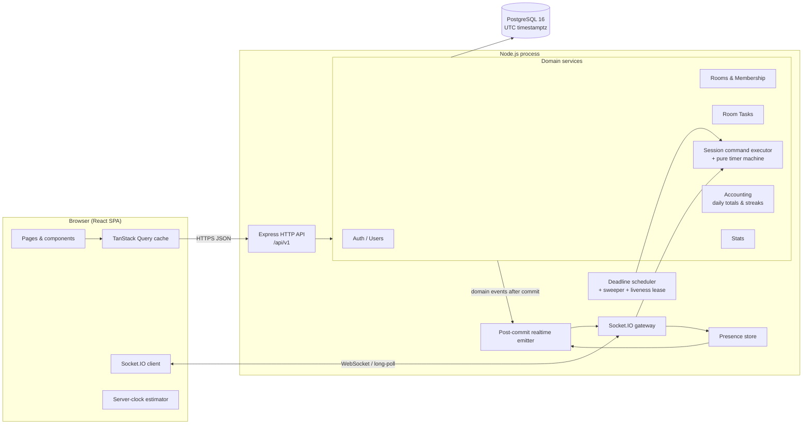
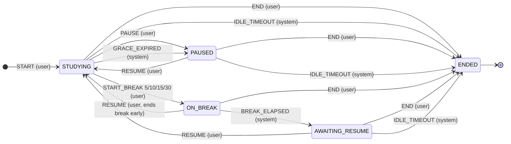
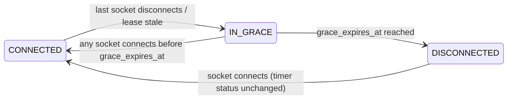

# StudySync — Architecture

> **Status: Draft v0.1 (planning phase).** No application code exists yet.
> This document is based on the 13 product rules given at project kickoff. The **complete
> product specification has not been received yet**. Every item in
> [§3 Assumptions & Open Questions](#3-assumptions--open-questions) and every section marked
> **[PENDING SPEC]** must be reconciled against it before Phase 1 begins.

Companion documents:
[DATABASE_DESIGN.md](./DATABASE_DESIGN.md) ·
[API_DESIGN.md](./API_DESIGN.md) ·
[DEVELOPMENT_ROADMAP.md](./DEVELOPMENT_ROADMAP.md) ·
[TESTING_STRATEGY.md](./TESTING_STRATEGY.md) ·
[CLAUDE.md](./CLAUDE.md)

---

## Contents

1. [Product overview](#1-product-overview)
2. [Requirements analysis](#2-requirements-analysis)
3. [Assumptions & open questions](#3-assumptions--open-questions)
4. [System architecture](#4-system-architecture)
5. [Technology stack](#5-technology-stack)
6. [Architectural principles](#6-architectural-principles)
7. [Backend architecture](#7-backend-architecture)
8. [Realtime architecture](#8-realtime-architecture)
9. [Study timer subsystem](#9-study-timer-subsystem)
10. [Frontend architecture](#10-frontend-architecture)
11. [Time & timezone handling](#11-time--timezone-handling)
12. [Security architecture](#12-security-architecture)
13. [Concurrency risk register](#13-concurrency-risk-register)
14. [Security risk register](#14-security-risk-register)
15. [Project folder structure](#15-project-folder-structure)
16. [Environments & configuration](#16-environments--configuration)
17. [Observability](#17-observability)
18. [Scalability path](#18-scalability-path)
19. [Architecture decision records](#19-architecture-decision-records)

---

## 1. Product overview

StudySync is a real-time collaborative study application. Users study inside **reusable rooms**
alongside other people. **Every user runs their own independent study timer.** Rooms share a
**task list that synchronizes in real time**. StudySync records **actual study time** (never
break time), totals it **per local day in the user's timezone**, maintains **streaks**, and
presents **analytics** (Recharts).

### Glossary

| Term | Meaning |
|---|---|
| **User** | An account. Has an IANA timezone (e.g. `Asia/Kolkata`) used for daily totals. |
| **Room** | A persistent, reusable space. Has members, a shared task list, and live presence. **Has no timer.** |
| **Membership** | Durable relationship between a user and a room (role: owner / moderator / member). |
| **Presence** | Ephemeral "who is in this room right now" state, derived from live socket connections. |
| **Study session** | One user's timer run, from START to END. At most one non-ended session per user. |
| **Segment** | A contiguous interval during which the session was `STUDYING`. **Only segments count as study time.** |
| **Break** | A fixed-length pause of exactly 5, 10, 15 or 30 minutes. Never counted as study time. |
| **Activity** | A signal that the user is present (UI interaction, timer command). Resets the idle clock. |
| **Disconnect grace** | 2-minute window after a user's last connection drops before the system pauses a running timer. |
| **Idle timeout** | 30 minutes with no activity → the system ends the session. |
| **Local day** | A calendar date in the user's timezone. |
| **Daily total** | Study milliseconds attributed to one local day. |
| **Streak** | Count of consecutive local days, each with ≥ 25 minutes (1,500,000 ms) of actual study. |

---

## 2. Requirements analysis

Every product rule is mapped to the mechanism(s) that enforce it and to the tests that prove it
(test IDs are defined in [TESTING_STRATEGY.md §12](./TESTING_STRATEGY.md#12-requirements-traceability-matrix)).
Enforcement is layered: **UI → shared Zod schema → service logic → database constraint**.

| # | Rule (verbatim) | Interpretation | Enforcement | Tests |
|---|---|---|---|---|
| R1 | Every user has an independent timer. | Timer state lives only on `study_sessions`, owned by exactly one user. Each user's state changes only through that user's own commands or system events about that user. | `study_sessions.user_id` is required. Every timer endpoint is scoped to the caller. Room views render each member's status from **their own** session. | T-R1 |
| R2 | Never implement a shared timer. | No room-level countdown, no "start together", no group pomodoro, no timer fields on rooms, no socket event that changes more than one user's timer. | `rooms` has no timer columns. No API or socket event can change another user's session. CLAUDE.md marks this as a review-blocking rule. | T-R2 |
| R3 | Break time never counts as study time. | Study time is the sum of segment durations. A break starts at the exact instant the open segment closes, and is stored in a separate table. | State machine closes the segment before opening the break. Accounting sums only `study_segments`. DB exclusion constraint forbids overlapping segments per user. A property-based invariant checks that no segment overlaps a break. | T-R3 |
| R4 | Breaks restricted to 5, 10, 15 and 30 minutes. | The only valid durations are `{5,10,15,30}`. No custom, extended or chained breaks. | Shared constant `BREAK_DURATIONS_MINUTES`. Zod literal union. DB `CHECK (duration_minutes IN (5,10,15,30))`. The UI offers only these four. | T-R4 |
| R5 | No automatic resume. | Only a **user-issued** `RESUME` (or `START`) can open a segment. System events may only close segments. After a break elapses → `AWAITING_RESUME`. After grace expires → `PAUSED`. A reconnect never changes timer status. A server restart never resumes. | State machine: system events have no transition into `STUDYING`. Invariant: every `STARTED`/`RESUMED` event has `actor = USER`. | T-R5 |
| R6 | One active session per user. | At most one session with `status <> 'ENDED'` per user, across all devices, tabs and rooms. | Partial unique index `study_sessions(user_id) WHERE status <> 'ENDED'`. `POST /sessions` returns `409 SESSION_ALREADY_ACTIVE`. All of a user's devices observe the same session via the `user:{id}` channel. | T-R6 |
| R7 | Rooms are reusable. | Rooms persist independently of sessions and presence. They are never deleted when empty. Membership and tasks persist across visits. Many sessions over many days can take place in one room. | No lifecycle coupling between `rooms` and `study_sessions`. Owner can archive (soft-delete) only explicitly. | T-R7 |
| R8 | Room tasks synchronize in real time. | Every task mutation is visible to all present members within ≤ 1 s (target), with deterministic conflict handling. | REST mutation → DB commit → `task:*` broadcast to `room:{id}`. Per-task `version`. Resync snapshot on (re)join. | T-R8 |
| R9 | Disconnect grace is 2 minutes. | When a user's **last** live connection drops while `STUDYING`, a 120 s grace window starts. Reconnect within grace → timer continues uninterrupted. Grace expires → system pauses **retroactively at the disconnect instant** (unverified time is not credited), and the timer stays paused until the user resumes. | `disconnected_at` / `grace_expires_at` persisted. Deadline-driven reconcile. Liveness lease detects crashed connections. Presence shows `reconnecting` during grace. | T-R9 |
| R10 | Idle timeout is 30 minutes. | No activity for 30 min → session is auto-ended. The idle clock is **suspended during breaks**. A warning is shown at 25 min. **[Q1, Q2]** | `last_activity_at` + `idle_deadline_at` persisted. Deadline-driven reconcile. | T-R10 |
| R11 | Streak requires 25 minutes of actual study per local day. | A local day qualifies when the sum of segment time attributed to it is ≥ 1,500,000 ms. The streak is the run of consecutive qualifying local days ending today or yesterday. **[Q12]** | `daily_study_totals` rollup + gaps-and-islands streak computation. Threshold is a shared constant. | T-R11 |
| R12 | All timestamps are stored in UTC. | Every instant is stored as `timestamptz`. The DB session timezone, the server process timezone and the API format are all UTC (ISO-8601 with `Z`). | Prisma `@db.Timestamptz(3)`. `TZ=UTC` env. DB `timezone=UTC`. Zod `z.iso.datetime()` (UTC only) at the API. | T-R12 |
| R13 | Daily totals use the user's timezone. | Study time is attributed to local dates by splitting segments at **local midnights** of the user's IANA timezone. "Today" is resolved in the user's current timezone. **[Q13]** | Accounting splits by local day using Luxon (DST-safe). `local_date DATE` column. Timezone snapshot stored on each segment. | T-R13 |

**Requirement preservation rule:** none of these rules may be relaxed, merged or simplified
during implementation. Any ambiguity is resolved by adding an entry to §3 and asking the product owner.

---

## 3. Assumptions & open questions

These are **proposed defaults** chosen so the design is complete and testable. Each one must be
confirmed or corrected against the full specification. IDs are referenced throughout all docs.

| ID | Question | Proposed default (used in this design) | Impact if changed |
|---|---|---|---|
| Q1 | What counts as **activity** for the idle timeout? Is time after the last activity credited when idle timeout fires? | Activity = any timer command, or a throttled `activity:ping` sent by the client on real user interaction (pointer, keyboard, touch, tab focus) or an explicit "I'm still here" click. When idle timeout fires while `STUDYING`, the segment is closed at `last_activity_at` (idle minutes **not** credited, matching "actual study"). A warning is shown at 25 min. | Accounting at timeout. |
| Q2 | Does idle timeout **end** or **pause** the session? | **End** (`end_reason = IDLE_TIMEOUT`). This frees the one-active-session slot and clears room presence for abandoned sessions. | State machine, presence. |
| Q3 | Is time during a disconnect credited when the user reconnects within grace? | **Yes** (network blips are invisible). If grace expires, the pause is **retroactive to the disconnect instant**. | Accounting. |
| Q4 | Can a user end a break early? | **Yes**, via Resume. Break time actually taken is recorded as break, and study resumes immediately. | State machine. |
| Q5 | Can a break start from `PAUSED`/`AWAITING_RESUME`, or be extended or chained? | **No.** A break can only start from `STUDYING`, with one of the four durations. | State machine. |
| Q6 | Are solo sessions (not in any room) allowed? | **Yes.** `study_sessions.room_id` is nullable. | Schema, UI. |
| Q7 | Can a user be present in several rooms at once (e.g. two tabs)? | **No.** One room at a time per user. Joining room B leaves room A on all of that user's connections. | Presence. |
| Q8 | If a user moves rooms mid-session, does the session follow? | **Yes.** Room context is updated, and the open segment is split at that instant so per-room analytics stay exact. | Segments. |
| Q9 | Room access model? | `PUBLIC` (discoverable, join freely) or `PRIVATE` (join by invite code). Capacity defaults to 50 (owner-configurable). Roles are `OWNER` / `MODERATOR` / `MEMBER`. The owner must transfer ownership before leaving. | Rooms module. |
| Q10 | Task model and permissions? | Shared room tasks: `title`, optional `notes`, `status ∈ {TODO, IN_PROGRESS, DONE}`, ordered list. Any member can create, edit, reorder and complete. Creator, moderator or owner can delete. No assignee or due date. **[PENDING SPEC]** | Schema, API. |
| Q11 | What can room members see about each other? | Display name, presence (`online`/`reconnecting`), timer **status** with `statusSince`, break end time, and today's study total. Each member's elapsed time is rendered from their own data (no shared timer). | Privacy, socket payloads. |
| Q12 | Is the 25-minute streak threshold cumulative across sessions in a day? | **Yes**, cumulative. | Streaks. |
| Q13 | What happens to daily attribution when a user changes timezone? | Each segment snapshots the user's timezone when it opens, and attribution uses that snapshot. A change applies to new segments only. Changes are audit-logged and not rate-limited **[confirm]**. | Accounting, abuse. |
| Q14 | Is there a maximum session length? | No cap beyond the idle rule. Segments spanning midnight are split across days. | Accounting. |
| Q15 | Password reset, email verification, OAuth? | **Out of scope for v1** (no email provider in the stack) unless the spec says otherwise. | Auth module. |
| Q16 | Chat, notifications, friends, leaderboards, room statistics? | Not designed yet. **[PENDING SPEC]** | API, sockets, schema. |
| Q17 | Production deployment target? | Not decided. The design assumes one Node process plus managed PostgreSQL, with a path to horizontal scaling (§18). | Ops. |
| Q18 | Account deletion and data retention? | `DELETE /users/me` ends the active session, transfers or archives owned rooms, and hard-deletes personal data. `session_events` are retained for 180 days. | Schema, privacy. |
| Q19 | Approval of supporting libraries (§5.2)? | As listed. | Tooling. |
| Q20 | Which analytics views are required? | Daily study bar chart (7/30/90 days), study-vs-break, streak calendar, time-of-day heatmap, per-room breakdown, session history. **[PENDING SPEC]** | Stats API, UI. |

---

## 4. System architecture



**Key flows**

- **Commands (all state mutations)**: REST → Zod validation → service → DB transaction →
  commit → post-commit emitter → Socket.IO broadcast. The REST response returns the new
  authoritative state to the caller.
- **Push**: Socket.IO pushes session state to the user's own devices (`user:{id}`), plus
  presence, member statuses and task changes to room members (`room:{id}`).
- **Liveness and activity**: Socket.IO carries connection lifecycle (disconnect grace), the
  throttled `activity:ping`, and room presence join/leave.
- **Time-driven transitions** (break elapsed, grace expired, idle timeout): stored as
  deadlines in the DB, applied by the scheduler/sweeper **and** lazily on every read or command.

**Deployment topology (v1):** one Node.js process (HTTP + Socket.IO + scheduler) and one
PostgreSQL database. The web app is served as static files (same origin in production; Vite
dev-server proxy in development). See §18 for horizontal scaling.

---

## 5. Technology stack

### 5.1 Mandated

| Layer | Technology |
|---|---|
| Frontend | React + TypeScript + Vite, Tailwind CSS, Recharts |
| Backend | Node.js + Express + TypeScript |
| Database | PostgreSQL + Prisma ORM |
| Realtime | Socket.IO (server + client) |
| Auth | JWT + bcrypt |
| Validation | Zod (shared between client and server) |

Versions: latest stable at scaffold time, pinned exactly in lockfiles. Expected majors at the
time of writing: Node 22 LTS, React 19, Vite 7, Tailwind 4 (`@tailwindcss/vite`), Express 5
(native async error propagation), Prisma 6/7 (if 7+, use `prisma.config.ts` and the
`@prisma/adapter-pg` driver adapter), Socket.IO 4.8, Zod 4. Versions are confirmed in Phase 1.

### 5.2 Proposed supporting libraries (need approval — Q19)

| Purpose | Library | Why |
|---|---|---|
| Monorepo | npm workspaces | No extra tooling; Node 22 ships npm 10. |
| Timezone math | `luxon` | DST-safe local-midnight splitting and IANA zone validation. One tz engine for the whole backend. |
| Client routing | `react-router` | Standard SPA routing. |
| Server state cache | `@tanstack/react-query` | Caching, refetch on reconnect; socket events patch the cache. |
| Client UI state | `zustand` | Small store for auth token, connection state, and server-clock offset. |
| Forms | `react-hook-form` + `@hookform/resolvers` | Reuses the shared Zod schemas on forms. |
| Task ordering | `fractional-indexing` | Reordering with O(1) row writes and no renumbering. |
| HTTP hardening | `helmet`, `cors`, `cookie-parser`, `express-rate-limit` | Security headers, CORS allowlist, refresh cookie, rate limits. |
| Logging | `pino`, `pino-http` | Structured JSON logs with redaction. |
| Dev runner | `tsx` | Run TypeScript directly in development. |
| Testing | `vitest`, `supertest`, `@testing-library/react`, `msw`, `@playwright/test`, `fast-check`, `socket.io-client` | See TESTING_STRATEGY.md. |
| Lint/format | `eslint` (typescript-eslint), `prettier` | Consistency. |

Explicitly **not** used in v1: Redis (§18), a DI framework, GraphQL, or an external job queue.

---

## 6. Architectural principles

1. **Server-authoritative time.** The client never sends timestamps or durations. Every instant
   comes from the server's injected `Clock`. The client only *displays* time, using a measured
   server-clock offset.
2. **Pure core, imperative shell.** The timer state machine is a pure function
   `transition(state, event) → { state, effects }` in `packages/shared`, with no I/O and no
   `Date.now()`. Persistence, accounting and broadcasting are separate effect handlers.
3. **Deadlines are data.** Break end, grace expiry and idle timeout are persisted timestamps.
   Correctness never depends on an in-memory `setTimeout` firing. Timers only make pushes
   timely; reconciliation applies due transitions **at their deadline timestamp**, not at the
   moment they are processed.
4. **The database is the last line of defense.** Invariants (one active session, no
   overlapping segments, legal break durations) are DB constraints, not only application checks.
5. **Single write path.** All mutations go through REST commands. Sockets are used for push,
   presence and activity. This keeps validation, authorization, idempotency and testing in one place.
6. **Emit after commit.** Socket events are emitted only after the transaction commits, so
   clients never observe state that was rolled back.
7. **Versioned entities, idempotent commands.** Sessions and tasks carry a monotonically
   increasing `version`. Timer commands carry a client `commandId`, and task creates carry a
   client-generated UUID, so retries are safe. Clients drop events with a stale version.
8. **Validate at every boundary.** Shared Zod schemas validate HTTP bodies and params, query
   strings, socket payloads, environment variables and form inputs. Unknown keys are rejected.
9. **UTC everywhere.** Timezone conversion happens only at two boundaries: daily attribution
   (accounting) and display (UI).
10. **Deterministic testability.** `Clock`, the scheduler's timer port and ID generation are
    injected, so tests can fast-forward time without real waiting.

---

## 7. Backend architecture

### 7.1 Layering

```
HTTP route ──► controller ──► service ──► repository (Prisma) ──► PostgreSQL
                  ▲              │
Socket handler ───┘              └──► domain events ──(after commit)──► realtime emitter
```

| Layer | Responsibility | Must not |
|---|---|---|
| **Route** | Path, middleware chain (auth, rate limit, Zod validation). | Contain logic. |
| **Controller** | Map validated request → service call → DTO response. | Touch Prisma. |
| **Service** | Business rules, authorization checks, transactions, domain events. | Know about HTTP or Socket.IO objects. |
| **Repository** | Prisma queries, row locking (`$queryRaw … FOR UPDATE`), mapping rows ↔ domain. | Contain business rules. |
| **Realtime handler** | Socket event → Zod validation → service call → ack. | Mutate DB directly. |
| **Emitter** | Translate committed domain events into socket emissions. | Run inside a transaction. |

Dependency wiring is a hand-written composition root (`container.ts`) with factory functions.
This makes it trivial to swap the `Clock`, timer port and presence store in tests.

### 7.2 Modules

| Module | Owns |
|---|---|
| `auth` | Register, login, refresh rotation, logout, token reuse detection. |
| `users` | Profile, timezone, password change, account deletion. |
| `rooms` | Room CRUD, archive, invite codes, membership, roles, capacity. |
| `tasks` | Room task CRUD, ordering, versioning. |
| `sessions` | Timer command executor, reconcile, scheduler, sweeper, liveness lease, session history. |
| `accounting` | Segment → local-day attribution, daily totals, streak computation. |
| `stats` | Read models for analytics charts. |
| `realtime` | Socket.IO server, socket auth, presence store, channel management, emitter, per-event rate limiting. |

### 7.3 Error model

All errors are `AppError` subclasses carrying a stable `code`, an HTTP status and optional
`details`. A single Express error handler serializes them as
`{ error: { code, message, details?, requestId } }`. Unknown errors become `500 INTERNAL` with
no internals leaked. Socket handlers return the same `{ code, message }` shape through acks.
The catalogue is in [API_DESIGN.md §3](./API_DESIGN.md#3-errors).

### 7.4 Transactions & domain events

- Services run multi-row changes in `prisma.$transaction(async (tx) => …)` (interactive,
  READ COMMITTED, with explicit row locks where needed).
- Services push domain events (`SessionStateChanged`, `TaskUpdated`, …) into a per-request
  `EventCollector`. After commit, the collector is flushed to the emitter. On rollback it is
  discarded.
- If the process crashes between commit and emit, clients recover by **resyncing on
  reconnect** (§8.5). No transactional outbox is needed in v1, because every pushed state is
  also fetchable.

---

## 8. Realtime architecture

### 8.1 Connection & authentication

- The client connects once after login: `io(origin, { auth: { token: accessToken } })`.
- Handshake middleware verifies the JWT (HS256 pinned, `iss`/`aud` checked) and the user's
  `token_version`, then sets `socket.data.userId` and `socket.data.tokenExp`.
- Each connection joins its private channel `user:{userId}`.
- **Token renewal without reconnecting:** before expiry the client sends `auth:renew` with a
  fresh access token. If a token expires without renewal, the server emits `auth:expired` and
  disconnects. The client refreshes and reconnects, which falls within disconnect grace and so
  has no timer impact.
- Limits: max 5 concurrent sockets per user, `maxHttpBufferSize` 64 KB, and Socket.IO
  `pingInterval` 10 s / `pingTimeout` 10 s for fast dead-connection detection.

### 8.2 Channels

| Channel | Members | Carries |
|---|---|---|
| `user:{userId}` | All sockets of one user (all tabs and devices) | `session:state`, `session:idle_warning`, account-level notices. |
| `room:{roomId}` | Sockets of users currently **present** in that room | Presence, member timer statuses, `task:*`, `room:*`. |

A socket joins `room:{roomId}` only after a server-side membership check in `room:join`. On
kick, archive or leave, the server removes **all** of that user's sockets from the channel
immediately (`io.in('user:{id}').socketsLeave('room:{roomId}')`).

### 8.3 Presence model

The presence store is in memory in v1, behind a `PresenceStore` interface so a Redis
implementation can replace it later.

```
userConnections: Map<userId, Set<socketId>>          // liveness (any tab counts)
userRoom:        Map<userId, roomId>                  // Q7: one room at a time
roomMembers:     Map<roomId, Map<userId, { joinedAt, connection: 'online' | 'reconnecting', graceTimer }>>
```

- **Connected** = the user has ≥ 1 live socket. The timer's disconnect grace starts only when
  the **last** socket of a user disconnects (closing one of two tabs does nothing).
- During grace the member shows as `reconnecting` in their room. On expiry they are removed
  from presence (`room:member_left`).
- **Member status** shown in the room = presence connection state + that member's own session
  status (`STUDYING`, `PAUSED`, `ON_BREAK`, `AWAITING_RESUME`, or `NO_SESSION`). It is
  recomputed and broadcast (`room:member_status`) whenever that member's session changes. This
  is a **read-only view of independent timers** (R1/R2).

### 8.4 Activity

The client tracks real interaction (pointer, key, touch, `visibilitychange` to visible, or the
"I'm still here" button) and sends `activity:ping` **at most once per 60 s**. The server
updates `last_activity_at` (throttled DB write, at most one per 60 s per session) and
recomputes `idle_deadline_at`. Activity pings do **not** bump the session version and do
**not** broadcast. Timer commands also count as activity.

### 8.5 Delivery semantics & resync

Socket.IO delivery is at most once. The contract is therefore:

1. Every pushed entity carries a `version` (session, task) or is a full snapshot (presence).
   Clients ignore events whose version is ≤ the version they already hold.
2. On every (re)connect and every `room:join`, the client refetches authoritative snapshots:
   `session:sync` (ack returns the session state), plus the room presence snapshot and task
   list in the `room:join` ack.
3. REST responses and socket broadcasts can arrive in either order. The version check makes
   this harmless.

### 8.6 Socket rate limiting

Each socket has a token bucket per event (e.g. `activity:ping` 2/min, `room:join` 10/min,
everything else 60/min). Exceeding it returns `RATE_LIMITED` in the ack. Repeated abuse
disconnects the socket.

---

## 9. Study timer subsystem

This is the core of StudySync and the highest-risk component. It is designed so that **every
rule is enforced by the shape of the state machine itself**, not by scattered `if` statements.

### 9.1 Session data (authoritative, server-side)

| Field | Meaning |
|---|---|
| `status` | `STUDYING` · `PAUSED` · `ON_BREAK` · `AWAITING_RESUME` · `ENDED` |
| `status_changed_at` | When the current status began (shown as "since" to the user and to the room) |
| `room_id` | Current room context (nullable — solo study, Q6) |
| `segment_started_at` | Start of the open segment (non-null **iff** `STUDYING`) |
| `study_ms_closed` | Sum of closed segment durations |
| `break_*` | Open break: `break_duration_minutes`, `break_started_at`, `break_ends_at` (non-null **iff** `ON_BREAK`). `last_break_ended_at` anchors the idle clock after a break. |
| `break_ms_closed` | Sum of closed break durations |
| `paused_at`, `pause_reason` | `USER` or `DISCONNECT_GRACE_EXPIRED` |
| `last_activity_at` | Last activity signal |
| `idle_deadline_at` | When idle timeout fires (null while `ON_BREAK` or `ENDED`) |
| `last_seen_at` | Liveness lease, refreshed while any socket of the user is connected |
| `disconnected_at`, `grace_expires_at` | Set while the user has no live connection |
| `next_deadline_at` | `min(` all pending deadlines `)`, indexed for the sweeper |
| `version` | Incremented on every state-visible change |
| `timezone` | User's timezone at session start (each segment also snapshots its own) |

Closed history lives in `study_segments`, `break_periods` and `session_events` (audit log).
See [DATABASE_DESIGN.md](./DATABASE_DESIGN.md).

### 9.2 Timer state machine



**Structural guarantees**

- **No automatic resume (R5):** no system event (`BREAK_ELAPSED`, `GRACE_EXPIRED`,
  `IDLE_TIMEOUT`, `RECONNECTED`, `LEASE_LOST`) has a target state of `STUDYING`.
- **Break ≠ study (R3):** `START_BREAK` closes the open segment at instant *t* and opens the
  break at the same *t*. While `ON_BREAK` no segment is open.
- **Break durations (R4):** `START_BREAK` carries `durationMinutes ∈ {5,10,15,30}`.
  `break_ends_at = t + duration`. Breaks can be neither extended nor chained (Q5).
- **One active session (R6):** `START` exists only from "no active session". `ENDED` is terminal.

### 9.3 Transition table

`t` = event time (server clock for user commands; **the deadline instant** for system events).

| From | Event | Actor | Guard | To | Effects |
|---|---|---|---|---|---|
| — | `START{roomId?}` | user | no non-ended session; member of `roomId` if given | `STUDYING` | create session; open segment at *t*; `last_activity_at=t` |
| `STUDYING` | `PAUSE` | user | — | `PAUSED` | close segment at *t* (`PAUSED`); `pause_reason=USER` |
| `STUDYING` | `START_BREAK{d}` | user | d ∈ {5,10,15,30} | `ON_BREAK` | close segment at *t* (`BREAK_STARTED`); open break `[t, t+d)` |
| `STUDYING` | `END` | user | — | `ENDED` | close segment at *t* (`SESSION_ENDED`); `end_reason=USER` |
| `STUDYING` | `GRACE_EXPIRED` | system | `disconnected_at` set, *t* = `grace_expires_at` | `PAUSED` | close segment at **`max(segment_started_at, disconnected_at)`** (`GRACE_EXPIRED`); `pause_reason=DISCONNECT_GRACE_EXPIRED` |
| `STUDYING` | `IDLE_TIMEOUT` | system | *t* = `idle_deadline_at` | `ENDED` | close segment at **`max(segment_started_at, last_activity_at)`** (`IDLE_TIMEOUT`); `end_reason=IDLE_TIMEOUT` [Q1/Q2] |
| `STUDYING` | `CHANGE_ROOM{roomId?}` | user | membership | `STUDYING` | close segment at *t* (`ROOM_CHANGED`); open new segment at *t* with new room [Q8] |
| `PAUSED` | `RESUME` | user | — | `STUDYING` | open segment at *t*; clear pause fields |
| `PAUSED` | `END` | user | — | `ENDED` | `end_reason=USER` |
| `PAUSED` | `IDLE_TIMEOUT` | system | *t* = `idle_deadline_at` | `ENDED` | `end_reason=IDLE_TIMEOUT` |
| `ON_BREAK` | `BREAK_ELAPSED` | system | *t* = `break_ends_at` | `AWAITING_RESUME` | close break at *t* (`ELAPSED`); idle clock restarts at *t* |
| `ON_BREAK` | `RESUME` | user | — | `STUDYING` | close break at *t* (`RESUMED_EARLY`); open segment at *t* [Q4] |
| `ON_BREAK` | `END` | user | — | `ENDED` | close break at *t* (`SESSION_ENDED`) |
| `AWAITING_RESUME` | `RESUME` | user | — | `STUDYING` | open segment at *t* |
| `AWAITING_RESUME` | `END` | user | — | `ENDED` | `end_reason=USER` |
| `AWAITING_RESUME` | `IDLE_TIMEOUT` | system | *t* = `idle_deadline_at` | `ENDED` | `end_reason=IDLE_TIMEOUT` |
| `PAUSED` / `ON_BREAK` / `AWAITING_RESUME` | `CHANGE_ROOM` | user | membership | same | update `room_id` only |
| any non-ended | `ACTIVITY` | user | — | same | `last_activity_at=t`; recompute idle deadline (no version bump) |
| any non-ended | `DISCONNECTED{at}` / `LEASE_LOST{at}` | system | user has 0 live connections | same | `disconnected_at=at`; `grace_expires_at=at+120 s` |
| any non-ended | `RECONNECTED` | system | *t* < `grace_expires_at` (after reconcile) | same | clear `disconnected_at`, `grace_expires_at` (**status unchanged — never resumes**) |
| `ENDED` | any | — | — | — | rejected: `409 SESSION_ENDED` |
| any | any other combination | — | — | — | rejected: `409 INVALID_TRANSITION` (state unchanged, current state returned) |

**Idempotency:** a user command whose `commandId` was already applied returns the current state
with `200` and does not re-apply.

**Commands while disconnected:** a REST command can arrive while the user has no live socket
(e.g. the socket is still reconnecting). A user command is proof of presence at *t*, so if
`disconnected_at` is set it is re-anchored to *t* (`grace_expires_at = t + 120 s`). Liveness is
still owned by the socket. If no socket connects within the new grace window, the segment
opened by that command closes at *t*.

### 9.4 Connection sub-machine (orthogonal region)



Grace has a timer consequence **only if the timer is `STUDYING` when grace expires** (→
`PAUSED`, segment closed retroactively at `disconnected_at`). For every other status, grace
affects presence only. Breaks keep counting down server-side regardless of connection.

### 9.5 Deadlines & the reconcile algorithm

```ts
// packages/shared/src/timer/deadlines.ts (pure)
function nextDeadline(s: SessionSnapshot): { kind: SystemEventKind; at: Instant } | null {
  const c: Deadline[] = [];
  if (s.status === 'ON_BREAK') c.push({ kind: 'BREAK_ELAPSED', at: s.breakEndsAt });
  if (s.status === 'STUDYING' && s.graceExpiresAt) c.push({ kind: 'GRACE_EXPIRED', at: s.graceExpiresAt });
  if (s.idleDeadlineAt && s.status !== 'ON_BREAK') c.push({ kind: 'IDLE_TIMEOUT', at: s.idleDeadlineAt });
  // earliest first; tie-break: BREAK_ELAPSED < GRACE_EXPIRED < IDLE_TIMEOUT
  return earliest(c);
}

// idle deadline (null while ON_BREAK / ENDED):
//   idleDeadlineAt = max(lastActivityAt, lastBreakEndedAt ?? -∞) + 30 min

function reconcile(s: SessionSnapshot, now: Instant): TransitionResult {
  let result = { state: s, effects: [] };
  for (let d = nextDeadline(s); d && d.at <= now; d = nextDeadline(result.state)) {
    result = chain(result, transition(result.state, { type: d.kind, at: d.at, actor: 'SYSTEM' }));
  }
  return result; // each system transition is stamped with its own deadline, not `now`
}
```

`reconcile` runs **before every command**, on every read (`GET /sessions/active`,
`session:sync`), and from the sweeper. A command therefore always sees the state as it truly is
at `now`. Example: a user clicks Pause 3 minutes after their connection dropped. Reconcile first
applies `GRACE_EXPIRED` (stamped at the grace deadline), so the session is already `PAUSED` and
Pause returns `409 INVALID_TRANSITION` with the current state.

Because deadlines are applied in chronological order and stamped at their own instants, the
outcome is **identical** whether the transition was processed exactly on time, 5 s late by the
sweeper, or an hour late after a server outage.

### 9.6 Command execution pipeline

```mermaid
sequenceDiagram
    participant C as Client
    participant API as Express route
    participant S as SessionService
    participant DB as PostgreSQL
    participant E as Emitter
    participant SCH as Scheduler

    C->>API: POST /sessions/:id/breaks {commandId, durationMinutes: 10}
    API->>API: auth + Zod validate
    API->>S: startBreak(userId, sessionId, cmd)
    S->>DB: BEGIN; SELECT … FROM study_sessions WHERE id=$1 AND user_id=$2 FOR UPDATE
    S->>DB: commandId already in session_events? → return current state
    S->>S: now = clock.now(); r = reconcile(snapshot, now)
    S->>S: r = transition(r.state, START_BREAK{10}, now)  (pure)
    S->>DB: apply effects: close segment, credit daily totals, open break,<br/>insert session_events, UPDATE session SET …, version = version + 1
    S->>DB: COMMIT
    S->>E: SessionStateChanged (post-commit)
    E-->>C: session:state → user:{id}   (all of the user's devices)
    E-->>C: room:member_status → room:{roomId}
    S->>SCH: reschedule(sessionId, next_deadline_at)
    API-->>C: 200 SessionState
```

**Locking strategy:** a short pessimistic row lock (`FOR UPDATE`) on the single session row
serializes all commands and system events for one user. Contention is per user only (one
person's devices), so lock waits are negligible. `version` gives clients a total order of
states and supports the optional `expectedVersion` precondition.

### 9.7 Scheduler, sweeper & liveness lease

| Mechanism | Purpose | Details |
|---|---|---|
| **In-process scheduler** | Timely pushes | After each commit, `setTimeout` is set to `next_deadline_at` (and to `idle_deadline_at − 5 min` for the idle warning). On fire → `sessions.reconcileById(id)`. Timers are an optimization only. |
| **Sweeper** | Safety net (restarts, missed timers, multi-instance) | Every 5 s: select up to 100 ids where `status <> 'ENDED' AND next_deadline_at <= now()`. For each id, run a transaction with `SELECT … FOR UPDATE SKIP LOCKED` and reconcile. `SKIP LOCKED` means two instances never block on or double-process a session. |
| **Liveness lease** | Detect connections lost without a clean `disconnect` (process crash, other instance died) | Every 30 s, each instance runs one batched `UPDATE study_sessions SET last_seen_at = now WHERE user_id = ANY($connectedUsers) AND status <> 'ENDED'`. The sweeper treats a session with `disconnected_at IS NULL AND last_seen_at < now − 90 s` as `LEASE_LOST{at: last_seen_at}`, so grace is measured from the last proof of life. If the user is connected on this instance and the session shows `disconnected_at` set, the lease tick emits `RECONNECTED` (self-healing across instances). |
| **Fast path** | Low-latency disconnect | Socket `disconnect`: if the user's live-socket count reaches 0 → `DISCONNECTED{at: now}`. Socket `connect`: → `RECONNECTED`. |

### 9.8 Restart recovery

1. On boot nothing special runs. The in-memory scheduler is empty, and the sweeper starts
   immediately.
2. Sessions whose deadlines passed during downtime are reconciled with deadline-stamped
   transitions (e.g. a break that elapsed during downtime → `AWAITING_RESUME`, stamped at
   `break_ends_at`).
3. `STUDYING` sessions whose clients have not reconnected become lease-stale 90 s after their
   last `last_seen_at`. Grace is anchored at `last_seen_at`. If the user reconnects within
   2 min of `last_seen_at`, the gap is credited; otherwise the segment is closed at
   `last_seen_at` and the session is `PAUSED`. **The timer is never resumed automatically.**
4. Worst-case under-credit after a crash is ≤ one lease interval (30 s). This is an accepted
   trade-off and is documented for users.

### 9.9 Study accounting (R3, R11, R12, R13)

When a segment closes `[start, end)` with timezone snapshot `tz`:

1. `durationMs = end − start` is stored on the segment and added to `study_ms_closed`.
2. **Split by local day:** walk local midnights of `tz` (Luxon `startOf('day')`, which handles
   23 h / 25 h DST days and zones whose midnight does not exist) and produce
   `[(localDate, ms), …]`.
3. For each piece: `INSERT INTO daily_study_totals … ON CONFLICT (user_id, local_date) DO
   UPDATE SET study_ms = daily_study_totals.study_ms + EXCLUDED.study_ms RETURNING study_ms`
   (atomic, no lost updates).
4. If a day crossed the threshold (`old < 1,500,000 ≤ new`), set `qualified_at` and recompute
   the streak (§9.10) **in the same transaction**.

Breaks are attributed to `break_ms` the same way (for analytics only). Time in `PAUSED` or
`AWAITING_RESUME` is neither study nor break.

**Live values:** the open segment is not yet in `daily_study_totals`. "Today's study" =
persisted total + the open segment's portion since local midnight. The client computes this
for display, and `GET /stats/today` and `GET /stats/streak` include it server-side.

### 9.10 Streaks (R11)

- A local date **qualifies** iff `daily_study_totals.study_ms ≥ 1,500,000`.
- Streak runs are computed with a gaps-and-islands query over qualifying dates
  ([DATABASE_DESIGN.md §6.3](./DATABASE_DESIGN.md#63-streak-recomputation-gaps-and-islands)).
  `user_streaks` is a **cache** that is fully recomputable from `daily_study_totals`. This
  stays correct even when data arrives late (e.g. a segment spanning midnight that closes
  after today already qualified).
- **Current streak** = length of the run whose last date is *today* or *yesterday* (user's
  current timezone); otherwise 0. If today is not yet qualified, the API returns `atRisk: true`.
- **Longest streak** = max run length.

### 9.11 Worked examples

| # | Scenario | Result |
|---|---|---|
| A | START 09:00 · break 10 min at 09:50 · break elapses 10:00 → `AWAITING_RESUME` · RESUME 10:07 · END 10:30 | Study = 50 + 23 = **73 min**. Break = 10 min. 10:00–10:07 counts as neither. |
| B | STUDYING since 14:00 · connection drops 14:20:00 · reconnects 14:21:30 · END 15:00 | Grace not exceeded → **60 min** study, no interruption. |
| C | STUDYING since 14:00 · drops 14:20:00 · no reconnect | At 14:22:00 → `PAUSED` (reason `DISCONNECT_GRACE_EXPIRED`), segment closed at 14:20:00 → **20 min**. User returns 14:40 → still `PAUSED`; must press Resume. |
| D | STUDYING since 15:30 · last activity 16:00 · warning 16:25 · no response | 16:30 → `ENDED` (`IDLE_TIMEOUT`). Credited 15:30–16:00 = **30 min** [Q1]. |
| E | 15-min break at 11:00 · RESUME at 11:06 | Break = 6 min (`RESUMED_EARLY`), study resumes 11:06. |
| F | User in `Asia/Kolkata` (UTC+05:30) · segment `2026-10-31T18:00Z`–`19:00Z` (local 23:30–00:30) | 2026-10-31: **30 min**, 2026-11-01: **30 min**. |
| G | User in `America/New_York` studies 01:30–03:30 local on 2026-11-01 (clocks fall back at 02:00) | Wall clock shows 2 h, but the true elapsed time is **3 h** (UTC-based). All 3 h attributed to 2026-11-01. |

---

## 10. Frontend architecture

### 10.1 Structure

- **Routing** (`react-router`): `/login`, `/register`, `/` (dashboard: today, streak, start
  solo session), `/rooms` (my rooms + discover), `/rooms/:roomId` (room view), `/history`,
  `/stats`, `/settings`. Authenticated routes sit behind an `AuthGate`.
- **Feature folders** (`features/auth`, `rooms`, `tasks`, `timer`, `presence`, `stats`,
  `profile`) colocate components, hooks and API calls.
- **Server state:** TanStack Query. Socket events patch the query cache via a single
  `realtime/cacheBridge.ts`, which applies version guards.
- **Client state:** Zustand for the access token (memory only), connection status and
  server-clock offset.

### 10.2 Timer display (never authoritative)

- `useServerClock()` estimates `offset = serverNow − clientNow` from `clock:sync` round trips
  (NTP-style, median of samples) and from `serverNow` on every `SessionState`.
- `useSessionTimer(session)` renders:
  `elapsedStudyMs = studyMsClosed + (status === 'STUDYING' ? correctedNow − currentSegmentStartedAt : 0)`
  and the break countdown `currentBreak.endsAt − correctedNow`. It ticks with
  `requestAnimationFrame` / 1 s interval and pauses when the tab is hidden.
- When a break countdown reaches 0, the UI shows "Break over — Resume when ready" but **does
  not** send anything. It waits for the server's `session:state` (`AWAITING_RESUME`).
  Resume is always an explicit click (R5).
- The break picker offers exactly four buttons: 5, 10, 15, 30 minutes (R4).
- `useActivityTracker()` sends throttled `activity:ping`. `IdleWarningModal` opens on
  `session:idle_warning` with an "I'm still studying" button.
- The room view shows **my timer panel** plus a **member list** where each member's status
  and elapsed time come from their own data. There is no room timer component (R1/R2).

### 10.3 Auth on the client

- The access token is kept in memory only (not `localStorage`). The refresh token is an
  `httpOnly` cookie.
- `httpClient` attaches the bearer token. On `401 TOKEN_EXPIRED` it performs a single-flight
  refresh, then retries once.
- On page load the client calls `POST /auth/refresh` to restore the session.

### 10.4 UX & accessibility

Tailwind with a small set of headless UI primitives. Keyboard-operable timer controls. An
`aria-live="polite"` region announces state changes (not every tick). Color is never the only
indicator of status. Responsive down to 360 px. Optional browser notification when a break
ends (permission-gated).

---

## 11. Time & timezone handling

| Concern | Rule |
|---|---|
| Storage | All instants are `timestamptz(3)`. DB `timezone = 'UTC'`. Node runs with `TZ=UTC`. |
| Source of "now" | Injected `Clock` on the server. The client never supplies instants. |
| API format | RFC 3339 / ISO-8601 UTC with `Z` and millisecond precision (`2026-10-31T18:00:00.000Z`). Local dates are plain `YYYY-MM-DD` strings, never timestamps. |
| Durations | Integer milliseconds (`*_ms`) to avoid rounding drift across many short segments. |
| User timezone | IANA name, validated with Luxon (`IANAZone.isValidZone`) at the API. Auto-detected at registration from `Intl.DateTimeFormat().resolvedOptions().timeZone`, editable in settings. The UI warns if the browser zone differs from the profile zone. |
| Attribution | Timezone snapshot per segment (Q13). All local-date math lives in `packages/shared/src/time/` and is done in the app (one tz engine), not in SQL. |
| "Today" | Computed in the user's **current** profile timezone at request time. |
| DST | Local days can last 23 h or 25 h. Daily totals are bounded by 25 h (`90,000,000 ms`) via a DB check. |
| Clock skew | Servers must run NTP. The client corrects display with the measured offset. |

---

## 12. Security architecture

| Area | Design |
|---|---|
| **Passwords** | bcrypt, cost 12 (benchmarked in Phase 1 to take ~250 ms). Policy: 10–72 **bytes** in UTF-8, because bcrypt silently truncates beyond 72 bytes. Rejected if equal to the email. |
| **Access token** | JWT HS256 (algorithm pinned on verify), 15 min TTL, claims `sub`, `tv` (token version), `iss`, `aud`, `iat`, `exp`. Secret ≥ 32 random bytes from env. Sent as `Authorization: Bearer`. |
| **Refresh token** | 256-bit random opaque value. Only its SHA-256 hash is stored. 30-day TTL. Rotated on every use. Belongs to a token *family*: reuse of a rotated token revokes the whole family (theft detection). Cookie: `httpOnly; Secure; SameSite=Strict; Path=/api/v1/auth`. |
| **Revocation** | `logout` revokes the family. `logout-all` and password change increment `users.token_version`, which is checked on refresh and on socket connect/renew. |
| **CSRF** | Only the refresh/logout endpoints use the cookie. They require `SameSite=Strict` **and** a custom header `X-StudySync-CSRF: 1` (not sendable cross-origin without CORS approval). |
| **Authorization** | Central guards: `requireRoomMember(roomId)`, `requireRoomRole(roomId, roles)`, session ownership by `user_id` in every query. Unauthorized resource access returns `404` (no existence leaks). The same guards are applied to socket `room:join`. |
| **Input validation** | Shared Zod schemas, `.strict()` objects, length limits on all strings, UUID params validated. JSON body limit 100 KB. |
| **Output** | Explicit DTO mappers (never return Prisma rows). `password_hash` and token hashes are never serialized. |
| **Headers / CORS** | `helmet` (strict CSP, HSTS in production). CORS allowlist = configured web origin only, `credentials: true`. |
| **Rate limiting** | Per-IP and per-account limits on auth endpoints. Per-user limits on mutations. Per-socket token buckets (§8.6). |
| **Timer integrity** | Clients cannot send times or durations. Break durations are allow-listed. Only user commands open segments. Activity pings can only postpone idle timeout, never add time. |
| **Secrets** | `.env` is git-ignored. `.env.example` is committed. Env is validated with Zod at boot (the process refuses to start on invalid config). |
| **Logging** | `pino` redaction of `authorization`, `cookie`, `password`, `token` fields. A request id is propagated in the `X-Request-Id` header. |
| **Test-only endpoints** | The clock-control endpoint used by E2E tests is mounted only when `NODE_ENV=test` **and** `ENABLE_TEST_CLOCK=true`. Boot fails if both are set together with `NODE_ENV=production`. |

---

## 13. Concurrency risk register

| ID | Risk | Scenario | Mitigation | Test |
|---|---|---|---|---|
| C1 | Duplicate active sessions | Two tabs click Start simultaneously | Partial unique index. The loser gets `409 SESSION_ALREADY_ACTIVE` plus the existing session. | CT-1 |
| C2 | Conflicting commands | Tab A pauses while tab B starts a break | `SELECT … FOR UPDATE` serializes. The second command is validated against the new state (`409 INVALID_TRANSITION` + current state). | CT-2 |
| C3 | Retry double-apply | Client retries Pause after a timeout | `commandId` uniqueness `(user_id, command_id)` in `session_events` → replay returns current state. | CT-3 |
| C4 | User command vs system deadline | User resumes at the exact instant the break elapses | Reconcile first (deadline-stamped), then apply the command, under the same row lock. Deterministic tie rule: a deadline at *t* ≤ now is applied before the command. | CT-4 |
| C5 | Sweeper vs scheduler vs command | The same deadline is processed twice | Row lock + `SKIP LOCKED` in the sweeper. Reconcile is idempotent (a processed deadline is no longer pending). | CT-5 |
| C6 | Multiple server instances | Two sweepers, cross-instance sockets | `SKIP LOCKED`. Liveness lease. Socket.IO Redis adapter and Redis presence store in the scale-out phase (§18). | CT-6 |
| C7 | Disconnect/reconnect race | Reconnect is processed before the old socket's disconnect, or a multi-tab close/open happens | Live-socket counter per user. Grace starts only at count 0. `RECONNECTED` clears grace. Grace expiry re-checks state under the row lock. Lease tick self-heals stale `disconnected_at`. | RT-4 |
| C8 | Server crash loses timers and sockets | Deploy or restart mid-session | Deadlines persisted. Sweeper on boot. Lease-based disconnect detection anchored at `last_seen_at`. No auto resume. | CT-7 |
| C9 | Lost daily-total updates | Two transactions credit the same day | Atomic `INSERT … ON CONFLICT DO UPDATE SET study_ms = study_ms + EXCLUDED.study_ms`. | CT-8 |
| C10 | Overlapping segments | Bug or race opens two segments | Partial unique (one open segment per session **and** per user) + `EXCLUDE USING gist` no-overlap constraint per user. | CT-9 |
| C11 | Concurrent task edits | Two members rename the same task | Per-task `version` + `expectedVersion` → `409 VERSION_CONFLICT` with the current task. Status toggles are idempotent set-operations. | CT-10 |
| C12 | Concurrent reorders | Two members move tasks into the same gap | Server generates fractional keys under a per-room transaction-scoped advisory lock. A partial unique index `(room_id, position)` on live tasks is the safety net. | CT-11 |
| C13 | Room capacity race | Two users join the last free slot | Conditional `UPDATE rooms SET member_count = member_count + 1 WHERE id = $1 AND member_count < max_members` in the same transaction as the insert. | CT-12 |
| C14 | Event before commit / stale event ordering | A broadcast describes rolled-back state; REST response and socket event race | Emit after commit only. Versions on every entity, and clients drop stale versions. | RT-6 |
| C15 | Kick or archive during live session | Member is removed while present and studying | Their sockets leave the room channel immediately. Their session continues (independent timer), and its room context is cleared with a segment split (Q8). | RT-7 |
| C16 | Clock skew between app nodes | Two nodes disagree on "now" | NTP required. All instants come from the app `Clock`. Deadlines are compared using the processing node's clock, and tolerance is covered by the grace windows. | — |

---

## 14. Security risk register

| ID | Threat | Mitigation |
|---|---|---|
| S1 | Credential stuffing / brute force | Rate limits per IP + per email. Constant-time comparison. Uniform `401 INVALID_CREDENTIALS`. bcrypt cost 12. |
| S2 | Account enumeration | Login responses are uniform. Registration necessarily reveals "email taken" (`409`); this is accepted and rate-limited [confirm with spec]. |
| S3 | JWT forgery / alg confusion | Pinned `HS256`, `iss`/`aud` checks, strong secret, short TTL. |
| S4 | Refresh token theft | httpOnly cookie, hashed at rest, rotation + family reuse detection, revocation on password change. |
| S5 | XSS stealing tokens | React escaping. No `dangerouslySetInnerHTML`. Strict CSP. Access token in memory only. |
| S6 | CSRF on cookie endpoints | SameSite=Strict + custom header check. All other endpoints use bearer auth. |
| S7 | IDOR (rooms, tasks, sessions) | Every query is scoped by membership or ownership. 404 on unauthorized access. Authz matrix tests. |
| S8 | Unauthorized socket channel access | `room:join` requires membership. Channel removal on kick/leave/archive. Payloads are emitted only to authorized channels. |
| S9 | Mass assignment | `.strict()` Zod schemas. Explicit field mapping in services. |
| S10 | Injection | Prisma parameterization. `$queryRaw` with tagged templates only (`$queryRawUnsafe` is banned by lint rule). |
| S11 | Timer / streak fraud | Server-only time. Allow-listed breaks. Only users open segments. Pings can't add time. Timezone changes are audit-logged (Q13). A bot sending pings can keep a session alive; this is accepted for a self-reported study tool and documented. |
| S12 | DoS via payloads / connections / events | Body limit, socket buffer limit, per-user socket cap, per-event rate limits, pagination caps (`limit ≤ 100`), query range caps (stats ≤ 366 days). |
| S13 | Sensitive data in logs | pino redaction. No tokens in URLs. |
| S14 | Secrets leakage | Env-only secrets. `.env` git-ignored. Zod-validated config. Secret scanning in CI. |
| S15 | Test hooks reachable in production | Test clock gated by env plus a boot-time assertion (§12). |
| S16 | Stale authorization on long-lived sockets | Token expiry enforced per socket. `auth:renew` re-checks `token_version`. Kick and deletion actively disconnect or remove sockets. |
| S17 | Dependency vulnerabilities | Lockfile, `npm audit` in CI, Dependabot. |
| S18 | Privacy of member activity | Only the fields in Q11 are broadcast, and only to current members of the room. |

---

## 15. Project folder structure

npm-workspaces monorepo. **Not scaffolded yet.** It is created in Phase 1, after approval.

```
StudySync/
├── CLAUDE.md · ARCHITECTURE.md · DATABASE_DESIGN.md · API_DESIGN.md
├── DEVELOPMENT_ROADMAP.md · TESTING_STRATEGY.md · README.md
├── package.json                  # workspaces: apps/*, packages/*; root scripts
├── package-lock.json
├── tsconfig.base.json            # strict, noUncheckedIndexedAccess, exactOptionalPropertyTypes
├── eslint.config.js · .prettierrc · .editorconfig · .nvmrc · .gitignore
├── .env.example
├── docker-compose.yml            # optional local Postgres for non-cloud machines
├── scripts/
│   └── dev-db.sh                 # start local Postgres in the cloud container, create dev/test DBs
├── .github/workflows/ci.yml      # lint · typecheck · unit · integration · e2e
├── packages/
│   └── shared/                   # imported by both apps; zero runtime deps besides zod/luxon
│       ├── src/
│       │   ├── constants.ts      # BREAK_DURATIONS_MINUTES, DISCONNECT_GRACE_MS, IDLE_TIMEOUT_MS, …
│       │   ├── schemas/          # Zod: common, auth, users, rooms, tasks, sessions, stats
│       │   ├── realtime/         # typed ClientToServer / ServerToClient event maps + payload schemas
│       │   ├── timer/            # machine.ts (pure transition), deadlines.ts, reconcile.ts, display.ts, types.ts
│       │   ├── time/             # splitByLocalDay.ts, localDate.ts, timezone.ts
│       │   └── index.ts
│       └── test/                 # exhaustive machine tests, property tests, DST fixtures
├── apps/
│   ├── server/
│   │   ├── prisma/
│   │   │   ├── schema.prisma
│   │   │   ├── migrations/       # includes hand-written SQL for partial indexes, checks, exclusion
│   │   │   └── seed.ts
│   │   ├── src/
│   │   │   ├── index.ts          # bootstrap: env → container → http + io → scheduler/sweeper
│   │   │   ├── app.ts            # express app factory (no listen) — used by supertest
│   │   │   ├── container.ts      # composition root (Clock, Prisma, PresenceStore, services)
│   │   │   ├── config/env.ts     # Zod-validated environment
│   │   │   ├── lib/              # prisma, logger, clock, errors, jwt, passwords, crypto, ids
│   │   │   ├── http/
│   │   │   │   ├── middleware/   # requestId, authenticate, validate, rateLimit, csrf, errorHandler
│   │   │   │   └── router.ts     # mounts module routers under /api/v1
│   │   │   ├── modules/
│   │   │   │   ├── auth/         # *.routes.ts · *.controller.ts · *.service.ts · *.repository.ts
│   │   │   │   ├── users/
│   │   │   │   ├── rooms/
│   │   │   │   ├── tasks/
│   │   │   │   ├── sessions/     # command executor, persistence of effects, scheduler, sweeper, lease
│   │   │   │   ├── accounting/   # dailyTotals.ts, streaks.ts
│   │   │   │   └── stats/
│   │   │   ├── realtime/
│   │   │   │   ├── io.ts         # Socket.IO server factory
│   │   │   │   ├── socketAuth.ts
│   │   │   │   ├── presenceStore.ts
│   │   │   │   ├── emitter.ts    # post-commit domain event → socket emissions
│   │   │   │   ├── rateLimiter.ts
│   │   │   │   └── handlers/     # room.ts, activity.ts, session.ts, clock.ts, auth.ts
│   │   │   └── events/           # EventCollector, domain event types
│   │   └── test/
│   │       ├── helpers/          # testDb, factories, FakeClock, socket client, auth helpers
│   │       ├── unit/
│   │       ├── integration/      # supertest + real Postgres
│   │       ├── realtime/         # socket.io-client against in-process server
│   │       └── concurrency/      # parallel command / race tests
│   └── web/
│       ├── index.html · vite.config.ts
│       ├── src/
│       │   ├── main.tsx · App.tsx · router.tsx
│       │   ├── api/              # httpClient (refresh single-flight), endpoint functions
│       │   ├── realtime/         # socket.ts, useSocketEvent.ts, cacheBridge.ts
│       │   ├── features/
│       │   │   ├── auth/ · rooms/ · tasks/ · presence/ · profile/
│       │   │   ├── timer/        # TimerPanel, BreakPicker, IdleWarningModal, useSessionTimer, useActivityTracker
│       │   │   └── stats/        # Recharts components
│       │   ├── components/       # ui/ primitives, layout/
│       │   ├── hooks/ · lib/     # serverClock, formatting, timezone helpers
│       │   ├── stores/           # zustand: auth, connection, clock
│       │   └── styles/index.css  # Tailwind entry
│       └── test/                 # setup, MSW handlers
└── e2e/
    ├── playwright.config.ts
    └── specs/                    # multi-user room, timer rules, task sync, auth
```

---

## 16. Environments & configuration

### 16.1 Cloud development environment (primary)

The product owner develops **only** in the Claude Code cloud environment. Nothing is installed
on their machine.

- Container: Node 22, npm 10, PostgreSQL 16 (local cluster, started on demand), Chromium and
  Playwright pre-installed. The Docker daemon is not running by default.
- `scripts/dev-db.sh` (Phase 1) starts the local Postgres cluster, sets `timezone=UTC`, and
  creates `studysync_dev` and `studysync_test`.
- **The container is ephemeral.** All work must be committed and pushed. Database contents
  are disposable; `npm run db:reset` re-runs migrations and the seed.
- An optional SessionStart hook (Phase 1, on request) can automate DB start and `npm install`.

### 16.2 Configuration (`apps/server/src/config/env.ts`, Zod-validated)

| Variable | Example | Notes |
|---|---|---|
| `NODE_ENV` | `development` | `development` · `test` · `production` |
| `PORT` | `4000` | |
| `DATABASE_URL` | `postgresql://…/studysync_dev?options=-c%20timezone%3DUTC` | Forces a UTC session |
| `JWT_ACCESS_SECRET` | 32+ random bytes | |
| `JWT_ISSUER` / `JWT_AUDIENCE` | `studysync` | |
| `ACCESS_TOKEN_TTL_SEC` | `900` | |
| `REFRESH_TOKEN_TTL_DAYS` | `30` | |
| `BCRYPT_COST` | `12` | `4` allowed only in test |
| `WEB_ORIGIN` | `http://localhost:5173` | CORS allowlist |
| `LOG_LEVEL` | `info` | |
| `ENABLE_TEST_CLOCK` | `false` | Test only (§12) |

Product constants (grace, idle, breaks, streak) are **not** configurable through env. They live
in `packages/shared/src/constants.ts` so client and server cannot disagree, and changing them
requires a code change and review.

### 16.3 Ports (development)

Web (Vite) `5173` proxies `/api` and `/socket.io` to the server on `4000`. Same origin means
`SameSite=Strict` cookies work in development.

---

## 17. Observability

- **Logs:** pino JSON with `requestId`, `userId` and `sessionId` where applicable. Every timer
  transition is logged at `info` with `{from, to, event, actor, at, lagMs}`, where `lagMs` is
  processing time minus deadline.
- **Health:** `GET /health` (liveness) and `GET /health/ready` (DB reachable, migrations applied).
- **Metrics (Phase 9):** active sockets, active sessions by status, sweeper lag (p95), command
  latency, broadcast fan-out time, rate-limit rejections.
- **Audit:** `session_events` is an append-only log of every timer event, used for debugging
  disputes ("my study time is wrong").

---

## 18. Scalability path

v1 is a single instance. The design keeps these seams so scaling out needs no redesign:

1. **Socket.IO Redis adapter** for cross-instance broadcasts, plus **sticky sessions** at the
   load balancer (required by Socket.IO long-polling fallback).
2. **`PresenceStore` → Redis** implementation (atomic per-user connection counters, room
   member hashes with TTL). On last-socket disconnect, the check for remaining sockets uses the
   cluster-wide count (or `fetchSockets()` through the adapter).
3. **Sweeper** is already multi-instance safe (`SKIP LOCKED`). The **lease** already detects
   connections lost on a dead instance.
4. **Read scaling:** stats queries read from `daily_study_totals` (small) rather than raw
   segments. Partition `session_events` by month if it grows.

---

## 19. Architecture decision records

| ADR | Decision | Rationale | Alternatives rejected |
|---|---|---|---|
| 001 | npm-workspaces monorepo with `packages/shared` | One source of truth for Zod schemas, event contracts, constants and the timer machine | Separate repos (contract drift); Nx/Turborepo (unneeded complexity) |
| 002 | REST for all mutations; Socket.IO for push/presence/activity | Single validation, authz, idempotency and test path; HTTP semantics | Socket-only commands (harder to test, no status codes); mixed (two code paths) |
| 003 | Pure timer state machine + persisted deadlines + lazy reconcile | Exact, deterministic, restart-safe, trivially unit-testable | In-memory timers as source of truth (lost on restart); cron-only (imprecise) |
| 004 | Segments table as the only source of study time | Makes "break never counts" structural; enables per-day/per-room/per-hour analytics | Single counter column (unauditable, unsplittable at midnight) |
| 005 | Pessimistic row lock per session + `version` | Contention is per user only; simplest correct serialization | Pure optimistic retries (complex with deadlines); SERIALIZABLE everywhere (retry storms) |
| 006 | Timezone math in the app (Luxon), not SQL | One tz engine and testable DST handling; avoids ICU vs Postgres tzdata mismatch | `AT TIME ZONE` in queries |
| 007 | `daily_study_totals` rollup, streak recomputed from it | Fast reads; streak is always correct even with late data | Computing from raw segments on every read (slow); incremental-only streak counter (fragile) |
| 008 | Access token in memory + rotating refresh cookie | Mitigates XSS token theft; survives reloads via refresh | `localStorage` tokens; server sessions (stack mandates JWT) |
| 009 | Milliseconds for durations | No rounding drift | Seconds |
| 010 | Retroactive pause at disconnect instant when grace expires | Credits only verifiable study time; grace still hides blips | Pausing at grace expiry (credits 2 unverified minutes) |
