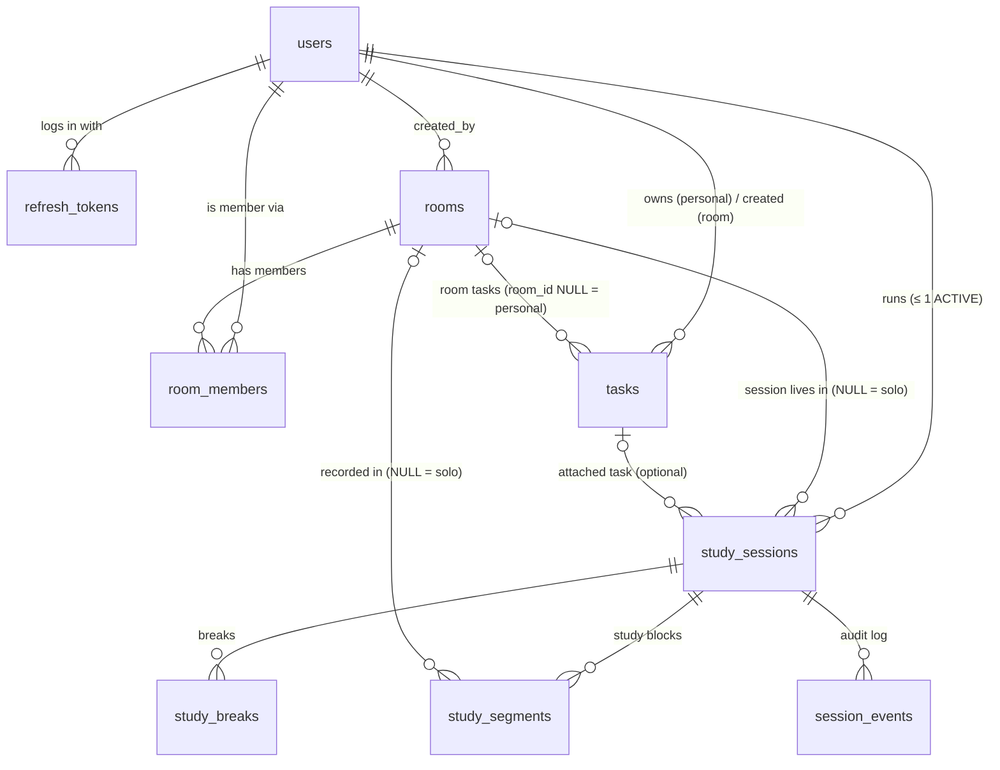

# StudySync — Database Design

> **Status: v1.0 FINAL — reconciled with the final spec. Awaiting approval.**
> PostgreSQL 16 + Prisma. Interpretation IDs (I-xx), gap IDs (D-x) and rule IDs (R-x) refer to
> [ARCHITECTURE.md](./ARCHITECTURE.md). The hand-written SQL (§5) and the time-splitting
> queries (§6) were **executed and validated against PostgreSQL 16** in the development container.

---

## Contents

1. [Design goals](#1-design-goals)
2. [Spec schema → final schema](#2-spec-schema--final-schema)
3. [Relationships](#3-relationships)
4. [Prisma schema](#4-prisma-schema)
5. [Hand-written constraints and indexes](#5-hand-written-constraints-and-indexes)
6. [Key queries](#6-key-queries)
7. [Index rationale](#7-index-rationale)
8. [Invariant audit queries](#8-invariant-audit-queries)
9. [Feature → data support check](#9-feature--data-support-check)
10. [Migrations workflow](#10-migrations-workflow)
11. [Seed data](#11-seed-data)
12. [Retention and capacity](#12-retention-and-capacity)

---

## 1. Design goals

| Goal | How |
|---|---|
| Segments are the single source of study time (spec §5) | Every number (session total, daily totals, Solo/Rooms, today in room, streak, charts) is a **query** over `study_segments`. **No stored counters.** |
| Timer rules enforced by the database | One ACTIVE session per user, studying-XOR-break, legal break durations, no resume before the countdown ends, idle bound, no overlapping intervals, no system-initiated resume. |
| UTC storage, local-day grouping (R12, R13) | `timestamptz(3)` everywhere, DB/session timezone UTC. Local days computed in SQL from per-segment timezone snapshots (validated on DST edge cases). |
| Restart-safe auto-save (R9, R10) | All deadlines derive from persisted columns (`break_ends_at`, `disconnected_at`, `last_seen_at`). |
| Membership ≠ session (R16) | `room_members` and `study_sessions` are independent tables with independent lifecycles. |

---

## 2. Spec schema → final schema

The spec's schema is kept. **Additions** are listed with the requirement that needs them.

| Table | Spec columns (kept) | Added | Why |
|---|---|---|---|
| `users` | id, name, email, password_hash, timezone, created_at | `updated_at` | Timezone and name are editable (F-34) |
| `refresh_tokens` | — | whole table | JWT sessions that survive page refresh securely (I-22). Rotation + reuse detection. |
| `rooms` | id, name, code (unique), created_by, created_at | `updated_at`, code format CHECK | F-13 (no O/0/I/1), D-2 ready |
| `room_members` | room_id, user_id, joined_at, unique together | `last_visited_at` | My Rooms ordering, one-click rejoin (F-19) |
| `tasks` | id, user_id, room_id (NULL = personal), title, description, status, due_date, created_at, completed_at | `completed_by_id`, `version`, `updated_at`, `deleted_at` | "Completed during session" for room tasks (I-13); edit conflicts (E-21); keep attached-task title in summaries (E-22) |
| `study_sessions` | id, user_id, room_id, task_id, started_at, ended_at, status (ACTIVE/ENDED), break_ends_at | `end_reason`, `current_segment_started_at`, `last_seen_at`, `disconnected_at`, `summary_seen_at`, `version`, `created_at`, `updated_at` | Auto-save reason and toast (F-40); DB-enforced studying-XOR-break; disconnect grace and crash detection that survive restarts (R9); push ordering |
| `study_segments` | id, session_id, started_at, ended_at (NULL = studying) | `user_id`, `room_id`, `timezone`, `end_reason`, `created_at` | Per-user no-overlap constraint; Solo/Rooms split when a solo session moves into a room (F-12, F-38); stable local-day grouping (I-10); audit |
| `study_breaks` | — (spec: "breaks are gaps") | whole table | The gap model cannot represent a break that ends the session, cannot prove the 5/10/15/30 rule in data, and cannot separate break time from waiting time (I-12). `study_sessions.break_ends_at` is kept as the spec's current-break field. |
| `session_events` | — | whole table | Command idempotency (`commandId`), audit trail, DB-checked "no system resume" (R5) |

**Not stored (computed):** session duration, daily totals, Solo/Rooms split, today in room,
streak, weekly/monthly/heatmap aggregates, current phase.

---

## 3. Relationships



**How the pieces relate:**

- **User ↔ Room is many-to-many through `room_members`.** Membership is durable: it is what
  *My Rooms* lists and what grants access. It is **not** presence (in memory) and **not** a
  session.
- **User → Study session is one-to-many**, with **at most one `ACTIVE`** (partial unique
  index). Past sessions stay `ENDED` forever as history.
- **Study session → Room is optional many-to-one.** `room_id` is where the session *lives*
  (NULL = solo). It can change only once, from NULL to a room (I-06). Rooms never own
  sessions: a room keeps existing with zero sessions (reusable, R7).
- **Study session → Segments (1-to-many)** are the study time. Each segment has its own
  `room_id` and `timezone` snapshot, so a session that moved from solo into a room splits
  correctly into Solo and Rooms time, and days are grouped stably.
- **Study session → Breaks (1-to-many).** Each break is the chosen 5/10/15/30 countdown plus
  when it actually closed. A session's history alternates segment, break, segment, …, with no
  overlaps.
- **Tasks** belong to a user (personal, `room_id` NULL) or to a room (`room_id` set, `user_id`
  = creator). A session may reference one task (`task_id`). Tasks never affect time.
- **Session events** are an append-only log per session. `(user_id, command_id)` is unique for
  idempotent retries.

---

## 4. Prisma schema

> Generator and datasource syntax follow the Prisma major version chosen at scaffold time.
> With Prisma ≥ 7: the `prisma-client` generator with an `output`, the URL in
> `prisma.config.ts`, and the `@prisma/adapter-pg` driver adapter.

```prisma
generator client {
  provider = "prisma-client-js"
}

datasource db {
  provider = "postgresql"
  url      = env("DATABASE_URL") // includes options=-c timezone=UTC
}

// ───────────────────────── Enums ─────────────────────────

enum SessionStatus {
  ACTIVE
  ENDED
}

enum SessionEndReason {
  USER          // End Study
  DISCONNECTED  // 2-min grace expired (auto-save)
  IDLE_TIMEOUT  // 30 min in Break Over (auto-save)
}

enum SegmentEndReason {
  BREAK
  ENDED_BY_USER
  DISCONNECTED
  ROOM_MOVE     // solo session moved into a room; a new segment continues immediately
}

enum BreakCloseReason {
  RESUMED
  ENDED_BY_USER
  DISCONNECTED
  IDLE_TIMEOUT
}

enum TaskStatus {
  TODO
  DONE
}

enum TimerPhase {
  NO_SESSION
  STUDYING
  ON_BREAK
  BREAK_OVER
  ENDED
}

enum SessionEventType {
  STARTED
  BREAK_TAKEN
  RESUMED
  ENDED
  MOVED_TO_ROOM
  TASK_SET
  DISCONNECTED
  LEASE_LOST
  RECONNECTED
  GRACE_EXPIRED
  IDLE_TIMEOUT
}

enum EventActor {
  USER
  SYSTEM
}

// ───────────────────────── Identity ─────────────────────────

model User {
  id           String   @id @default(uuid()) @db.Uuid
  name         String   @db.VarChar(50)
  email        String   @unique @db.VarChar(254) // lower-cased (CHECK)
  passwordHash String   @map("password_hash") @db.VarChar(100)
  timezone     String   @db.VarChar(64) // IANA, validated in app
  createdAt    DateTime @default(now()) @map("created_at") @db.Timestamptz(3)
  updatedAt    DateTime @updatedAt @map("updated_at") @db.Timestamptz(3)

  refreshTokens  RefreshToken[]
  roomsCreated   Room[]         @relation("RoomCreatedBy")
  memberships    RoomMember[]
  tasks          Task[]         @relation("TaskOwner")
  tasksCompleted Task[]         @relation("TaskCompletedBy")
  sessions       StudySession[]
  segments       StudySegment[]
  breaks         StudyBreak[]
  sessionEvents  SessionEvent[]

  @@map("users")
}

model RefreshToken {
  id           String    @id @default(uuid()) @db.Uuid
  userId       String    @map("user_id") @db.Uuid
  familyId     String    @map("family_id") @db.Uuid
  tokenHash    String    @unique @map("token_hash") @db.Char(64) // SHA-256 hex
  expiresAt    DateTime  @map("expires_at") @db.Timestamptz(3)
  revokedAt    DateTime? @map("revoked_at") @db.Timestamptz(3)
  replacedById String?   @map("replaced_by_id") @db.Uuid
  userAgent    String?   @map("user_agent") @db.VarChar(255)
  createdAt    DateTime  @default(now()) @map("created_at") @db.Timestamptz(3)

  user User @relation(fields: [userId], references: [id], onDelete: Cascade)

  @@index([userId])
  @@index([familyId])
  @@map("refresh_tokens")
}

// ───────────────────────── Rooms ─────────────────────────
// R2: rooms carry NO timer state. Never add timer columns here.

model Room {
  id          String   @id @default(uuid()) @db.Uuid
  name        String   @db.VarChar(60)
  code        String   @unique @db.Char(6) // ^[A-HJ-NP-Z2-9]{6}$ (CHECK)
  createdById String   @map("created_by") @db.Uuid
  createdAt   DateTime @default(now()) @map("created_at") @db.Timestamptz(3)
  updatedAt   DateTime @updatedAt @map("updated_at") @db.Timestamptz(3)

  createdBy User           @relation("RoomCreatedBy", fields: [createdById], references: [id], onDelete: Restrict)
  members   RoomMember[]
  tasks     Task[]
  sessions  StudySession[]
  segments  StudySegment[]

  @@map("rooms")
}

model RoomMember {
  roomId        String    @map("room_id") @db.Uuid
  userId        String    @map("user_id") @db.Uuid
  joinedAt      DateTime  @default(now()) @map("joined_at") @db.Timestamptz(3)
  lastVisitedAt DateTime? @map("last_visited_at") @db.Timestamptz(3)

  room Room @relation(fields: [roomId], references: [id], onDelete: Restrict)
  user User @relation(fields: [userId], references: [id], onDelete: Cascade)

  @@id([roomId, userId]) // spec: unique together
  @@index([userId, lastVisitedAt(sort: Desc)])
  @@map("room_members")
}

// ───────────────────────── Tasks ─────────────────────────

model Task {
  id            String     @id @db.Uuid // client-generated → idempotent task_add
  userId        String     @map("user_id") @db.Uuid // personal: owner · room: creator
  roomId        String?    @map("room_id") @db.Uuid // NULL = personal
  title         String     @db.VarChar(200)
  description   String?    @db.VarChar(2000)
  status        TaskStatus @default(TODO)
  dueDate       DateTime?  @map("due_date") @db.Date // calendar date, no timezone
  version       Int        @default(1)
  completedAt   DateTime?  @map("completed_at") @db.Timestamptz(3)
  completedById String?    @map("completed_by_id") @db.Uuid
  createdAt     DateTime   @default(now()) @map("created_at") @db.Timestamptz(3)
  updatedAt     DateTime   @updatedAt @map("updated_at") @db.Timestamptz(3)
  deletedAt     DateTime?  @map("deleted_at") @db.Timestamptz(3)

  user        User           @relation("TaskOwner", fields: [userId], references: [id], onDelete: Cascade)
  room        Room?          @relation(fields: [roomId], references: [id], onDelete: Restrict)
  completedBy User?          @relation("TaskCompletedBy", fields: [completedById], references: [id], onDelete: SetNull)
  sessions    StudySession[]

  // partial indexes in §5
  @@map("tasks")
}

// ───────────────────────── Timer ─────────────────────────

model StudySession {
  id                      String            @id @default(uuid()) @db.Uuid
  userId                  String            @map("user_id") @db.Uuid
  roomId                  String?           @map("room_id") @db.Uuid // NULL = solo
  taskId                  String?           @map("task_id") @db.Uuid // NULL = none
  status                  SessionStatus     @default(ACTIVE)
  startedAt               DateTime          @map("started_at") @db.Timestamptz(3)
  endedAt                 DateTime?         @map("ended_at") @db.Timestamptz(3)
  endReason               SessionEndReason? @map("end_reason")
  currentSegmentStartedAt DateTime?         @map("current_segment_started_at") @db.Timestamptz(3) // non-null iff STUDYING
  breakEndsAt             DateTime?         @map("break_ends_at") @db.Timestamptz(3) // non-null iff ON_BREAK or BREAK_OVER
  lastSeenAt              DateTime          @map("last_seen_at") @db.Timestamptz(3) // liveness lease
  disconnectedAt          DateTime?         @map("disconnected_at") @db.Timestamptz(3) // grace started
  summarySeenAt           DateTime?         @map("summary_seen_at") @db.Timestamptz(3)
  version                 Int               @default(1)
  createdAt               DateTime          @default(now()) @map("created_at") @db.Timestamptz(3)
  updatedAt               DateTime          @updatedAt @map("updated_at") @db.Timestamptz(3)

  user     User           @relation(fields: [userId], references: [id], onDelete: Cascade)
  room     Room?          @relation(fields: [roomId], references: [id], onDelete: Restrict)
  task     Task?          @relation(fields: [taskId], references: [id], onDelete: SetNull)
  segments StudySegment[]
  breaks   StudyBreak[]
  events   SessionEvent[]

  @@index([userId, startedAt(sort: Desc)])
  @@index([roomId])
  // one-ACTIVE-per-user + sweeper/lease partial indexes in §5
  @@map("study_sessions")
}

model StudySegment {
  id        String            @id @default(uuid()) @db.Uuid
  sessionId String            @map("session_id") @db.Uuid
  userId    String            @map("user_id") @db.Uuid
  roomId    String?           @map("room_id") @db.Uuid // snapshot: NULL = solo study
  timezone  String            @db.VarChar(64) // snapshot of users.timezone at segment start (I-10)
  startedAt DateTime          @map("started_at") @db.Timestamptz(3)
  endedAt   DateTime?         @map("ended_at") @db.Timestamptz(3) // NULL = currently studying
  endReason SegmentEndReason? @map("end_reason")
  createdAt DateTime          @default(now()) @map("created_at") @db.Timestamptz(3)

  session StudySession @relation(fields: [sessionId], references: [id], onDelete: Cascade)
  user    User         @relation(fields: [userId], references: [id], onDelete: Cascade)
  room    Room?        @relation(fields: [roomId], references: [id], onDelete: Restrict)

  @@index([userId, startedAt])
  @@index([roomId, startedAt])
  @@index([sessionId, startedAt])
  @@map("study_segments")
}

model StudyBreak {
  id              String            @id @default(uuid()) @db.Uuid
  sessionId       String            @map("session_id") @db.Uuid
  userId          String            @map("user_id") @db.Uuid
  durationMinutes Int               @map("duration_minutes") // 5 | 10 | 15 | 30 (CHECK)
  startedAt       DateTime          @map("started_at") @db.Timestamptz(3)
  endsAt          DateTime          @map("ends_at") @db.Timestamptz(3) // = started_at + duration (CHECK)
  closedAt        DateTime?         @map("closed_at") @db.Timestamptz(3) // resume / end / auto-save
  closeReason     BreakCloseReason? @map("close_reason")
  createdAt       DateTime          @default(now()) @map("created_at") @db.Timestamptz(3)

  session StudySession @relation(fields: [sessionId], references: [id], onDelete: Cascade)
  user    User         @relation(fields: [userId], references: [id], onDelete: Cascade)

  @@index([sessionId, startedAt])
  @@index([userId, startedAt])
  @@map("study_breaks")
}

model SessionEvent {
  id         BigInt           @id @default(autoincrement())
  sessionId  String           @map("session_id") @db.Uuid
  userId     String           @map("user_id") @db.Uuid
  type       SessionEventType
  actor      EventActor
  fromPhase  TimerPhase       @map("from_phase")
  toPhase    TimerPhase       @map("to_phase")
  occurredAt DateTime         @map("occurred_at") @db.Timestamptz(3) // deadline instant for SYSTEM events
  recordedAt DateTime         @default(now()) @map("recorded_at") @db.Timestamptz(3)
  commandId  String?          @map("command_id") @db.Uuid
  payload    Json?

  session StudySession @relation(fields: [sessionId], references: [id], onDelete: Cascade)
  user    User         @relation(fields: [userId], references: [id], onDelete: Cascade)

  @@unique([userId, commandId]) // idempotency; NULLs are distinct
  @@index([sessionId, id])
  @@index([recordedAt])
  @@map("session_events")
}
```

**Prisma `@db.Date` caveat:** `due_date` maps to a JS `Date` at UTC midnight. The repository
converts it to and from `YYYY-MM-DD` immediately, so no `Date` holding a calendar date leaves
the repository.

---

## 5. Hand-written constraints and indexes

Appended to migrations created with `prisma migrate dev --create-only`. Every object is named
and asserted by the `INT-SCHEMA` test. **Validated on PostgreSQL 16:** each constraint accepts
valid rows and rejects the violation it targets.

```sql
CREATE EXTENSION IF NOT EXISTS btree_gist;  -- uuid equality inside GiST exclusion constraints

-- ─── users ───
ALTER TABLE users
  ADD CONSTRAINT users_email_lowercase CHECK (email = lower(email)),
  ADD CONSTRAINT users_name_not_blank  CHECK (length(btrim(name)) > 0);

-- ─── rooms ───  (F-13: 6 chars, no O/0/I/1)
ALTER TABLE rooms
  ADD CONSTRAINT rooms_code_format    CHECK (code ~ '^[A-HJ-NP-Z2-9]{6}$'),
  ADD CONSTRAINT rooms_name_not_blank CHECK (length(btrim(name)) > 0);

-- ─── tasks ───
ALTER TABLE tasks
  ADD CONSTRAINT tasks_title_not_blank CHECK (length(btrim(title)) > 0),
  ADD CONSTRAINT tasks_done_consistent CHECK (
    (status = 'DONE') = (completed_at IS NOT NULL) AND (status = 'DONE') = (completed_by_id IS NOT NULL)),
  ADD CONSTRAINT tasks_version_positive CHECK (version >= 1);
CREATE INDEX tasks_personal_live ON tasks (user_id, created_at) WHERE room_id IS NULL AND deleted_at IS NULL;
CREATE INDEX tasks_room_live     ON tasks (room_id, created_at) WHERE room_id IS NOT NULL AND deleted_at IS NULL;
CREATE INDEX tasks_completed_by  ON tasks (completed_by_id, completed_at) WHERE completed_at IS NOT NULL;

-- ─── study_sessions ───
-- R6 / F-17: one ACTIVE session per user, ever
CREATE UNIQUE INDEX study_sessions_one_active_per_user ON study_sessions (user_id) WHERE status = 'ACTIVE';
-- sweeper: idle deadline (break_ends_at + 30 min), grace deadline (disconnected_at + 2 min), stale lease
CREATE INDEX study_sessions_break_deadline ON study_sessions (break_ends_at)   WHERE status = 'ACTIVE' AND break_ends_at IS NOT NULL;
CREATE INDEX study_sessions_grace_deadline ON study_sessions (disconnected_at) WHERE status = 'ACTIVE' AND disconnected_at IS NOT NULL;
CREATE INDEX study_sessions_lease          ON study_sessions (last_seen_at)    WHERE status = 'ACTIVE' AND disconnected_at IS NULL;

ALTER TABLE study_sessions
  ADD CONSTRAINT ss_ended_consistent CHECK (
    (status = 'ENDED') = (ended_at IS NOT NULL) AND (status = 'ENDED') = (end_reason IS NOT NULL)),
  -- the four-state model at row level: an ACTIVE session is studying XOR on a break (ON_BREAK/BREAK_OVER)
  ADD CONSTRAINT ss_active_phase_xor CHECK (
    status <> 'ACTIVE' OR ((current_segment_started_at IS NULL) <> (break_ends_at IS NULL))),
  ADD CONSTRAINT ss_ended_clean CHECK (
    status <> 'ENDED' OR (current_segment_started_at IS NULL AND break_ends_at IS NULL AND disconnected_at IS NULL)),
  ADD CONSTRAINT ss_time_order CHECK (ended_at IS NULL OR ended_at >= started_at),
  ADD CONSTRAINT ss_version_positive CHECK (version >= 1);

-- ─── study_segments ───
CREATE UNIQUE INDEX study_segments_one_open_per_session ON study_segments (session_id) WHERE ended_at IS NULL;
CREATE UNIQUE INDEX study_segments_one_open_per_user    ON study_segments (user_id)    WHERE ended_at IS NULL;
ALTER TABLE study_segments
  ADD CONSTRAINT seg_close_consistent CHECK ((ended_at IS NULL) = (end_reason IS NULL)),
  ADD CONSTRAINT seg_time_order       CHECK (ended_at IS NULL OR ended_at >= started_at),
  -- no two study blocks of one user overlap (half-open; open segment = unbounded)
  ADD CONSTRAINT seg_no_overlap_per_user EXCLUDE USING gist (
    user_id WITH =, tstzrange(started_at, ended_at, '[)') WITH &&);

-- ─── study_breaks ───
CREATE UNIQUE INDEX study_breaks_one_open_per_session ON study_breaks (session_id) WHERE closed_at IS NULL;
ALTER TABLE study_breaks
  ADD CONSTRAINT brk_duration_allowed CHECK (duration_minutes IN (5, 10, 15, 30)),                      -- R4
  ADD CONSTRAINT brk_ends_exact       CHECK (ends_at = started_at + duration_minutes * interval '1 minute'),
  ADD CONSTRAINT brk_close_consistent CHECK ((closed_at IS NULL) = (close_reason IS NULL)),
  -- R10: a break (incl. Break Over waiting) can never outlive ends_at + 30 min
  ADD CONSTRAINT brk_close_window CHECK (
    closed_at IS NULL OR (closed_at >= started_at AND closed_at <= ends_at + interval '30 minutes')),
  -- R5: Resume is only possible once the countdown has finished
  ADD CONSTRAINT brk_resume_only_after_end CHECK (close_reason IS DISTINCT FROM 'RESUMED' OR closed_at >= ends_at),
  -- R10: idle auto-save happens exactly 30 min after the countdown ends
  ADD CONSTRAINT brk_idle_exact CHECK (close_reason IS DISTINCT FROM 'IDLE_TIMEOUT' OR closed_at = ends_at + interval '30 minutes'),
  ADD CONSTRAINT brk_no_overlap_per_user EXCLUDE USING gist (
    user_id WITH =, tstzrange(started_at, closed_at, '[)') WITH &&);

-- ─── session_events ───
ALTER TABLE session_events
  ADD CONSTRAINT evt_actor_matches_type CHECK (
    (type IN ('STARTED', 'BREAK_TAKEN', 'RESUMED', 'ENDED', 'MOVED_TO_ROOM', 'TASK_SET')) = (actor = 'USER')),
  ADD CONSTRAINT evt_command_only_for_user CHECK (command_id IS NULL OR actor = 'USER'),
  -- R5: a SYSTEM event may keep a session in STUDYING (e.g. RECONNECTED) but never move it INTO STUDYING
  ADD CONSTRAINT evt_no_system_resume CHECK (actor = 'USER' OR to_phase <> 'STUDYING' OR from_phase = 'STUDYING');
```

**Cross-table guarantees.** "A segment never overlaps a break" (R3) and "an ACTIVE session's
open segment matches `current_segment_started_at`" span two tables, which PostgreSQL CHECK
constraints cannot express. They are guaranteed by the state machine (all writes happen in one
transaction under the per-user lock) and verified by the audit queries in §8. Those queries run
after every integration test and nightly.

**Database setting** (by `scripts/dev-db.sh` and the deployment setup): `ALTER DATABASE <db> SET timezone TO 'UTC';`

---

## 6. Key queries

Time math runs in SQL so there is one aggregation engine. All instants are passed as
parameters from the app `Clock` (`$now`), never `now()`, so tests are deterministic.

### 6.1 Daily totals with midnight splitting (F-35, F-38): Solo / Rooms / Total

```sql
-- $1 user_id, $2 from local date, $3 to local date, $4 now
WITH seg AS (
  SELECT s.room_id, s.timezone AS tz, s.started_at, COALESCE(s.ended_at, $4) AS ended_at
  FROM study_segments s
  WHERE s.user_id = $1
    AND s.started_at < ($3::date + 2)::timestamptz                 -- ±1 day margin covers every UTC offset
    AND COALESCE(s.ended_at, $4) > ($2::date - 1)::timestamptz
),
pieces AS (
  SELECT seg.room_id,
         d.local_day::date AS local_date,
         GREATEST(seg.started_at, d.local_day AT TIME ZONE seg.tz)                 AS p_start,
         LEAST(seg.ended_at, (d.local_day + interval '1 day') AT TIME ZONE seg.tz) AS p_end
  FROM seg
  CROSS JOIN LATERAL generate_series(
      date_trunc('day', seg.started_at AT TIME ZONE seg.tz),   -- local midnight of first day
      date_trunc('day', seg.ended_at   AT TIME ZONE seg.tz),   -- local midnight of last day
      interval '1 day') AS d(local_day)
)
SELECT local_date,
       SUM(EXTRACT(EPOCH FROM p_end - p_start) * 1000)::bigint                                          AS total_ms,
       COALESCE(SUM(EXTRACT(EPOCH FROM p_end - p_start) * 1000) FILTER (WHERE room_id IS NULL), 0)::bigint     AS solo_ms,
       COALESCE(SUM(EXTRACT(EPOCH FROM p_end - p_start) * 1000) FILTER (WHERE room_id IS NOT NULL), 0)::bigint AS rooms_ms
FROM pieces
WHERE p_end > p_start AND local_date BETWEEN $2::date AND $3::date
GROUP BY local_date
ORDER BY local_date;
-- app fills missing dates with zeros for charts
```

**Validated cases** (PostgreSQL 16, conservation of total time asserted):

| Case | Pieces |
|---|---|
| Asia/Kolkata 23:30–00:30 | 30 min + 30 min |
| America/New_York, 26.5 h across fall-back 2026-11-01 | 60 min · **1500 min (25 h)** · 30 min |
| America/New_York, 25 h across spring-forward 2026-03-08 | 60 min · **1380 min (23 h)** · 60 min |
| America/Santiago 2026-09-06 (local midnight does not exist) | 30 min + 30 min (boundary = clock-jump instant) |
| Australia/Lord_Howe 2026-04-05 (30-min DST shift) | **1470 min (24.5 h)** |
| Segment ending exactly at local midnight | One piece; no zero-length piece |
| Pacific/Kiritimati vs Pacific/Pago_Pago, same UTC instant | 2026-10-31/11-01 vs 2026-10-30 |

### 6.2 Streak (F-36, F-37): computed, never stored

```sql
-- $1 user_id, $2 now, $3 threshold_ms (1500000)
WITH seg AS (
  SELECT s.timezone AS tz, s.started_at, COALESCE(s.ended_at, $2) AS ended_at
  FROM study_segments s WHERE s.user_id = $1
),
pieces AS ( /* same split as 6.1 */ ),
daily AS (
  SELECT local_date, SUM(EXTRACT(EPOCH FROM p_end - p_start) * 1000) AS total_ms
  FROM pieces WHERE p_end > p_start GROUP BY local_date
),
qualified AS (SELECT local_date FROM daily WHERE total_ms >= $3),
islands AS (
  SELECT local_date, local_date - (ROW_NUMBER() OVER (ORDER BY local_date))::int AS grp FROM qualified
)
SELECT MIN(local_date) AS run_start, MAX(local_date) AS run_end, COUNT(*)::int AS run_length
FROM islands GROUP BY grp ORDER BY run_end DESC;
-- app: today = $now in users.timezone (Luxon)
--   current = first run if run_end = today, or run_end = today − 1 (then atRisk = !todayQualified), else 0
--   longest = max(run_length)
```

### 6.3 Today in this room (F-23)

```sql
-- $1 room_id, $2 now
WITH members AS (
  SELECT u.id AS user_id, u.name, ($2 AT TIME ZONE u.timezone)::date AS today   -- each member's own today (I-09)
  FROM room_members m JOIN users u ON u.id = m.user_id
  WHERE m.room_id = $1
),
seg AS (
  SELECT s.user_id, s.timezone AS tz, s.started_at, COALESCE(s.ended_at, $2) AS ended_at
  FROM study_segments s JOIN members mb ON mb.user_id = s.user_id
  WHERE s.room_id = $1 AND COALESCE(s.ended_at, $2) > $2 - interval '2 days'
),
pieces AS (
  SELECT seg.user_id, d.local_day::date AS local_date,
         GREATEST(seg.started_at, d.local_day AT TIME ZONE seg.tz)                 AS p_start,
         LEAST(seg.ended_at, (d.local_day + interval '1 day') AT TIME ZONE seg.tz) AS p_end
  FROM seg CROSS JOIN LATERAL generate_series(
      date_trunc('day', seg.started_at AT TIME ZONE seg.tz),
      date_trunc('day', seg.ended_at   AT TIME ZONE seg.tz), interval '1 day') AS d(local_day)
)
SELECT mb.user_id, mb.name,
       COALESCE(SUM(EXTRACT(EPOCH FROM p.p_end - p.p_start) * 1000)
                FILTER (WHERE p.local_date = mb.today AND p.p_end > p.p_start), 0)::bigint AS today_ms,
       ss.current_segment_started_at AS studying_since          -- non-null → client ticks live
FROM members mb
LEFT JOIN pieces p ON p.user_id = mb.user_id
LEFT JOIN study_sessions ss ON ss.user_id = mb.user_id AND ss.status = 'ACTIVE' AND ss.room_id = $1
GROUP BY mb.user_id, mb.name, ss.current_segment_started_at
ORDER BY today_ms DESC;
-- app hides members with today_ms = 0 and studying_since IS NULL
```

### 6.4 Session summary (F-39)

```sql
-- $1 session_id, $2 user_id, $3 now
SELECT ss.id, ss.started_at, ss.ended_at, ss.end_reason, r.name AS room_name, t.title AS task_title,
       (SELECT COALESCE(SUM(EXTRACT(EPOCH FROM COALESCE(g.ended_at, $3) - g.started_at) * 1000), 0)::bigint
          FROM study_segments g WHERE g.session_id = ss.id)                                   AS studied_ms,
       (SELECT COUNT(*)::int FROM study_breaks b WHERE b.session_id = ss.id)                   AS break_count,
       (SELECT COALESCE(SUM(EXTRACT(EPOCH FROM LEAST(COALESCE(b.closed_at, $3), b.ends_at) - b.started_at) * 1000), 0)::bigint
          FROM study_breaks b WHERE b.session_id = ss.id)                                     AS break_ms,  -- I-12
       EXISTS (SELECT 1 FROM study_segments g WHERE g.session_id = ss.id AND g.room_id IS NULL) AS had_solo_part
FROM study_sessions ss
LEFT JOIN rooms r ON r.id = ss.room_id
LEFT JOIN tasks t ON t.id = ss.task_id                  -- soft-deleted tasks still resolve (E-22)
WHERE ss.id = $1 AND ss.user_id = $2;

-- completed during session (I-13)
SELECT id, title FROM tasks
WHERE completed_by_id = $2 AND status = 'DONE'
  AND completed_at >= $started_at AND completed_at <= COALESCE($ended_at, $3)
ORDER BY completed_at;
```

### 6.5 Room members with session data (status built with in-memory presence)

```sql
SELECT m.user_id, u.name, m.joined_at,
       ss.id AS session_id, ss.room_id AS session_room_id,
       ss.current_segment_started_at, ss.break_ends_at, ss.disconnected_at
FROM room_members m
JOIN users u ON u.id = m.user_id
LEFT JOIN study_sessions ss ON ss.user_id = m.user_id AND ss.status = 'ACTIVE'
WHERE m.room_id = $1
ORDER BY u.name;
```

### 6.6 My Rooms (F-19)

```sql
SELECT r.id, r.name, r.code, m.joined_at, m.last_visited_at
FROM room_members m JOIN rooms r ON r.id = m.room_id
WHERE m.user_id = $1
ORDER BY m.last_visited_at DESC NULLS LAST, m.joined_at DESC;
```

### 6.7 Sweeper: auto-save candidates (R9, R10; restart-safe)

```sql
-- $1 now
SELECT id, user_id FROM study_sessions
WHERE status = 'ACTIVE' AND (
       (disconnected_at IS NOT NULL AND disconnected_at <= $1::timestamptz - interval '2 minutes')            -- grace expired
    OR (current_segment_started_at IS NULL AND break_ends_at <= $1::timestamptz - interval '30 minutes')      -- idle in Break Over
    OR (disconnected_at IS NULL AND last_seen_at < $1::timestamptz - interval '90 seconds'))                  -- lease stale (crash)
LIMIT 200;
-- per candidate, own transaction:
--   SELECT pg_try_advisory_xact_lock(<user key>)   → false: a command is running, skip this round
--   SELECT … FROM study_sessions WHERE id = $id AND status = 'ACTIVE' FOR UPDATE SKIP LOCKED
--   reconcile(session, now)  → effects stamped at the deadline instant
```

### 6.8 Liveness lease refresh (every 30 s per instance)

```sql
-- $1 now, $2 users with ≥1 socket on this instance, $3/$4 (user, present room) pairs on this instance
UPDATE study_sessions s SET last_seen_at = $1
WHERE s.status = 'ACTIVE' AND s.disconnected_at IS NULL
  AND (   (s.room_id IS NULL     AND s.user_id = ANY($2::uuid[]))
       OR (s.room_id IS NOT NULL AND (s.user_id, s.room_id) IN (
             SELECT p.u, p.r FROM unnest($3::uuid[], $4::uuid[]) AS p(u, r))));
```

### 6.9 Break-end pushes to reschedule at boot

```sql
SELECT id, user_id, room_id, break_ends_at FROM study_sessions
WHERE status = 'ACTIVE' AND current_segment_started_at IS NULL AND break_ends_at > $1::timestamptz;
```

### 6.10 History list (keyset pagination)

```sql
SELECT ss.id, ss.room_id, r.name AS room_name, ss.started_at, ss.ended_at, ss.end_reason,
       (SELECT COALESCE(SUM(EXTRACT(EPOCH FROM COALESCE(g.ended_at, $4) - g.started_at) * 1000), 0)::bigint
          FROM study_segments g WHERE g.session_id = ss.id) AS studied_ms
FROM study_sessions ss LEFT JOIN rooms r ON r.id = ss.room_id
WHERE ss.user_id = $1 AND (ss.started_at, ss.id) < ($2, $3)   -- cursor omitted on first page
ORDER BY ss.started_at DESC, ss.id DESC
LIMIT 20;
```

### 6.11 Heatmap (Phase 4): local weekday × hour

Same split as 6.1, using `generate_series(date_trunc('hour', … AT TIME ZONE tz), …, interval '1 hour')`
and grouping by `EXTRACT(ISODOW FROM local_hour)`, `EXTRACT(HOUR FROM local_hour)`. Total time
is conserved. On a fall-back day the repeated local hour is folded into the preceding hour
bucket, which is acceptable for a heatmap (one hour, once a year).

### 6.12 Weekly / monthly (Phase 3)

6.1 over the requested range, grouped by `date_trunc('week', local_date)` (ISO weeks, Monday
start) or `date_trunc('month', local_date)`.

---

## 7. Index rationale

| Index | Serves |
|---|---|
| `study_sessions_one_active_per_user` (partial unique) | **R6** + `session_state` lookup |
| `study_sessions_break_deadline` / `_grace_deadline` / `_lease` (partial) | Sweeper (6.7) and boot rescheduling (6.9) |
| `study_sessions(user_id, started_at DESC)` | History (6.10) |
| `study_segments(user_id, started_at)` | Daily totals, streak, heatmap |
| `study_segments(room_id, started_at)` | Today in this room, room history |
| `study_segments(session_id, started_at)` | Session totals and summary |
| `study_segments_one_open_per_session` / `_per_user` (partial unique) | Exactly one running block |
| `seg_no_overlap_per_user` / `brk_no_overlap_per_user` (GiST) | **R3** defense-in-depth |
| `study_breaks_one_open_per_session` (partial unique) | One current break |
| `rooms(code)` unique | Join by code, **R17** |
| `room_members` PK `(room_id, user_id)` / `(user_id, last_visited_at DESC)` | Membership check / My Rooms |
| `tasks_personal_live` / `tasks_room_live` (partial) | Task lists |
| `tasks_completed_by` (partial) | "Completed during session" |
| `session_events(user_id, command_id)` unique | Idempotency |
| `refresh_tokens(token_hash)` unique, `(family_id)` | Refresh, reuse revocation |

---

## 8. Invariant audit queries

Run after every integration, concurrency and realtime test, and nightly in production. **Any
returned row is a bug.**

```sql
-- A. R3: no study segment overlaps a break of the same user
SELECT g.id AS segment_id, b.id AS break_id
FROM study_segments g JOIN study_breaks b ON b.user_id = g.user_id
 AND tstzrange(g.started_at, g.ended_at, '[)') && tstzrange(b.started_at, b.closed_at, '[)');

-- B. ACTIVE + studying ⇔ exactly one open segment, matching current_segment_started_at
SELECT ss.id FROM study_sessions ss
LEFT JOIN study_segments g ON g.session_id = ss.id AND g.ended_at IS NULL
WHERE ss.status = 'ACTIVE'
  AND ((ss.current_segment_started_at IS NULL) <> (g.id IS NULL)
       OR g.started_at IS DISTINCT FROM ss.current_segment_started_at);

-- C. ACTIVE + on break ⇔ exactly one open break, matching break_ends_at
SELECT ss.id FROM study_sessions ss
LEFT JOIN study_breaks b ON b.session_id = ss.id AND b.closed_at IS NULL
WHERE ss.status = 'ACTIVE'
  AND ((ss.break_ends_at IS NULL) <> (b.id IS NULL) OR b.ends_at IS DISTINCT FROM ss.break_ends_at);

-- D. ENDED sessions have nothing open, and every interval lies inside the session window
SELECT ss.id FROM study_sessions ss
WHERE ss.status = 'ENDED' AND (
      EXISTS (SELECT 1 FROM study_segments g WHERE g.session_id = ss.id AND (g.ended_at IS NULL OR g.ended_at > ss.ended_at OR g.started_at < ss.started_at))
   OR EXISTS (SELECT 1 FROM study_breaks  b WHERE b.session_id = ss.id AND (b.closed_at IS NULL OR b.closed_at > ss.ended_at OR b.started_at < ss.started_at)));

-- E. R5: every entry into STUDYING was user-initiated
SELECT id FROM session_events
WHERE to_phase = 'STUDYING' AND from_phase <> 'STUDYING' AND actor <> 'USER';

-- F. Every RESUMED break is followed by a segment starting at the same instant (no lost or extra time)
SELECT b.id FROM study_breaks b
WHERE b.close_reason = 'RESUMED'
  AND NOT EXISTS (SELECT 1 FROM study_segments g WHERE g.session_id = b.session_id AND g.started_at = b.closed_at);

-- G. A room session's user is a member of that room (R16 consistency)
SELECT ss.id FROM study_sessions ss
WHERE ss.room_id IS NOT NULL
  AND NOT EXISTS (SELECT 1 FROM room_members m WHERE m.room_id = ss.room_id AND m.user_id = ss.user_id);

-- H. R2: rooms have no timer columns (schema guard)
SELECT column_name FROM information_schema.columns
WHERE table_name = 'rooms' AND column_name ~ '(timer|break|segment|started|ends_at|duration)';
```

---

## 9. Feature → data support check

| Spec feature | Supported by |
|---|---|
| Four states + Offline | Phase derived from `study_sessions` (§13.2 of ARCHITECTURE); Offline from presence |
| Break 5/10/15/30, countdown visible to room | `study_breaks.duration_minutes` (CHECK), `study_sessions.break_ends_at` |
| No auto resume; resume only from Break Over | `brk_resume_only_after_end`, `evt_no_system_resume` |
| Disconnect grace / idle auto-save surviving restarts | `disconnected_at`, `last_seen_at`, `break_ends_at` + partial indexes (6.7) |
| One active session ever | `study_sessions_one_active_per_user` |
| Session lives in one room; solo moves into room | `study_sessions.room_id` + per-segment `room_id` (ROOM_MOVE split) |
| Reusable rooms, My Rooms, code | `rooms`, `room_members.last_visited_at`, `rooms.code` unique + format |
| Room screen statuses | 6.5 + presence |
| Today in this room | 6.3 |
| Personal and room tasks, real-time | `tasks.room_id` NULL/non-NULL, `version`, `completed_by_id` |
| Attach task to session | `study_sessions.task_id` |
| Refresh-proof timer | `current_segment_started_at`, `break_ends_at`, Σ closed segments |
| Daily totals Solo/Rooms/Total, 11pm–1am split | 6.1 |
| Streak from history | 6.2 |
| Session summary incl. completed tasks | 6.4 |
| History, weekly/monthly, heatmap, room history | 6.10, 6.12, 6.11, 6.3 over a date range |
| Saved-session toast | `end_reason`, `summary_seen_at` |

---

## 10. Migrations workflow

1. Edit `schema.prisma` → `npx prisma migrate dev --create-only --name <change>`.
2. Review the SQL. **Delete any `DROP` of hand-written objects** (Prisma doesn't model
   partial indexes or EXCLUDE constraints). Append new hand-written SQL.
3. `npx prisma migrate dev`. Commit the schema and migration together.
4. `INT-SCHEMA` asserts every named object from §5 exists after `migrate deploy` on a fresh
   database, and that each rejects its violation.
5. Production uses `prisma migrate deploy` only. Changes follow expand → migrate → contract.

---

## 11. Seed data

`prisma/seed.ts` is dev only and refuses to run with `NODE_ENV=production`. It creates users in
`Asia/Kolkata`, `America/New_York` and `Australia/Lord_Howe`, the room "DSA Night Study" (code
`DSA7K2`) with all three as members, personal and room tasks, and 60 days of sessions
generated **through the session service with a fake clock**. These include solo-to-room
moves, breaks, idle and disconnect auto-saves, midnight-spanning segments, and the 2026 US DST
days, so history, streak and charts look realistic.

---

## 12. Retention and capacity

| Data | Policy |
|---|---|
| `session_events` | 180 days, purged daily in batches by `recorded_at` |
| `refresh_tokens` | Purge 30 days after expiry or revocation |
| Soft-deleted tasks | Kept while referenced by a session (summary titles); otherwise purged after 30 days |
| Segments, breaks, sessions | Kept indefinitely: they *are* the history and the streak |

Capacity at 10k daily users: ~40k segments/day (~15 M/year). Per-user queries touch about
2k rows/year, so a computed streak scanning a user's full history is cheap with
`(user_id, started_at)`. If needed later, a rebuildable daily cache can be added without
changing the source of truth (ARCHITECTURE T3).
