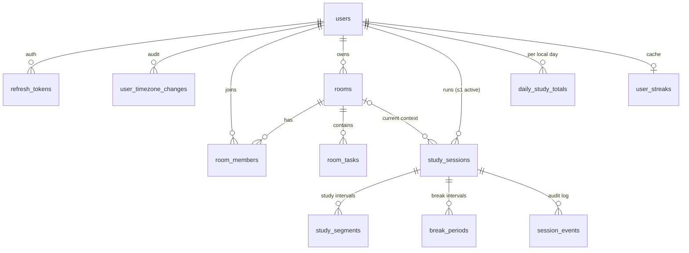

# StudySync — Database Design

> **Status: Draft v0.1 (planning phase).** PostgreSQL 16 + Prisma ORM. Based on the kickoff
> product rules. Items tagged **[Qn]** refer to open questions in
> [ARCHITECTURE.md §3](./ARCHITECTURE.md#3-assumptions--open-questions) and may change once
> the full specification arrives.

---

## Contents

1. [Design goals](#1-design-goals)
2. [Conventions](#2-conventions)
3. [Entity–relationship overview](#3-entityrelationship-overview)
4. [Prisma schema](#4-prisma-schema)
5. [Constraints Prisma cannot express (hand-written SQL)](#5-constraints-prisma-cannot-express-hand-written-sql)
6. [Key queries](#6-key-queries)
7. [Index rationale](#7-index-rationale)
8. [Invariants & audit queries](#8-invariants--audit-queries)
9. [Migrations workflow](#9-migrations-workflow)
10. [Seed data](#10-seed-data)
11. [Retention, deletion & backups](#11-retention-deletion--backups)
12. [Capacity estimates](#12-capacity-estimates)

---

## 1. Design goals

| Goal | How |
|---|---|
| Rules enforced by the DB, not just the app | Partial unique indexes (one active session, one open segment/break), `CHECK` constraints (break durations, state/column consistency), `EXCLUDE` constraints (no overlapping intervals). |
| Study time is auditable and exact | Every study interval is a row in `study_segments`, and every break a row in `break_periods`. Durations are integer milliseconds derived from UTC instants. |
| UTC everywhere (R12) | All instants are `timestamptz(3)`, and the connection forces `timezone=UTC`. Local calendar days are stored only as `date` in rollups. |
| Daily totals in the user's timezone (R13) | `daily_study_totals(user_id, local_date)` is filled by app-side splitting of segments at local midnights. Each segment carries a timezone snapshot. |
| Fast reads for realtime and charts | Denormalized current-state fields on `study_sessions`, a daily rollup table, and a cached streak table. |
| Safe concurrency | Row locks on the session row. Atomic upserts for rollups. A `version` column on mutable shared entities. |

---

## 2. Conventions

- **Naming:** tables and columns in `snake_case` (via `@@map` / `@map`). Prisma models in
  `PascalCase`, fields in `camelCase`.
- **Primary keys:** UUID v4 (`gen_random_uuid()` / Prisma `uuid()`). Room tasks also accept
  **client-generated** UUIDs, which makes creates idempotent. `session_events` uses `bigserial`
  (append-only, ordered).
- **Timestamps:** `timestamptz(3)` (millisecond precision). `created_at` / `updated_at` on
  mutable tables.
- **Durations:** `integer` milliseconds, suffix `_ms`.
- **Soft delete:** only where history matters (`rooms.archived_at`, `room_tasks.deleted_at`).
- **Enums:** PostgreSQL enums via Prisma.
- **Named constraints:** every hand-written constraint and index has an explicit name, so a
  test can assert it exists after migrations (§9).

---

## 3. Entity–relationship overview



| Table | Purpose | Mutability |
|---|---|---|
| `users` | Accounts, timezone, token version | Mutable |
| `refresh_tokens` | Hashed rotating refresh tokens with family tracking | Append + revoke |
| `user_timezone_changes` | Audit of timezone changes [Q13] | Append-only |
| `rooms` | Reusable rooms (no timer fields — R2) | Mutable, soft-archive |
| `room_members` | Durable membership + role | Mutable |
| `room_tasks` | Shared, ordered, versioned room tasks | Mutable, soft-delete |
| `study_sessions` | One user's timer run + current state + deadlines | Mutable (row-locked) |
| `study_segments` | Closed and open study intervals — **the only source of study time** | Insert + close once |
| `break_periods` | Break intervals (5/10/15/30) | Insert + close once |
| `session_events` | Append-only timer audit log + command idempotency | Append-only |
| `daily_study_totals` | Study/break ms per user per local date | Atomic increments |
| `user_streaks` | Cached current/longest streak (recomputable) | Recomputed |

---

## 4. Prisma schema

> Generator and datasource syntax will be adjusted to the Prisma major version chosen in
> Phase 1. With Prisma ≥ 7: the `prisma-client` generator with an explicit `output`, the
> connection URL in `prisma.config.ts`, and the `@prisma/adapter-pg` driver adapter.

```prisma
generator client {
  provider = "prisma-client-js"
}

datasource db {
  provider = "postgresql"
  url      = env("DATABASE_URL") // must include options=-c timezone=UTC
}

// ───────────────────────────── Enums ─────────────────────────────

enum RoomVisibility {
  PUBLIC
  PRIVATE
}

enum RoomRole {
  OWNER
  MODERATOR
  MEMBER
}

enum TaskStatus {
  TODO
  IN_PROGRESS
  DONE
}

enum SessionStatus {
  STUDYING
  PAUSED
  ON_BREAK
  AWAITING_RESUME
  ENDED
}

enum PauseReason {
  USER
  DISCONNECT_GRACE_EXPIRED
}

enum SessionEndReason {
  USER
  IDLE_TIMEOUT
  ACCOUNT_DELETED
}

enum SegmentEndReason {
  PAUSED
  BREAK_STARTED
  SESSION_ENDED
  GRACE_EXPIRED
  IDLE_TIMEOUT
  ROOM_CHANGED
}

enum BreakEndReason {
  ELAPSED
  RESUMED_EARLY
  SESSION_ENDED
}

enum SessionEventType {
  STARTED
  PAUSED
  RESUMED
  BREAK_STARTED
  BREAK_ELAPSED
  BREAK_ENDED_EARLY
  ROOM_CHANGED
  ENDED
  DISCONNECTED
  LEASE_LOST
  RECONNECTED
  GRACE_EXPIRED
  IDLE_TIMEOUT
}

enum EventActor {
  USER
  SYSTEM
}

// ───────────────────────────── Identity ─────────────────────────────

model User {
  id                String   @id @default(uuid()) @db.Uuid
  email             String   @unique @db.VarChar(254) // stored lower-cased (CHECK in §5)
  passwordHash      String   @map("password_hash") @db.VarChar(100)
  displayName       String   @map("display_name") @db.VarChar(50)
  timezone          String   @db.VarChar(64) // IANA, validated in app
  tokenVersion      Int      @default(0) @map("token_version")
  createdAt         DateTime @default(now()) @map("created_at") @db.Timestamptz(3)
  updatedAt         DateTime @updatedAt @map("updated_at") @db.Timestamptz(3)

  refreshTokens     RefreshToken[]
  timezoneChanges   UserTimezoneChange[]
  ownedRooms        Room[]             @relation("RoomOwner")
  memberships       RoomMember[]
  createdTasks      RoomTask[]         @relation("TaskCreatedBy")
  updatedTasks      RoomTask[]         @relation("TaskUpdatedBy")
  completedTasks    RoomTask[]         @relation("TaskCompletedBy")
  sessions          StudySession[]
  segments          StudySegment[]
  breaks            BreakPeriod[]
  sessionEvents     SessionEvent[]
  dailyTotals       DailyStudyTotal[]
  streak            UserStreak?

  @@map("users")
}

model RefreshToken {
  id           String    @id @default(uuid()) @db.Uuid
  userId       String    @map("user_id") @db.Uuid
  familyId     String    @map("family_id") @db.Uuid
  tokenHash    String    @unique @map("token_hash") @db.Char(64) // SHA-256 hex of the opaque token
  expiresAt    DateTime  @map("expires_at") @db.Timestamptz(3)
  revokedAt    DateTime? @map("revoked_at") @db.Timestamptz(3)
  replacedById String?   @map("replaced_by_id") @db.Uuid
  userAgent    String?   @map("user_agent") @db.VarChar(255)
  createdAt    DateTime  @default(now()) @map("created_at") @db.Timestamptz(3)

  user User @relation(fields: [userId], references: [id], onDelete: Cascade)

  @@index([userId])
  @@index([familyId])
  @@map("refresh_tokens")
}

model UserTimezoneChange {
  id           String   @id @default(uuid()) @db.Uuid
  userId       String   @map("user_id") @db.Uuid
  fromTimezone String   @map("from_timezone") @db.VarChar(64)
  toTimezone   String   @map("to_timezone") @db.VarChar(64)
  changedAt    DateTime @default(now()) @map("changed_at") @db.Timestamptz(3)

  user User @relation(fields: [userId], references: [id], onDelete: Cascade)

  @@index([userId, changedAt])
  @@map("user_timezone_changes")
}

// ───────────────────────────── Rooms ─────────────────────────────
// NOTE (R1/R2): rooms carry NO timer state. Never add timer columns here.

model Room {
  id          String         @id @default(uuid()) @db.Uuid
  name        String         @db.VarChar(80)
  description String?        @db.VarChar(500)
  visibility  RoomVisibility @default(PRIVATE)
  inviteCode  String         @unique @map("invite_code") @db.VarChar(16)
  ownerId     String         @map("owner_id") @db.Uuid
  maxMembers  Int            @default(50) @map("max_members")
  memberCount Int            @default(0) @map("member_count")
  createdAt   DateTime       @default(now()) @map("created_at") @db.Timestamptz(3)
  updatedAt   DateTime       @updatedAt @map("updated_at") @db.Timestamptz(3)
  archivedAt  DateTime?      @map("archived_at") @db.Timestamptz(3)

  owner    User           @relation("RoomOwner", fields: [ownerId], references: [id], onDelete: Restrict)
  members  RoomMember[]
  tasks    RoomTask[]
  sessions StudySession[]
  segments StudySegment[]

  @@index([visibility, archivedAt, createdAt])
  @@index([ownerId])
  @@map("rooms")
}

model RoomMember {
  roomId        String    @map("room_id") @db.Uuid
  userId        String    @map("user_id") @db.Uuid
  role          RoomRole  @default(MEMBER)
  joinedAt      DateTime  @default(now()) @map("joined_at") @db.Timestamptz(3)
  lastVisitedAt DateTime? @map("last_visited_at") @db.Timestamptz(3)

  room Room @relation(fields: [roomId], references: [id], onDelete: Cascade)
  user User @relation(fields: [userId], references: [id], onDelete: Cascade)

  @@id([roomId, userId])
  @@index([userId])
  @@map("room_members")
}

model RoomTask {
  id            String     @id @db.Uuid // client may supply (idempotent create)
  roomId        String     @map("room_id") @db.Uuid
  title         String     @db.VarChar(200)
  notes         String?    @db.VarChar(2000)
  status        TaskStatus @default(TODO)
  position      String     @db.VarChar(64) // fractional index key; column collation "C" (§5)
  version       Int        @default(1)
  createdById   String     @map("created_by_id") @db.Uuid
  updatedById   String     @map("updated_by_id") @db.Uuid
  completedById String?    @map("completed_by_id") @db.Uuid
  completedAt   DateTime?  @map("completed_at") @db.Timestamptz(3)
  createdAt     DateTime   @default(now()) @map("created_at") @db.Timestamptz(3)
  updatedAt     DateTime   @updatedAt @map("updated_at") @db.Timestamptz(3)
  deletedAt     DateTime?  @map("deleted_at") @db.Timestamptz(3)

  room        Room  @relation(fields: [roomId], references: [id], onDelete: Cascade)
  createdBy   User  @relation("TaskCreatedBy", fields: [createdById], references: [id], onDelete: Restrict)
  updatedBy   User  @relation("TaskUpdatedBy", fields: [updatedById], references: [id], onDelete: Restrict)
  completedBy User? @relation("TaskCompletedBy", fields: [completedById], references: [id], onDelete: SetNull)

  // ordered-list index is a partial index (§5)
  @@map("room_tasks")
}

// ───────────────────────────── Timer ─────────────────────────────

model StudySession {
  id                   String            @id @default(uuid()) @db.Uuid
  userId               String            @map("user_id") @db.Uuid
  roomId               String?           @map("room_id") @db.Uuid // null = solo [Q6]
  status               SessionStatus
  statusChangedAt      DateTime          @map("status_changed_at") @db.Timestamptz(3) // "since" shown to the user & room
  timezone             String            @db.VarChar(64) // user tz at session start (info)
  startedAt            DateTime          @map("started_at") @db.Timestamptz(3)
  endedAt              DateTime?         @map("ended_at") @db.Timestamptz(3)
  endReason            SessionEndReason? @map("end_reason")

  // STUDYING
  segmentStartedAt     DateTime?         @map("segment_started_at") @db.Timestamptz(3)
  studyMsClosed        Int               @default(0) @map("study_ms_closed")

  // PAUSED
  pausedAt             DateTime?         @map("paused_at") @db.Timestamptz(3)
  pauseReason          PauseReason?      @map("pause_reason")

  // ON_BREAK
  breakDurationMinutes Int?              @map("break_duration_minutes")
  breakStartedAt       DateTime?         @map("break_started_at") @db.Timestamptz(3)
  breakEndsAt          DateTime?         @map("break_ends_at") @db.Timestamptz(3)
  lastBreakEndedAt     DateTime?         @map("last_break_ended_at") @db.Timestamptz(3)
  breakMsClosed        Int               @default(0) @map("break_ms_closed")

  // Idle (R10)
  lastActivityAt       DateTime          @map("last_activity_at") @db.Timestamptz(3)
  idleDeadlineAt       DateTime?         @map("idle_deadline_at") @db.Timestamptz(3)

  // Connection / grace (R9)
  lastSeenAt           DateTime          @map("last_seen_at") @db.Timestamptz(3)
  disconnectedAt       DateTime?         @map("disconnected_at") @db.Timestamptz(3)
  graceExpiresAt       DateTime?         @map("grace_expires_at") @db.Timestamptz(3)

  // Scheduling & concurrency
  nextDeadlineAt       DateTime?         @map("next_deadline_at") @db.Timestamptz(3)
  version              Int               @default(1)
  createdAt            DateTime          @default(now()) @map("created_at") @db.Timestamptz(3)
  updatedAt            DateTime          @updatedAt @map("updated_at") @db.Timestamptz(3)

  user     User           @relation(fields: [userId], references: [id], onDelete: Cascade)
  room     Room?          @relation(fields: [roomId], references: [id], onDelete: SetNull)
  segments StudySegment[]
  breaks   BreakPeriod[]
  events   SessionEvent[]

  @@index([userId, startedAt(sort: Desc)])
  @@index([roomId])
  // partial indexes for one-active-session, sweeper and lease: see §5
  @@map("study_sessions")
}

model StudySegment {
  id         String            @id @default(uuid()) @db.Uuid
  sessionId  String            @map("session_id") @db.Uuid
  userId     String            @map("user_id") @db.Uuid
  roomId     String?           @map("room_id") @db.Uuid
  timezone   String            @db.VarChar(64) // snapshot for local-day attribution [Q13]
  startedAt  DateTime          @map("started_at") @db.Timestamptz(3)
  endedAt    DateTime?         @map("ended_at") @db.Timestamptz(3)
  durationMs Int?              @map("duration_ms")
  endReason  SegmentEndReason? @map("end_reason")
  createdAt  DateTime          @default(now()) @map("created_at") @db.Timestamptz(3)

  session StudySession @relation(fields: [sessionId], references: [id], onDelete: Cascade)
  user    User         @relation(fields: [userId], references: [id], onDelete: Cascade)
  room    Room?        @relation(fields: [roomId], references: [id], onDelete: SetNull)

  @@index([userId, startedAt])
  @@index([sessionId, startedAt])
  @@index([roomId, startedAt])
  @@map("study_segments")
}

model BreakPeriod {
  id              String          @id @default(uuid()) @db.Uuid
  sessionId       String          @map("session_id") @db.Uuid
  userId          String          @map("user_id") @db.Uuid
  timezone        String          @db.VarChar(64)
  durationMinutes Int             @map("duration_minutes") // CHECK IN (5,10,15,30)
  startedAt       DateTime        @map("started_at") @db.Timestamptz(3)
  scheduledEndAt  DateTime        @map("scheduled_end_at") @db.Timestamptz(3)
  endedAt         DateTime?       @map("ended_at") @db.Timestamptz(3)
  actualMs        Int?            @map("actual_ms")
  endReason       BreakEndReason? @map("end_reason")
  createdAt       DateTime        @default(now()) @map("created_at") @db.Timestamptz(3)

  session StudySession @relation(fields: [sessionId], references: [id], onDelete: Cascade)
  user    User         @relation(fields: [userId], references: [id], onDelete: Cascade)

  @@index([userId, startedAt])
  @@index([sessionId, startedAt])
  @@map("break_periods")
}

model SessionEvent {
  id         BigInt           @id @default(autoincrement())
  sessionId  String           @map("session_id") @db.Uuid
  userId     String           @map("user_id") @db.Uuid
  type       SessionEventType
  actor      EventActor
  fromStatus SessionStatus?   @map("from_status")
  toStatus   SessionStatus    @map("to_status")
  occurredAt DateTime         @map("occurred_at") @db.Timestamptz(3) // deadline instant for SYSTEM events
  recordedAt DateTime         @default(now()) @map("recorded_at") @db.Timestamptz(3)
  commandId  String?          @map("command_id") @db.Uuid // USER commands only
  payload    Json?

  session StudySession @relation(fields: [sessionId], references: [id], onDelete: Cascade)
  user    User         @relation(fields: [userId], references: [id], onDelete: Cascade)

  @@unique([userId, commandId]) // idempotency (NULLs are distinct)
  @@index([sessionId, id])
  @@index([recordedAt])
  @@map("session_events")
}

// ───────────────────────────── Accounting ─────────────────────────────

model DailyStudyTotal {
  userId      String    @map("user_id") @db.Uuid
  localDate   DateTime  @map("local_date") @db.Date // calendar date in segment's tz
  studyMs     Int       @default(0) @map("study_ms")
  breakMs     Int       @default(0) @map("break_ms")
  qualifiedAt DateTime? @map("qualified_at") @db.Timestamptz(3) // when study_ms first reached 1,500,000
  updatedAt   DateTime  @updatedAt @map("updated_at") @db.Timestamptz(3)

  user User @relation(fields: [userId], references: [id], onDelete: Cascade)

  @@id([userId, localDate])
  @@map("daily_study_totals")
}

model UserStreak {
  userId             String    @id @map("user_id") @db.Uuid
  currentStreak      Int       @default(0) @map("current_streak")     // as of last_qualified_date
  currentStreakStart DateTime? @map("current_streak_start") @db.Date
  lastQualifiedDate  DateTime? @map("last_qualified_date") @db.Date
  longestStreak      Int       @default(0) @map("longest_streak")
  updatedAt          DateTime  @updatedAt @map("updated_at") @db.Timestamptz(3)

  user User @relation(fields: [userId], references: [id], onDelete: Cascade)

  @@map("user_streaks")
}
```

**Prisma `@db.Date` caveat:** Prisma maps `date` to a JS `Date` at UTC midnight. The
repository layer converts it to and from `YYYY-MM-DD` strings immediately. A `Date` object
holding a local date never leaves the repository.

---

## 5. Constraints Prisma cannot express (hand-written SQL)

Added through `prisma migrate dev --create-only`, followed by appending the SQL to the
generated migration. Every object is explicitly named and checked by the schema-invariants
test (§9).

```sql
-- Extensions
CREATE EXTENSION IF NOT EXISTS btree_gist;   -- uuid equality inside GiST exclusion constraints

-- ─── users ───
ALTER TABLE users
  ADD CONSTRAINT users_email_lowercase CHECK (email = lower(email)),
  ADD CONSTRAINT users_display_name_not_blank CHECK (length(btrim(display_name)) > 0);

-- ─── rooms ───
ALTER TABLE rooms
  ADD CONSTRAINT rooms_name_not_blank       CHECK (length(btrim(name)) > 0),
  ADD CONSTRAINT rooms_max_members_range    CHECK (max_members BETWEEN 2 AND 200),
  ADD CONSTRAINT rooms_member_count_range   CHECK (member_count >= 0 AND member_count <= max_members);

-- At most one OWNER membership row per room (rooms.owner_id is canonical; kept in sync transactionally)
CREATE UNIQUE INDEX room_members_one_owner ON room_members (room_id) WHERE role = 'OWNER';

-- ─── room_tasks ───
ALTER TABLE room_tasks ALTER COLUMN position TYPE varchar(64) COLLATE "C"; -- byte order = fractional-index order
ALTER TABLE room_tasks
  ADD CONSTRAINT room_tasks_title_not_blank CHECK (length(btrim(title)) > 0),
  ADD CONSTRAINT room_tasks_done_consistent CHECK ((status = 'DONE') = (completed_at IS NOT NULL)),
  ADD CONSTRAINT room_tasks_version_positive CHECK (version >= 1);
CREATE UNIQUE INDEX room_tasks_room_position_live
  ON room_tasks (room_id, position) WHERE deleted_at IS NULL;

-- ─── study_sessions ───
-- R6: one active session per user
CREATE UNIQUE INDEX study_sessions_one_active_per_user
  ON study_sessions (user_id) WHERE status <> 'ENDED';

-- Sweeper: due deadlines
CREATE INDEX study_sessions_due
  ON study_sessions (next_deadline_at) WHERE status <> 'ENDED';

-- Liveness lease: candidates for LEASE_LOST
CREATE INDEX study_sessions_lease
  ON study_sessions (last_seen_at) WHERE status <> 'ENDED' AND disconnected_at IS NULL;

ALTER TABLE study_sessions
  ADD CONSTRAINT ss_ended_consistent CHECK (
    (status = 'ENDED') = (ended_at IS NOT NULL) AND (status = 'ENDED') = (end_reason IS NOT NULL)),
  ADD CONSTRAINT ss_studying_consistent CHECK (
    (status = 'STUDYING') = (segment_started_at IS NOT NULL)),
  ADD CONSTRAINT ss_paused_consistent CHECK (
    (status = 'PAUSED') = (paused_at IS NOT NULL) AND (status = 'PAUSED') = (pause_reason IS NOT NULL)),
  ADD CONSTRAINT ss_break_consistent CHECK (
    (status = 'ON_BREAK' AND break_duration_minutes IS NOT NULL AND break_started_at IS NOT NULL AND break_ends_at IS NOT NULL)
    OR (status <> 'ON_BREAK' AND break_duration_minutes IS NULL AND break_started_at IS NULL AND break_ends_at IS NULL)),
  ADD CONSTRAINT ss_break_duration_allowed CHECK (           -- R4
    break_duration_minutes IS NULL OR break_duration_minutes IN (5, 10, 15, 30)),
  ADD CONSTRAINT ss_break_end_exact CHECK (
    break_ends_at IS NULL OR break_ends_at = break_started_at + break_duration_minutes * interval '1 minute'),
  ADD CONSTRAINT ss_idle_deadline_consistent CHECK (         -- idle clock suspended on break
    (status IN ('ON_BREAK', 'ENDED')) = (idle_deadline_at IS NULL)),
  ADD CONSTRAINT ss_grace_consistent CHECK (                 -- R9: exactly 2 minutes
    (disconnected_at IS NULL AND grace_expires_at IS NULL)
    OR (disconnected_at IS NOT NULL AND grace_expires_at = disconnected_at + interval '2 minutes')),
  ADD CONSTRAINT ss_ms_non_negative CHECK (study_ms_closed >= 0 AND break_ms_closed >= 0),
  ADD CONSTRAINT ss_version_positive CHECK (version >= 1);

-- ─── study_segments ───
CREATE UNIQUE INDEX study_segments_one_open_per_session ON study_segments (session_id) WHERE ended_at IS NULL;
CREATE UNIQUE INDEX study_segments_one_open_per_user    ON study_segments (user_id)    WHERE ended_at IS NULL;

ALTER TABLE study_segments
  ADD CONSTRAINT seg_close_consistent CHECK (
    (ended_at IS NULL AND duration_ms IS NULL AND end_reason IS NULL)
    OR (ended_at IS NOT NULL AND duration_ms IS NOT NULL AND end_reason IS NOT NULL)),
  ADD CONSTRAINT seg_order CHECK (ended_at IS NULL OR ended_at >= started_at),
  ADD CONSTRAINT seg_duration_exact CHECK (
    ended_at IS NULL OR duration_ms = (EXTRACT(EPOCH FROM (ended_at - started_at)) * 1000)::int),
  -- No two study intervals of the same user may overlap (half-open ranges; open segment = unbounded)
  ADD CONSTRAINT seg_no_overlap_per_user EXCLUDE USING gist (
    user_id WITH =, tstzrange(started_at, ended_at, '[)') WITH &&);

-- ─── break_periods ───
CREATE UNIQUE INDEX break_periods_one_open_per_session ON break_periods (session_id) WHERE ended_at IS NULL;

ALTER TABLE break_periods
  ADD CONSTRAINT brk_duration_allowed CHECK (duration_minutes IN (5, 10, 15, 30)),        -- R4
  ADD CONSTRAINT brk_schedule_exact   CHECK (scheduled_end_at = started_at + duration_minutes * interval '1 minute'),
  ADD CONSTRAINT brk_close_consistent CHECK (
    (ended_at IS NULL AND actual_ms IS NULL AND end_reason IS NULL)
    OR (ended_at IS NOT NULL AND actual_ms IS NOT NULL AND end_reason IS NOT NULL)),
  ADD CONSTRAINT brk_within_schedule  CHECK (ended_at IS NULL OR (ended_at >= started_at AND ended_at <= scheduled_end_at)),
  ADD CONSTRAINT brk_actual_exact     CHECK (
    ended_at IS NULL OR actual_ms = (EXTRACT(EPOCH FROM (ended_at - started_at)) * 1000)::int),
  ADD CONSTRAINT brk_no_overlap_per_user EXCLUDE USING gist (
    user_id WITH =, tstzrange(started_at, ended_at, '[)') WITH &&);

-- ─── session_events ───
ALTER TABLE session_events
  ADD CONSTRAINT evt_command_only_for_user CHECK (command_id IS NULL OR actor = 'USER'),
  -- R5: only users can (re)enter STUDYING. SYSTEM events may keep a session in STUDYING
  -- (e.g. RECONNECTED, DISCONNECTED) but can never move it INTO STUDYING.
  ADD CONSTRAINT evt_no_system_resume CHECK (
    actor = 'USER'
    OR (type NOT IN ('STARTED', 'RESUMED')
        AND (to_status <> 'STUDYING' OR from_status = 'STUDYING')));

-- ─── daily_study_totals ───
ALTER TABLE daily_study_totals
  ADD CONSTRAINT dst_study_range CHECK (study_ms BETWEEN 0 AND 90000000),  -- ≤ 25 h (DST fall-back day)
  ADD CONSTRAINT dst_break_range CHECK (break_ms BETWEEN 0 AND 90000000);

-- ─── user_streaks ───
ALTER TABLE user_streaks
  ADD CONSTRAINT streak_non_negative CHECK (current_streak >= 0 AND longest_streak >= current_streak);
```

**Cross-table guarantee (R3: break never overlaps study).** PostgreSQL cannot express an
exclusion constraint across two tables. It is guaranteed by the state machine (the segment
closes at *t*, and the break opens at the same *t*), by property-based tests, and by audit query
§8-A run in the test suite and nightly. *Alternative considered:* a single `session_intervals`
table with a `kind` column and one exclusion constraint. It was rejected for clarity of the
break-specific columns, and can be revisited if the spec demands DB-level enforcement.

**Database-level settings** (run once per database by `scripts/dev-db.sh` and by the deployment
setup):

```sql
ALTER DATABASE studysync_dev SET timezone TO 'UTC';
```

---

## 6. Key queries

### 6.1 Credit study time to a local day (atomic, inside the transition transaction)

```sql
INSERT INTO daily_study_totals (user_id, local_date, study_ms, break_ms, updated_at)
VALUES ($1, $2::date, $3, 0, now())
ON CONFLICT (user_id, local_date)
DO UPDATE SET study_ms   = daily_study_totals.study_ms + EXCLUDED.study_ms,
              updated_at = now()
RETURNING study_ms;
-- app: previous = returned − $3; if previous < 1500000 ≤ returned → set qualified_at, recompute streak
```

The split into `(local_date, ms)` pieces happens in the app (`packages/shared/src/time/splitByLocalDay.ts`, Luxon).

### 6.2 Sweeper: due sessions (multi-instance safe)

```sql
-- 1) find candidates (no lock)
SELECT id FROM study_sessions
WHERE status <> 'ENDED' AND next_deadline_at <= $1
ORDER BY next_deadline_at
LIMIT 100;

-- 2) per candidate, in its own transaction
SELECT * FROM study_sessions WHERE id = $1 FOR UPDATE SKIP LOCKED;  -- none → another worker owns it
-- … reconcile(snapshot, now) and persist effects …
```

### 6.3 Streak recomputation (gaps-and-islands)

```sql
WITH qualified AS (
  SELECT local_date
  FROM daily_study_totals
  WHERE user_id = $1 AND study_ms >= $2            -- $2 = 1500000
),
islands AS (
  SELECT local_date,
         local_date - (ROW_NUMBER() OVER (ORDER BY local_date))::int AS grp
  FROM qualified
)
SELECT MIN(local_date) AS run_start, MAX(local_date) AS run_end, COUNT(*)::int AS run_length
FROM islands
GROUP BY grp
ORDER BY run_end DESC;
-- current streak = run_length of the first row if run_end >= yesterday (user's current tz), else 0
-- longest streak = max(run_length)
```

### 6.4 Daily chart data

```sql
SELECT local_date, study_ms, break_ms, (study_ms >= $4) AS qualified
FROM daily_study_totals
WHERE user_id = $1 AND local_date BETWEEN $2::date AND $3::date
ORDER BY local_date;
-- app fills missing dates with zeros so Recharts gets a continuous series
```

### 6.5 Session history (keyset pagination)

```sql
SELECT id, room_id, status, started_at, ended_at, end_reason, study_ms_closed, break_ms_closed
FROM study_sessions
WHERE user_id = $1
  AND (started_at, id) < ($2, $3)        -- cursor (omitted on first page)
ORDER BY started_at DESC, id DESC
LIMIT $4;
```

### 6.6 Room task list (ordered)

```sql
SELECT * FROM room_tasks
WHERE room_id = $1 AND deleted_at IS NULL
ORDER BY position;          -- "C" collation → byte order matches fractional-index keys
```

Reorders and appends take `pg_advisory_xact_lock(hashtextextended('room_tasks:' || $roomId, 0))`
so key generation between neighbors is serialized per room. The partial unique index
`room_tasks_room_position_live` is the safety net.

### 6.7 Liveness lease

```sql
-- every 30 s per instance: refresh proof-of-life for connected users
UPDATE study_sessions SET last_seen_at = $1
WHERE user_id = ANY($2::uuid[]) AND status <> 'ENDED';

-- sweeper: sessions whose holder vanished (→ LEASE_LOST{at: last_seen_at} through the state machine)
SELECT id FROM study_sessions
WHERE status <> 'ENDED' AND disconnected_at IS NULL AND last_seen_at < $1 - interval '90 seconds'
LIMIT 100;
```

### 6.8 Hourly heatmap / per-room breakdown

Raw segments for the requested range (≤ 366 days) are fetched with
`WHERE user_id = $1 AND started_at < $to AND (ended_at IS NULL OR ended_at > $from)`, then
split per local hour or grouped by `room_id` in the app with the same Luxon helpers
(consistent DST handling).

---

## 7. Index rationale

| Index | Serves |
|---|---|
| `users(email)` unique | Login lookup, uniqueness |
| `refresh_tokens(token_hash)` unique | Refresh lookup |
| `refresh_tokens(family_id)` | Family revocation on reuse |
| `rooms(invite_code)` unique | Join by code |
| `rooms(visibility, archived_at, created_at)` | Public room discovery |
| `room_members(user_id)` | "My rooms" |
| `room_tasks_room_position_live` (partial unique) | Ordered list read + no duplicate positions |
| `study_sessions_one_active_per_user` (partial unique) | **R6** + fast active-session lookup |
| `study_sessions_due` (partial) | Sweeper |
| `study_sessions_lease` (partial) | Lease-lost detection |
| `study_sessions(user_id, started_at DESC)` | History pagination |
| `study_segments(user_id, started_at)` | Heatmap / range scans |
| `study_segments(room_id, started_at)` | Per-room analytics |
| `seg_no_overlap_per_user` (GiST) | **R3** defense-in-depth; also serves range-overlap queries |
| `session_events(user_id, command_id)` unique | Idempotency |
| `session_events(session_id, id)` | Session timeline |
| `session_events(recorded_at)` | Retention purge |
| `daily_study_totals` PK `(user_id, local_date)` | Upsert target, chart ranges, streak |

---

## 8. Invariants & audit queries

Run in integration tests after every scenario, and nightly in production (log/alert on any row).

```sql
-- A. R3: no study segment overlaps a break of the same user
SELECT s.id AS segment_id, b.id AS break_id
FROM study_segments s
JOIN break_periods b ON b.user_id = s.user_id
 AND tstzrange(s.started_at, s.ended_at, '[)') && tstzrange(b.started_at, b.ended_at, '[)');

-- B. Session totals equal the sum of their closed segments / breaks
SELECT ss.id
FROM study_sessions ss
LEFT JOIN LATERAL (SELECT COALESCE(SUM(duration_ms), 0) AS ms FROM study_segments WHERE session_id = ss.id AND ended_at IS NOT NULL) seg ON true
LEFT JOIN LATERAL (SELECT COALESCE(SUM(actual_ms), 0)  AS ms FROM break_periods  WHERE session_id = ss.id AND ended_at IS NOT NULL) brk ON true
WHERE ss.study_ms_closed <> seg.ms OR ss.break_ms_closed <> brk.ms;

-- C. Daily totals equal the sum of closed segments per user (attribution conserves time)
SELECT u.id
FROM users u
LEFT JOIN LATERAL (SELECT COALESCE(SUM(study_ms), 0) AS ms FROM daily_study_totals WHERE user_id = u.id) d ON true
LEFT JOIN LATERAL (SELECT COALESCE(SUM(duration_ms), 0) AS ms FROM study_segments WHERE user_id = u.id AND ended_at IS NOT NULL) s ON true
WHERE d.ms <> s.ms;

-- D. STUDYING ⇔ exactly one open segment
SELECT ss.id FROM study_sessions ss
LEFT JOIN study_segments sg ON sg.session_id = ss.id AND sg.ended_at IS NULL
WHERE (ss.status = 'STUDYING') <> (sg.id IS NOT NULL)
   OR (ss.status = 'STUDYING' AND sg.started_at <> ss.segment_started_at);

-- E. ON_BREAK ⇔ exactly one open break
SELECT ss.id FROM study_sessions ss
LEFT JOIN break_periods b ON b.session_id = ss.id AND b.ended_at IS NULL
WHERE (ss.status = 'ON_BREAK') <> (b.id IS NOT NULL);

-- F. R5: every transition INTO STUDYING was user-initiated
SELECT id FROM session_events
WHERE to_status = 'STUDYING'
  AND from_status IS DISTINCT FROM 'STUDYING'
  AND actor <> 'USER';
```

---

## 9. Migrations workflow

1. Edit `schema.prisma`, then run `npx prisma migrate dev --create-only --name <change>`.
2. Review the generated SQL. **Remove any `DROP` of hand-written objects** (Prisma does not
   model partial indexes or exclusion constraints and may try to drop them). Append new
   hand-written SQL if needed.
3. Run `npx prisma migrate dev` to apply it, then commit `schema.prisma` and the migration together.
4. **Schema-invariants test** (`apps/server/test/integration/schema.test.ts`): after
   `migrate deploy` on a fresh DB, it asserts that every named object from §5 exists in
   `pg_indexes` / `pg_constraint`. CI fails if a migration silently removed one.
5. Production: `prisma migrate deploy` only. Migrations must be backward compatible for one
   release (expand → migrate → contract).

---

## 10. Seed data

`apps/server/prisma/seed.ts` (development only; refuses to run when `NODE_ENV=production`):

- Users `alice@example.com` (`America/New_York`), `bob@example.com` (`Asia/Kolkata`),
  `chen@example.com` (`Australia/Lord_Howe`, which has a 30-minute DST shift). Shared dev
  password is printed to the console.
- Rooms: one public ("Library — Silent Study") and one private with an invite code, both
  with tasks in several statuses.
- 60 days of historical sessions and segments generated **through the real accounting
  service** (not raw inserts), including segments crossing local midnight and the
  2026-03-08 and 2026-11-01 US DST transitions, so charts and streaks render realistic data.

---

## 11. Retention, deletion & backups

| Data | Policy |
|---|---|
| `session_events` | Retain 180 days [Q18]. A daily purge job deletes by `recorded_at` in batches. |
| `refresh_tokens` | Purge rows expired or revoked for more than 30 days. |
| `room_tasks` soft-deleted | Purge after 30 days. |
| Account deletion | One transaction: end the active session (`ACCOUNT_DELETED`); transfer each owned room to the longest-tenured moderator or member, otherwise archive it; delete the user (cascades personal rows). Task authorship on shared tasks is reassigned to a "Deleted user" tombstone [Q18]. |
| Backups | Managed-Postgres daily snapshots + point-in-time recovery (deployment phase, Q17). |

---

## 12. Capacity estimates

Assuming 10,000 daily-active users × 3 sessions/day × ~4 segments/session:

| Table | Rows / day | Notes |
|---|---|---|
| `study_segments` | ~120 k | ~45 M/year, which is fine with the indexes above. Partition by year if needed. |
| `break_periods` | ~60 k | |
| `session_events` | ~400 k | Bounded by 180-day retention (~72 M rows). |
| `daily_study_totals` | ~10 k | Tiny. Serves all charts. |
| Lease updates | 1 batched `UPDATE` / 30 s / instance | Independent of user count in query count. |
