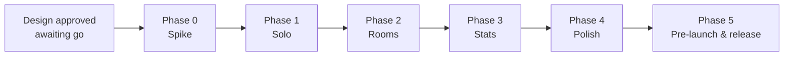

# StudySync — Development Roadmap (step-by-step build process)

> **Status: v1.1 — architecture APPROVED with clarifications (ARCHITECTURE §5). Waiting for
> your explicit go to begin Phase 0.** Follows the spec's build order (Spike → Solo → Rooms →
> Stats → Polish), plus a pre-launch phase. No phase starts without your explicit approval.
> Every phase ends with a demo and an approval gate.

---

## Contents

1. [How we work](#1-how-we-work)
2. [Phase overview](#2-phase-overview)
3. [Phase 0 — Spike](#3-phase-0--spike-12-days-first)
4. [Phase 1 — Solo](#4-phase-1--solo)
5. [Phase 2 — Rooms](#5-phase-2--rooms)
6. [Phase 3 — Stats](#6-phase-3--stats)
7. [Phase 4 — Polish](#7-phase-4--polish)
8. [Phase 5 — Pre-launch and release readiness](#8-phase-5--pre-launch-and-release-readiness)
9. [How you will see progress](#9-how-you-will-see-progress)
10. [Roadmap risks](#10-roadmap-risks)
11. [Scope boundaries](#11-scope-boundaries)

---

## 1. How we work

- **Everything happens in the cloud environment.** You install nothing. Code is committed and
  pushed at least once per phase step, because the container is ephemeral.
- **Vertical slices.** Each phase ships backend, frontend and tests together.
- **Tests ship with code.** Each step lists its tests (IDs from TESTING_STRATEGY.md). A step
  is done only when they pass locally and in CI.
- **Docs stay true.** Any design change updates ARCHITECTURE / DATABASE_DESIGN / API_DESIGN in
  the same commit.
- **Approval gates.** At each phase end you get a summary, test results and screenshots or
  recordings. Work continues only after your OK.

---

## 2. Phase overview

| Phase | Outcome | Spec features (ARCHITECTURE §2) | Rules proven |
|---|---|---|---|
| 0 Spike | Two browsers, one room, live statuses, refresh-safe timer | F-01–F-06, F-24, F-30–F-32, F-42, F-45, F-46 | R1–R5, R6 (solo), R12, R14 |
| 1 Solo | Auth, personal tasks, full solo timer, summary, daily totals, history | F-10, F-25, F-27–F-29, F-33–F-35, F-38, F-39, F-41 (list) | R6, R13 |
| 2 Rooms | Create/join, mid-study move, statuses, room tasks, auto-save, Today in this room | F-07–F-09, F-11–F-23, F-26, F-40, F-43, F-44 | R7–R10, R15–R18 |
| 3 Stats | Streak, weekly/monthly views | F-36, F-37, F-41 (charts) | R11 |
| 4 Polish | Heatmap, room history, break-end notification + sound, saved-session toast | F-41 (heatmap), F-48 | — |
| 5 Pre-launch & release | Password reset and account deletion (D-4), security review, performance, deployment | — | All, end-to-end |

---

## 3. Phase 0 — Spike (1–2 days, first)

**Goal (spec):** two browsers, one hardcoded room, live status updates and a refresh-safe
timer. This is the riskiest part; everything after it is plumbing. The spike is built **on
the real project skeleton**, so the timer core, schema and socket layer are kept. Only the
hardcoded room and the dev-only identity are thrown away.

### Steps

| # | Step | Details |
|---|---|---|
| 0.1 | Scaffold the monorepo | npm workspaces: `apps/web`, `apps/server`, `packages/shared`, `e2e`. Strict `tsconfig.base.json`, ESLint + Prettier, `.nvmrc` (22), `.env.example`, root scripts (`dev`, `build`, `lint`, `typecheck`, `test`, `test:e2e`, `db:migrate`, `db:reset`, `db:seed`). |
| 0.2 | Database up in the cloud container | `scripts/dev-db.sh`: start the PostgreSQL 16 cluster, create `studysync_dev` / `studysync_test`, `ALTER DATABASE … SET timezone TO 'UTC'`. |
| 0.3 | Full schema + constraints | Prisma schema from DATABASE_DESIGN §4. The first migration includes all hand-written SQL from §5. Write the `INT-SCHEMA` test (every named constraint exists and rejects its violation). |
| 0.4 | Shared timer core | `constants.ts`, Zod primitives (UUID, UTC instant, local date, IANA timezone, break minutes), pure `phaseOf()`, `decide()` (start, take_break, resume, end), `dueAutoSave()`. The exhaustive transition-table test for these commands. |
| 0.5 | Server skeleton | Express 5 app factory, Zod env, pino, error handler, `GET /health`. Injected `Clock`. |
| 0.6 | Socket layer | Socket.IO on the same port. JWT handshake. **Spike-only** `POST /__dev__/identity {name}` issuing a dev JWT (enabled only with `SPIKE_MODE=true` outside production; deleted in Phase 1). Per-user command queue. `session_state` on connect. |
| 0.7 | Spike room + presence | Seed one hardcoded room. `join_room` / `leave_room`. Presence store. `member_joined` / `member_left` / `status_changed`. |
| 0.8 | Timer commands | `start_study`, `take_break`, `resume_study`, `end_study` through the session service: advisory lock, row lock, `commandId` idempotency, segments and breaks, version. Scheduled `BREAK_OVER` push at `break_ends_at`. |
| 0.9 | Spike UI | One page: pick a name → room screen with **Members** (🟢/🟡 countdown/⚪/⚫) and **Your timer** (Start, Take Break 5/10/15/30, Resume enabled only after the countdown, End). Server-clock offset. Timer reconstructed from `session_state` on load. |
| 0.10 | Two-browser E2E | Playwright with two contexts: live status propagation, refresh while studying keeps the elapsed time, break → Break Over → no auto resume → Resume. |
| 0.11 | CI | GitHub Actions: lint, typecheck, unit, integration (postgres:16 service), the spike E2E. |

**Tests:** INT-SCHEMA, machine table (spike subset), P1–P5, INT-SESS (spike subset), RT-1,
RT-3 (basic), E2E-0.

**Acceptance:** with two browsers in the spike room, each starts, breaks and resumes
independently. The other browser sees the status (and break countdown) within 1 s. A
refresh while studying shows the same elapsed time (±1 s). Resume is impossible before the
countdown ends, and nothing resumes automatically. CI is green.

**Demo:** a side-by-side recording of two browsers, plus test report. **Go/no-go gate.**

---

## 4. Phase 1 — Solo

**Goal (spec):** auth, personal tasks, study timer with segments, breaks + Break Over +
Resume, end summary, daily totals, history.

### Steps

| # | Step | Details |
|---|---|---|
| 1.1 | Real authentication | Register (name, email, password, auto-detected timezone), login, refresh rotation with reuse detection, logout. Rate limits, CSRF header, auth middleware, socket handshake on real tokens, `auth_renew`. **Delete the spike identity endpoint.** |
| 1.2 | Profile | `GET/PATCH /users/me` (name, timezone with IANA validation). Settings page. |
| 1.3 | App shell | Router, auth gate, silent refresh on load, single-flight refresh on 401, socket lifecycle + `cacheBridge` with version guards. |
| 1.4 | Personal tasks | `GET /tasks`. Socket `task_add` (client UUID, idempotent), `task_toggle` (set semantics), `task_update` (version), `task_delete` (soft). `personal_task_updated` to all my devices. Dashboard task list with title, description, due date and status. |
| 1.5 | Full solo timer | Dashboard timer: all transitions for solo sessions (rows 1–6 and 12–20 of the transition table), `set_session_task`, `STALE_SESSION` protection, every rejection carrying `details.session`. The break picker shows exactly 5/10/15/30. The break screen shows the D-5 hint. |
| 1.6 | Session summary | Summary query (DATABASE_DESIGN §6.4) + `GET /sessions/:id/summary`. Summary screen after End Study: studied, breaks, where, task, completed during session. |
| 1.7 | Daily totals | Midnight-split query (§6.1), grouping each segment by **its own timezone snapshot** (D-6). `GET /stats/today` (Solo / Rooms / Total, including the running segment). `GET /stats/daily`. TODAY card on the dashboard. |
| 1.8 | History | `GET /sessions` (keyset). History page: per-day totals + session list → summary. |
| 1.9 | Concurrency hardening | Per-user advisory lock everywhere. Parallel-start and parallel-command tests. |

**Tests:** INT-AUTH, INT-USERS, INT-TASKS (personal), INT-SESS (solo), INT-ACC (DST matrix + timezone-snapshot history, P11),
INT-STATS (today/daily), CT-1–CT-3, CT-5, CT-7, CT-8, CT-9, RT-1, RT-5, RT-9, SEC-1 (solo
part), SEC-2–SEC-7, frontend timer and task tests, E2E-1, E2E-2, E2E-3, E2E-6, E2E-11.

**Acceptance:** a user can register, keep personal tasks, run solo sessions with legal breaks
only, never resume early or automatically, see an exact summary, and see today's Solo total.
A session from 23:00 to 01:00 local splits across two days. Two tabs can't create two sessions.

> **Note:** per the spec's build order, auto-save (disconnect / idle) arrives in Phase 2. It
> also covers solo sessions. Until then, an abandoned solo session stays active. This only
> affects development builds; nothing is released before Phase 2.

---

## 5. Phase 2 — Rooms

**Goal (spec):** create/join, mid-study room creation, statuses, room tasks, disconnect/idle
auto-save, Today in this room.

### Steps

| # | Step | Details |
|---|---|---|
| 2.1 | Room creation and codes | `POST /rooms` with code generation (32-char alphabet, 6 chars, `crypto.randomInt`, retry on unique violation). Create Room dialog with copy-code and share-link buttons. |
| 2.2 | Join and My Rooms | `POST /rooms/join {code}` (rate-limited, uniform `INVALID_CODE`, `ROOM_FULL` at 50 (D-3), membership idempotent and permanent (D-2)). `/join/:code` link route. `GET /rooms` My Rooms list with one-click rejoin. |
| 2.3 | Room screen | Replace the spike page: header (name, code), **all members** with 🟢/🟡/⚪/⚫, room tasks, your timer, Today in this room. `GET /rooms/:id/members`. The `join_room` ack carries all snapshots. One room presence per user. Display grace ("reconnecting" → Offline after 2 min). |
| 2.4 | Session ↔ room rules | Start in a room (`MUST_START_IN_CURRENT_ROOM`). **Study with friends** button on the solo timer → create room → `join_room` moves the session (segment split). Joining while solo-studying moves the session. `SESSION_IN_OTHER_ROOM` for a second room (no side effects). `NOT_IN_SESSION_ROOM` for resume. |
| 2.5 | Room tasks | `GET /rooms/:id/tasks`. Socket task events for room tasks with membership checks. Delete restricted to task creator or room creator. `room_task_updated` broadcast after commit. |
| 2.6 | Liveness (solo vs room) | `PresenceService.isLive()` with the **two definitions** in ARCHITECTURE §11.3: a solo session is live with any socket on any page; a room session only while present in its room. Re-evaluated on every connect, disconnect, join, leave, start and move. `DISCONNECTED` / `RECONNECTED` transitions. Presence-gated `start_study` / `resume_study` for room sessions. "Back to room — saves in 1:42" banner (room sessions only). |
| 2.7 | Auto-save engine | Grace deadline (2 min) and idle deadline (`break_ends_at + 30 min`) applied by reconcile, stamped at the deadline. Sweeper every 5 s with `pg_try_advisory_xact_lock` + `SKIP LOCKED`. Liveness lease (30 s refresh, 90 s stale). Boot-time rescheduling of break-end pushes. `lastAutoSaved` in `session_state` + `POST /sessions/:id/summary-seen`. A basic "session saved" notice (polished toast in Phase 4). |
| 2.8 | Restart recovery | Integration tests that start a second app instance on the same DB mid-session (crash simulation), with and without a timely reconnect. |
| 2.9 | Today in this room | Query §6.3 + `GET /rooms/:id/today`. The panel ticks live from `studyingSince`, refetches every 60 s and on `status_changed`. |

**Tests:** INT-ROOMS, INT-TASKS (room), INT-SESS (room rules), INT-RESILIENCE, CT-4, CT-6,
CT-10–CT-12, RT-2, RT-3, RT-4a, RT-4b, RT-5–RT-8, RT-10–RT-12, SEC-1 (full matrix), SEC-8, SEC-11, E2E-4, E2E-5,
E2E-7–E2E-10, E2E-12, E2E-13, E2E-18.

**Acceptance:** two or more users in a reusable room see each other's live statuses and
countdowns. Each runs an independent timer. Room tasks sync within 1 s. A solo session moves
into a room without resetting. Network blips under 2 min change nothing. Longer drops
auto-save at the disconnect instant. 30 min in Break Over auto-saves. All of this survives a
server restart. Membership, presence and sessions behave as separate concepts. Membership
persists (D-2), rooms never exceed 50 members (D-3), and solo and room liveness behave exactly
as documented in ARCHITECTURE §11.3 (D-7).

---

## 6. Phase 3 — Stats

**Goal (spec):** streak and weekly/monthly views.

| # | Step | Details |
|---|---|---|
| 3.1 | Streak | Query §6.2 (gaps-and-islands over computed daily totals, never stored). `GET /stats/streak` with `atRisk`. Dashboard streak card (current, longest, today's progress toward 25:00). |
| 3.2 | Periods | `GET /stats/periods?granularity=week\|month`. Recharts bar charts (Solo vs Rooms stacked), period navigation, timezone label. |
| 3.3 | History charts | Daily bar chart for 7/30/90 days on the History page. |

**Tests:** INT-STATS (streak, periods), streak edge cases (today/yesterday boundary, late
segment crossing midnight, timezone change, DST days), E2E-14, E2E-15.

**Acceptance:** a day counts only with ≥ 25 min of recorded study (presence and breaks don't
count). The streak equals a hand-computed value on the seed data. The charts match `/stats/daily`.

---

## 7. Phase 4 — Polish

**Goal (spec):** heatmap, room history page, browser notification + sound when a break ends,
saved-session toast after a disconnect.

| # | Step | Details |
|---|---|---|
| 4.1 | Heatmap | `GET /stats/heatmap` (§6.11) + weekday × hour heatmap |
| 4.2 | Room history page | `GET /rooms/:id/history` + per-day, per-member view |
| 4.3 | Break-end notification | Permission-gated browser notification + sound "Break over — tap to resume", scheduled from `breakEndsAt` and confirmed by `session_state`. **Tapping opens the app; it never resumes automatically.** |
| 4.4 | Saved-session toast | Toast from `lastAutoSaved` ("Session saved after disconnect: 1h 12m") → summary → `summary-seen`. |
| 4.5 | UX pass | Accessibility (keyboard, `aria-live` for status changes, not color-only), responsive down to 360 px, empty and error states. |

**Tests:** E2E-16, E2E-17, component tests for notification scheduling and toast, accessibility checks.

---

## 8. Phase 5 — Pre-launch and release readiness

*Added to the spec's order. Besides release hardening, it contains the two account features
deferred to pre-launch by decision D-4.*

| # | Step | Details |
|---|---|---|
| 5.1 | Password reset (D-4) | Choose an email provider. `password_reset_tokens` (hashed, single-use, short TTL). Request + confirm endpoints with uniform responses (no account enumeration). On success, revoke all refresh-token families. Rate limits. |
| 5.2 | Account deletion (D-4) | End the active session (auto-save). Anonymize the user record rather than hard-delete, so permanent rooms and room-task authorship stay intact (DATABASE_DESIGN §13). Confirmation flow with password re-entry. |
| 5.3 | Security review | Full authorization matrix, CSP tuning, rate-limit tuning, `npm audit`, secret scan, log-redaction test, review of the whole diff. |
| 5.4 | Performance | PERF-1–PERF-4 (TESTING §5.10). `EXPLAIN ANALYZE` on the split queries with a year of seed data. |
| 5.5 | Operations | Retention jobs, nightly invariant audit, metrics, graceful shutdown (flush lease, close sockets). |
| 5.6 | Deployment | Hosting target (decision needed). Managed PostgreSQL with `timezone=UTC`, `prisma migrate deploy`, HTTPS, same-origin web + API, sticky sessions if more than one instance. |
| 5.7 | Runbook + README | How to operate, restore and debug ("my time is wrong" → `session_events`). |

**Acceptance:** password reset and account deletion pass their integration, security and E2E
tests. All CI gates are green, the full E2E suite is green, performance targets are met, the
manual checklist is complete, and you approve the release.

---

## 9. How you will see progress

1. **Test reports** from the cloud container and GitHub Actions for every step.
2. **Screenshots and recordings** made with Playwright in the cloud, including two-browser
   room scenarios side by side.
3. **A live preview URL** once you choose a hosting target. Deploying is outward-facing, so it
   needs your accounts and approval. **Recommendation:** decide during Phase 1, so you can
   click through Rooms in Phase 2.

---

## 10. Roadmap risks

| Risk | Mitigation |
|---|---|
| Spike reveals Socket.IO or timing issues | That is the spike's purpose. Fix them before any feature work. |
| Prisma drops hand-written constraints | Review every migration. `INT-SCHEMA` fails CI if an object disappears. |
| Timezone / DST bugs | SQL split validated up front. DST matrix in tests. SQL ↔ Luxon cross-check. |
| No auto-save between Phase 1 and Phase 2 | Dev-only builds. The engine lands in Phase 2 (it covers solo sessions too). |
| Empty-chair time accrues while studying (accepted MVP limitation, D-1) | Documented. Measurable from segment lengths after launch. |
| Pre-launch account features need an email provider (D-4) | Choose the provider at the start of Phase 5. |
| Ephemeral container | Push after every step. DB rebuilt by `db:reset` + seed. |

---

## 11. Scope boundaries

| Category | Items |
|---|---|
| **Not building (spec)** | Video, voice, chat, file or screen sharing, AI, notes, music, calendar, friends, public communities, leaderboards |
| **Not in the MVP (decided)** | "Still studying?" empty-chair prompt (D-1). Leaving room membership, room rename, room deletion (D-2). Password change. |
| **Future enhancements (post-MVP, not scheduled)** | Member removal, room-code regeneration (D-2; design notes in ARCHITECTURE §5.2) |
| **Pre-launch only (Phase 5)** | Password reset, account deletion (D-4) |
