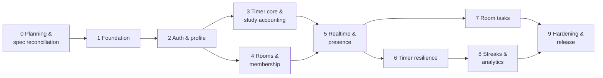

# StudySync — Development Roadmap

> **Status: Draft v0.1 (planning phase).** We are in **Phase 0**. No phase starts without the
> product owner's explicit approval, and every phase ends with a demo and an approval gate.

---

## Contents

1. [Delivery approach](#1-delivery-approach)
2. [Phase overview](#2-phase-overview)
3. [Phase details](#3-phase-details)
4. [Milestones](#4-milestones)
5. [How you will see progress (cloud-only workflow)](#5-how-you-will-see-progress-cloud-only-workflow)
6. [Roadmap risks](#6-roadmap-risks)
7. [Out of scope for v1 (unless the spec says otherwise)](#7-out-of-scope-for-v1-unless-the-spec-says-otherwise)

---

## 1. Delivery approach

- **Vertical slices.** Each phase delivers backend, frontend and tests for one capability, so
  every phase ends with something demonstrable.
- **Risk first.** The timer, which is the heart of the product and the source of most of the
  rules, is built and proven early (Phase 3). Realtime resilience follows as soon as sockets
  exist (Phase 6).
- **Tests ship with code.** Every phase's exit criteria include the tests listed in
  [TESTING_STRATEGY.md](./TESTING_STRATEGY.md). A phase is not done with failing, skipped or
  missing tests.
- **Approval gates.** At the end of each phase: a summary of what was built, test results,
  screenshots or recordings, and any spec questions that surfaced. Work continues only after
  approval.
- **Docs stay current.** Any design change updates ARCHITECTURE / API_DESIGN /
  DATABASE_DESIGN in the same commit.
- **Git.** Work happens on the designated feature branch with small, descriptive commits that
  are pushed at least at every phase end. The container is ephemeral, so unpushed work is lost.

---

## 2. Phase overview

| Phase | Name | Rules delivered | Relative size |
|---|---|---|---|
| 0 | Planning & spec reconciliation | All (designed) | S |
| 1 | Foundation | R12 (infrastructure) | M |
| 2 | Auth & profile | R13 (user timezone) | M |
| 3 | Timer core & study accounting | R1, R2, R3, R4, R5, R6, R12, R13 | L |
| 4 | Rooms & membership | R7 | M |
| 5 | Realtime foundation & presence | R1, R2 (room view) | M |
| 6 | Timer resilience | R5, R9, R10 | L |
| 7 | Room tasks (real-time) | R8 | M |
| 8 | Streaks & analytics | R11, R13 | M |
| 9 | Hardening & release readiness | All (verified end-to-end) | L |

---

## 3. Phase details

### Phase 0 — Planning & spec reconciliation *(current)*

**Goal:** a complete, approved design that faithfully covers the full specification.

- [x] Architecture, database, API, socket events, timer state machine, risk registers,
      folder structure, roadmap, testing strategy (this document set).
- [ ] Receive the complete StudySync specification.
- [ ] Reconcile the docs with the spec: resolve open questions Q1–Q20 (ARCHITECTURE §3), add
      any missing features, and keep a traceability row for every spec requirement.
- [ ] Approve the supporting libraries (Q19) and decide the deployment target (Q17).

**Exit gate:** written approval of the reconciled design.

---

### Phase 1 — Foundation

**Goal:** a runnable, tested, CI-checked skeleton. No product features yet.

| Area | Work |
|---|---|
| Repo | npm workspaces (`apps/web`, `apps/server`, `packages/shared`, `e2e`), strict `tsconfig.base.json`, ESLint + Prettier, `.editorconfig`, `.nvmrc` (22), `.env.example`, `.gitignore`. |
| Cloud dev | `scripts/dev-db.sh`: start the local PostgreSQL 16 cluster, set `timezone=UTC`, create `studysync_dev` / `studysync_test`. Root scripts: `dev`, `build`, `test`, `test:integration`, `test:e2e`, `lint`, `typecheck`, `db:migrate`, `db:reset`, `db:seed`. Optional SessionStart hook (on request). |
| Server | Express 5 app factory, Zod-validated env, pino logging with redaction, request id, error handler + `AppError` catalogue, helmet, CORS, `GET /health` and `/health/ready`, injected `Clock`, composition root. |
| Database | Prisma setup. **Complete schema from DATABASE_DESIGN.md**, including hand-written SQL (partial indexes, CHECK and EXCLUDE constraints). `INT-SCHEMA` test. |
| Shared | `constants.ts` (break durations, grace, idle, streak threshold), common Zod primitives (UUID, UTC instant, local date, IANA timezone), timer type definitions. |
| Web | Vite + React + TS + Tailwind 4 shell, router, layout, API client skeleton, dev proxy for `/api` and `/socket.io`. |
| Testing | Vitest in all workspaces, per-worker test databases, `FakeClock`, factory scaffolding, Playwright config using the pre-installed Chromium. |
| CI | GitHub Actions: lint, typecheck, unit, integration (postgres:16 service), e2e smoke. |

**Acceptance criteria**
- `npm run dev` serves the web shell and API in the cloud container. `/api/v1/health` returns `ok`.
- `npm test` runs green across the workspaces. CI is green on push.
- `INT-SCHEMA` proves every constraint exists, and a direct insert of a 20-minute break or a
  second active session is rejected by the database.

---

### Phase 2 — Auth & profile

| Area | Work |
|---|---|
| Server | Register, login, refresh (rotation + family reuse detection), logout, logout-all, `GET/PATCH /users/me` (timezone validation + audit), password change, account deletion (skeleton; room transfer completed in Phase 4). Auth middleware, CSRF header check, auth rate limits. |
| Web | Register (timezone auto-detected and editable), login, silent refresh on load, single-flight refresh on 401, auth gate, settings page (display name, timezone, password), logout. |
| Tests | `INT-AUTH`, `INT-USERS`, SEC-3/4/5/6/9, auth client unit tests, E2E-1. |

**Acceptance criteria:** a user can register, log in, reload without logging in again, change
their timezone and log out everywhere. Token reuse revokes the family.

---

### Phase 3 — Timer core & study accounting (solo mode)

The highest-risk phase. It delivers the full pure state machine and all solo-timer behavior.

| Area | Work |
|---|---|
| Shared | Pure `transition()` covering **every** state × event (including system events used later), `nextDeadline()`, `reconcile()`, display helpers, `splitByLocalDay()`. |
| Server | Session command executor (row lock, `commandId` idempotency, reconcile-then-apply, effect persistence, version). Endpoints: `GET /sessions/active`, `POST /sessions`, pause, resume, breaks, end, activity (REST), history, detail. Daily-total attribution by local day. In-process deadline scheduler + DB sweeper (break elapsed, idle timeout). |
| Web | Dashboard with the **personal timer panel**: Start, Pause, Resume, End, and a break picker with **exactly** 5/10/15/30. Break countdown. "Break over — Resume when ready" state with no auto resume. Today's study progress toward 25 min. Session history list. Server-clock offset estimation. Until Phase 5, the client polls `GET /sessions/active` at the known break end. |
| Tests | Exhaustive transition table, properties P1–P9, §6 DST matrix, `INT-SESS`, `INT-ACC` (daily totals), CT-1 to CT-5, CT-8, CT-9, timer component tests, E2E-3, E2E-4, E2E-8, E2E-10. |

**Acceptance criteria:** R3, R4, R5 and R6 are demonstrably enforced at UI, API and DB level.
Study time is exact to the millisecond. A segment crossing local midnight is split correctly
in the user's timezone. A server restart during a break yields `AWAITING_RESUME` stamped at
the break's end.

---

### Phase 4 — Rooms & membership

| Area | Work |
|---|---|
| Server | Room CRUD, discover, invite codes (generate/rotate), join by code or public, capacity (conditional update), leave, roles, ownership transfer, kick, archive and restore. Account-deletion room transfer. Authorization guards. |
| Web | My rooms, discover, create room, join by code, room settings (owner/mod), members list, a room page shell. |
| Tests | `INT-ROOMS`, CT-12, SEC-1 (rooms part), SEC-2, E2E-11 (persistence part). |

**Acceptance criteria:** rooms are reusable. They persist when empty, membership persists,
and they can be re-entered any number of times. The authorization matrix passes.

---

### Phase 5 — Realtime foundation & presence

| Area | Work |
|---|---|
| Server | Socket.IO server sharing the HTTP port. JWT handshake, `auth:renew`, per-user socket cap, `user:{id}` channel. `session:state` push after commit (replacing Phase 3 polling). `clock:sync`, `session:sync`. `room:join` / `room:leave` with membership check, one room at a time. Presence store. `room:member_*` events. `PUT /sessions/:id/room` (segment split). Channel removal on kick and archive. Socket Zod validation and rate limits. |
| Web | Socket client lifecycle with resync on reconnect, cache bridge with version guards, connection indicator. Room page: **my own timer panel** + live member list showing each member's own status and elapsed time. |
| Tests | RT-1, RT-2, RT-3, RT-5, RT-6, RT-7, RT-9, RT-11, RT-12, E2E-2, E2E-12. |

**Acceptance criteria:** two users in one room see each other's statuses live, each with an
**independent timer**. No UI element or event represents a shared timer. All of a user's
devices stay in sync.

---

### Phase 6 — Timer resilience

| Area | Work |
|---|---|
| Server | Disconnect detection (live-socket counting), `DISCONNECTED` / `RECONNECTED`, 2-minute grace with retroactive pause, liveness lease (refresh + `LEASE_LOST`), `activity:ping`, idle warning push at 25 min, idle timeout at 30 min, restart recovery, presence `reconnecting` → removed. |
| Web | Activity tracker (throttled pings), "Still studying?" modal, reconnecting banner, clear messaging for `PAUSED` after a disconnect ("Your timer was paused at 14:20 because you were offline. Resume?"). |
| Tests | `INT-RESILIENCE`, CT-6, CT-7, RT-4, RT-8, E2E-6, E2E-7, manual checklist items 1–5. |

**Acceptance criteria:** a network blip under 2 minutes is invisible. A longer outage pauses
retroactively and never resumes on its own. Idle sessions end at 30 minutes, with a warning at
25. Killing the server mid-session never credits unverified time and never resumes a timer.

---

### Phase 7 — Room tasks (real-time)

| Area | Work |
|---|---|
| Server | Task CRUD with client ids, versions, status set-semantics, fractional ordering under a per-room advisory lock, soft delete, 500-task limit, `task:*` broadcasts after commit. |
| Web | Task panel in the room: add, inline edit, status toggle, drag-and-drop reorder (keyboard accessible), delete, optimistic updates with reconciliation, conflict UI. |
| Tests | `INT-TASKS`, CT-10, CT-11, RT-10, cache bridge tests, SEC-8, E2E-5. |

**Acceptance criteria:** every task change appears for all present members within 1 s.
Concurrent edits never silently lose data. The order is identical for all members.

---

### Phase 8 — Streaks & analytics

| Area | Work |
|---|---|
| Server | Threshold detection (`qualified_at`), streak recompute (gaps-and-islands) with the `user_streaks` cache. Stats endpoints: today, daily, summary, streak, hourly, rooms. Live open-segment inclusion. |
| Web | Dashboard: streak card (current, longest, at risk), today's progress ring toward 25 min. Stats page with Recharts: daily study bar chart (7/30/90 days, study vs break), streak calendar, time-of-day heatmap, per-room breakdown, period comparison. Session detail timeline. Timezone shown on every chart. |
| Tests | `INT-STATS`, streak unit tests (today/yesterday boundary, late data, timezone change), E2E-9, E2E-10 (chart). |

**Acceptance criteria:** a streak day requires ≥ 25 minutes of actual study (breaks never
count) on a local day in the user's timezone. The charts match `daily_study_totals` exactly.

---

### Phase 9 — Hardening & release readiness

| Area | Work |
|---|---|
| Security | Full authorization matrix (SEC-1), CSP tuning, rate-limit tuning, `npm audit`, secret scanning, log-redaction test, an internal security review of the diff. |
| Performance | PERF-1 to PERF-4, index review with `EXPLAIN ANALYZE`, payload sizes. |
| Reliability | Retention jobs (events, tokens, deleted tasks), nightly invariant audit, metrics, graceful shutdown (stop accepting, flush lease, close sockets). |
| UX | Accessibility pass, responsive pass (360 px+), empty and error states, optional break-end browser notification. |
| Release | Deployment to the chosen target (Q17): managed PostgreSQL with `timezone=UTC`, migrations via `migrate deploy`, HTTPS, same-origin web + API, sticky sessions if more than one instance. Runbook and README. |

**Acceptance criteria:** all CI gates are green, the full E2E suite passes, performance targets
are met, the manual exploratory checklist is complete, and you approve the release.

---

## 4. Milestones

| Milestone | After phase | You can… |
|---|---|---|
| **M1 — Solo timer** | 3 | Register, then study alone with breaks and see today's progress and history. |
| **M2 — Study together** | 5 | Create and join reusable rooms and see other members' independent timers live. |
| **M3 — Collaborative MVP** | 7 | All of the above, plus reliable reconnect and idle handling and real-time shared tasks. |
| **M4 — Release candidate** | 9 | Streaks, analytics, hardened and deployed. |

---

## 5. How you will see progress (cloud-only workflow)

You do not install anything locally. Each phase demo includes:

1. **Test reports**: unit, integration, realtime and E2E results from the cloud container and
   from GitHub Actions.
2. **Screenshots and recordings** captured with Playwright in the cloud container (multi-user
   scenarios recorded side by side) and shared with you in the session.
3. **A live preview URL** once a hosting target is chosen (Q17). This needs your accounts and
   approval, because deploying is an outward-facing action. **Recommendation:** decide by the
   end of Phase 4, so you can click through the realtime features from Phase 5 onward.

---

## 6. Roadmap risks

| Risk | Impact | Mitigation |
|---|---|---|
| The full spec adds or changes major features | Re-planning | Phase 0 reconciliation before any code. The modular design isolates change. |
| Prisma does not model partial indexes or exclusion constraints | Constraints silently dropped by a later migration | Hand-written SQL, review of every generated migration, and the `INT-SCHEMA` test fails CI if an object disappears. |
| Ephemeral cloud container | Lost local DB or uncommitted work | Push frequently. `db:reset` + seed rebuilds the DB in seconds. |
| Timezone and DST edge cases | Wrong daily totals or streaks | A single tz engine (Luxon), the §6 DST matrix, property tests and conservation invariant C. |
| Socket behavior differs behind real proxies or load balancers | Grace or presence glitches in production | Long-polling fallback, sticky sessions, a liveness lease that does not depend on clean disconnects, and the manual network checklist. |
| Scope creep in analytics | Delay | Charts are driven by the spec's list (Q20). Extras are deferred. |

---

## 7. Out of scope for v1 (unless the spec says otherwise)

Password reset and email verification (no email provider in the stack), OAuth or social login,
chat, push notifications to mobile, friends and leaderboards, native mobile apps, offline
mode, and multi-region deployment. Each is listed in ARCHITECTURE §3 (Q15, Q16) for
confirmation.
